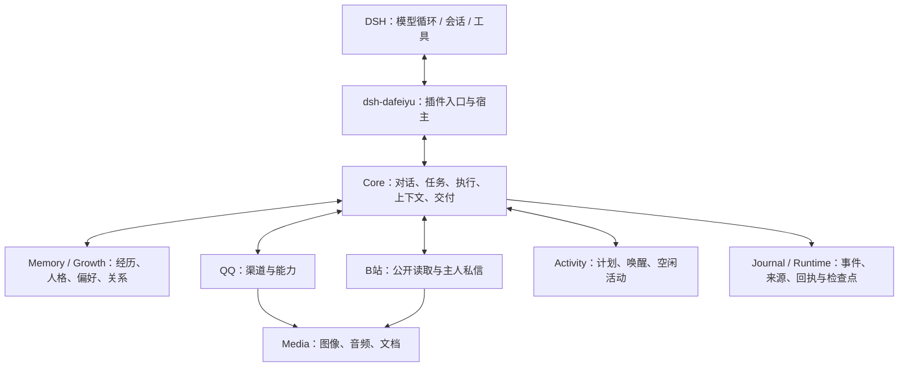

# 大肥鱼 · dsh-dafeiyu

> 一个运行在 DeepSeek Harness 上的可成长智能体：有长期记忆和阶段人格，通过 QQ 与人相处，也能自己读 B 站、看评论、整理任务。

**v0.25.0 开发版** · Windows · DSH `0.2.1-rc.2` · Node.js `24.13+`（24.x）

大肥鱼不是通用 QQ 机器人框架。它把 DSH 的模型循环、会话和工具作为执行底座；自己负责身份与权限、记忆与成长、QQ/B站渠道、任务执行、媒体处理、自主活动和结果交付。

---

## 它是什么

- **一个住在 QQ 里的智能体**：通过 OneBot 11 接入 QQ，支持私聊、群聊、自然称呼、消息合并、历史回看、引用回复和本地表情。
- **有记忆和成长**：固定底色、经历、反思、自我认识、阶段人格、表达偏好和关系分别保存；人格变化有来源、版本和适用范围，不是每次对话重写一段人设。
- **能接真实任务**：主人在 QQ 里布置任务后，由 DSH Agent 使用当前授权工具执行；程序负责来源、权限、回执、等待和交付，模型负责方法、判断和表达。
- **能自己读 B 站**：搜索、视频信息、评论、字幕、弹幕、视频帧与音轨；可选配置唯一的 B 站主人私信通道。当前不提供发表评论或发布弹幕。
- **有自主活动**：在空闲时按计划唤醒、探索、整理记忆或休息；预算、时间、频率和权限由程序控制。
- **有管理中心**：在 DSH 设置中打开“大肥鱼管理中心”，查看人格与记忆、QQ、B站、媒体、任务、运行状态和提示词预览。

## 它不是什么

- 不是多租户 QQ 机器人平台。一个实例绑定一个机器人 QQ 和一个主人 QQ，账号没有默认值。
- 不内置 OneBot 服务。需要本机运行 SnowLuma、NapCat 等 OneBot 11 实现并登录机器人号。
- 不随包提供模型、FFmpeg、Whisper、视觉模型或语音模型；需要按配置准备。
- 不会默认获得系统操作权限。`dshTools: true` 才让主人的真实任务使用 DSH 已安装工具；这是一项高风险开关，默认关闭。
- 不把单元测试当成真实平台验收。模型语义、QQ/B站真实交互和长期效果需要单独验证。

## 功能

| 模块 | 能力 |
|---|---|
| 核心 | 对话、持续任务、异议与等待、来源核验、压缩后的接续、结果交付 |
| 记忆与成长 | 选择性记忆、工作状态、经历关联、反思、自我认识、阶段人格与表达偏好 |
| QQ | OneBot 收发、自然称呼、群助手过滤、最近 24 小时回看、合并转发、历史引用、消息合并、本地表情、任务与媒体接口 |
| B站 | 公开搜索/视频/评论/字幕/弹幕/媒体；可选独立主人私信；不发布评论或弹幕 |
| 媒体 | 视频抽帧、视觉、语音识别、声音事件、文档读取、可选语音输出 |
| 自主活动 | 计划、条件唤醒、空闲探索、记忆整理、休息与预算控制 |
| 管理中心 | DSH 设置页中的总览、人格与记忆、能力、任务与记录、提示词预览、运行 |

## 架构



程序控制接口、权限、来源、任务阶段、等待和真实交付；模型决定探索方法、目标是否达成以及如何表达。平台事实经渠道进入 Core，能力返回观察、覆盖范围和回执，Core 再决定是否记住、如何回复或交付。

## 仓库结构

| 路径 | 内容 |
|---|---|
| `packages/plugin/` | DSH 组合包入口、安装、管理中心、客户端 UI |
| `packages/host/` | 宿主装配、生命周期、Host CLI、DSH 工具桥 |
| `packages/core/` | 对话协调、任务执行、上下文、来源核验、结果交付 |
| `packages/memory/` | 记忆、成长、人格投影、检索与近期状态 |
| `packages/channel-qq/` | OneBot QQ 渠道、能力、媒体和表情 |
| `packages/bilibili/` | B站公开读取、主人私信渠道、视频媒体 |
| `packages/media/` | 视觉、语音识别、声音事件、文档、可选 TTS |
| `packages/activity/` | 自主活动计划、调度与唤醒 |
| `packages/contracts/` | 共享 schema、协议与输出契约 |
| `packages/journal/`、`packages/timeline/` | 事件/来源日志与时间线 |
| `packages/server-*` | 服务端执行、启动与运行时装配 |
| `packages/channel-simulator/` | 本地测试渠道 |
| `profiles/` | Host、人格、媒体、B站、任务示例配置 |
| `scripts/` | 构建、测试、发布、管理端预览 |
| `packages/plugin/docs/` | 架构、配置、当前契约、管理中心与验证说明 |

## 快速开始

### 环境

- Windows（当前完整功能的目标平台）
- Node.js **24.13+（24.x）**
- 兼容的 DSH **0.2.1-rc.2**
- 本机 OneBot 11 服务（SnowLuma / NapCat 等）
- DeepSeek API Key，或本机已有的 DSH 账号登录

### 构建与测试

```sh
npm install
npm run build
npm test
```

- `npm run build`：生成各包 `lib/` 与管理端资源。
- `npm test`：按当前源码编译并运行本机测试。
- `npm run test:smoke`：短冒烟检查。
- `npm run build:release`：生成公开发布包（含预编译 `runtime/`）。

### 接到 DSH

1. 通过 DSH 插件管理安装本仓库构建出的组合包；开发时也可以让 profile 的 `dsh-dafeiyu` 指向本机插件目录或部署包。
2. 把 [`packages/plugin/examples/dafeiyu.config.json`](packages/plugin/examples/dafeiyu.config.json) 复制到**仓库之外**的配置目录，填写模型、机器人 QQ、主人 QQ、OneBot 地址与令牌文件。
3. 在当前 DSH profile 的 `cordis.patch.yml` 中配置 `settingsFile` 和 `nodePath`；具体写法见[配置说明](packages/plugin/docs/configuration.md)。
4. 启动顺序：本机 OneBot 并登录机器人 QQ → 打开 DSH → 启用大肥鱼。
5. 用管理中心或 Host `status` 查看 `online`、`phase` 和 QQ 连接；插件入口显示“运行中”不代表 QQ 已连通。

更完整的安装、独立 CLI 和依赖隔离说明见 [`packages/plugin/README.md`](packages/plugin/README.md)。

## 必要配置

| 配置 | 说明 |
|---|---|
| `dataDir` | 实例数据目录，必须放在安装包之外；首次使用独立空目录 |
| `model.model` | 已授权的 DeepSeek 模型名 |
| `model.auth` | 默认 `api-key`；`dsh-account` 可复用本机 DSH 账号登录 |
| `model.credentialStore` | DSH 版本 1 凭据文件；不要把密钥写进配置 |
| `qq.botId` / `qq.ownerId` | 机器人 QQ / 唯一主人 QQ，必须不同且显式配置 |
| `qq.tokenFile` | OneBot 令牌文件，至少 32 字符 |
| `qq.httpURL` / `qq.wsURL` | 本机 OneBot 回环地址 |
| `qq.groupIds` / `qq.joinedGroups` | 指定群或开放实际加入的群；默认不开放群 |
| `dshTools` | 默认 `false`；开启后主人任务可使用 DSH 工具，风险较高 |
| `bilibili.capabilities` | 启用 B站公开读取；需要同时配置 `media` |
| `bilibili.channel` | 可选的 B站主人私信通道，需要账号 UID 与登录凭据文件 |

字段与媒体后端的完整说明见[配置说明](packages/plugin/docs/configuration.md)和[当前契约](packages/plugin/docs/current-contract.md)。

## 数据、权限与边界

- 所有实例数据放在显式配置的 `dataDir`；仓库和发布包不包含私人聊天、记忆、登录态、API Key 或账号默认值。
- 主人身份是权限配置，不是昵称或关系状态；改变绑定应使用新的数据目录，不能静默接管旧实例。
- 程序校验来源、权限、任务阶段和真实回执；模型不能凭文本材料获得额外权限。
- QQ 群助手、撤回、群失权和过期引用会阻止旧内容继续处理；未知发送结果不会自动重发。
- B站只读公开内容，或使用单独配置的主人私信；不提供发表评论/弹幕、点赞、关注等写操作。
- 记忆删除是保留修订历史的逻辑删除，不代表磁盘上的所有副本被擦除；媒体缓存按容量回收。
- 启用 `dshTools` 会使用 DSH 宿主当前的系统工具能力；只应在你信任的实例和账号范围内开启。

## 开发与验证

- 源码为严格 TypeScript；`npm run build` 负责编译，`npm test` 使用本机 SQLite、文件、进程、IPC 和模拟平台/模型运行测试。
- 测试结果区分本机程序检查、分发安装检查和真实模型/平台验收；历史测试计数不累加成本版结论。
- `npm run build:release` 生成隔离的公开包；发布前应检查包内是否只含源码、预编译运行代码和公开示例。
- 真实验收需要单独准备模型、OneBot、QQ 账号、B站登录态和媒体后端，并遵守各平台的使用规则。

## 文档

- [插件包说明：功能、安装、独立 CLI、QQ/B站细节](packages/plugin/README.md)
- [架构与数据流](packages/plugin/docs/architecture.md)
- [配置说明](packages/plugin/docs/configuration.md)
- [当前接口与记忆驱动架构](packages/plugin/docs/current-contract.md)
- [管理中心 0.25.0](packages/plugin/docs/management-center-0.25.md)
- [验证范围与边界（历史记录，不能直接当作 v0.25.0 结论）](packages/plugin/docs/validation.md)
- [历史更新说明](packages/plugin/docs/release-notes.md)
- 示例配置：[Host](profiles/host.local.example.json)、[QQ](profiles/host.qq.example.json)、[B站](profiles/host.bilibili.example.json)、[媒体](profiles/host.media.example.json)、[活动](profiles/host.activity.example.json)、[人格底色](profiles/persona.foundation.md)

## 许可证

MIT。发现问题请提交 Issue；提交日志前请删除账号、Cookie、密钥、私人消息和本机路径。
