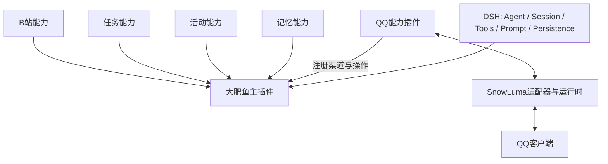

# 大肥鱼架构与开发决策

状态：已讨论确认的架构方向；第一阶段实现范围见 phase-1.md。日期：2026-10-23（北京时间）。

## 目标与归属

大肥鱼 = 人格核心 + 持续状态 + 运行协调 + 可插拔能力 + 配置。以 DSH 原有服务为底座，主插件拥有智能体身份，关联插件向该智能体注册能力。

主插件不成为新的全能桥接器：它不实现 QQ 协议、不拥有 B站检索实现，也不自建模型循环。一个人格可以拥有多个 DSH 会话；用户私聊、各个群和后台工作保留独立上下文，通过有来源和可见范围的记忆形成连续性。

## QQ接入决定

保留外部底层组件，由 QQ 能力插件封装稳定服务。主插件不依赖 OneBot/SnowLuma 数据结构。适配器负责消息转换、附件、引用、连接状态、重连、去重与平台回执。外部组件版本变化仍需维护适配器，但不应扩散到人格和记忆。

QQ能力可以同时提供渠道与操作。平台特性通过能力声明暴露，不能假装不同后端完全等价。第一阶段只实现文本模拟渠道；QQ适配器未开发。

## 人格运行

- 主插件常驻，不等于模型持续运行。输入事件或活动唤醒才触发处理。
- 固定人格从明确文件装配，保存每轮使用版本；不靠历史摘要维持人格。
- 成长偏好、关系和经历属于独立的持续状态，不能覆盖为部署默认值。
- 固定人格修改从下一轮生效；执行中的回合使用固定快照。
- 场景背景、真实发送者和时间由程序提供。昵称、引用、转发或记忆不能授予权限。
- 同一群映射到一个会话，不能按群内发言人拆开；不同群不混原始上下文。
- 主插件配置明确的模型路由，初期不增加每轮调用次数限制。超时与取消是单独运行机制。

## 关联插件

插件通过 DSH/Cordis 注入 `ctx.dafeiyu`，调用注册接口；核心不硬编码每个扩展的模块路径。

注册信息包含扩展标识、扩展版本、接口版本、绑定智能体、渠道与操作。核心验证版本与重复名称，授予只属于该扩展的入站句柄。扩展不能在消息正文中自行声明自己来自另一渠道。

主插件内部按作用域为当前 DSH Agent 提供操作，不把能力注册成所有 DSH 会话的全局工具。卸载撤销未来使用并取消合作式运行中的操作。独立进程隔离可以由能力插件管理，不与“插件化”冲突。

所有同进程插件属于可信代码；接口隔离不是操作系统安全沙箱。未来运行不可信插件需要单独隔离方案。

## 消息与交付

渠道标准化事件 → 核心持久化接收 → 会话队列 → 创建/恢复DSH Agent → 装配人格和能力 → DSH处理 → 保存结果 → 渠道交付 → 保存回执。

基本聊天的最终文字由程序自动交付；主动跨会话发送、附加素材等未来作为显式操作。受理、模型完成、平台确认交付是三个不同阶段。

会话键为智能体、渠道、账号、会话类型、会话编号的结构化组合。第一阶段使用 JSON 数组编码，避免分隔符碰撞。同会话串行，不同会话允许并行；后续可加整体并发配置，不能硬编码为调用次数预算。

确认未发送可重试交付；结果未知不得盲目重发。恢复日志、索引和记忆不触发真实操作。

## 配置和状态

系统配置管理模型、插件装配和数据位置；行为配置管理兴趣、主动联系、安静时段等；持续状态管理活动、关系和记忆。部署不得把持续状态作为配置模板覆盖。

后续配置继承目标：全局默认 → 渠道 → 会话。界面显示生效值、来源和生效时机。第一阶段仅实现明确的主插件参数；不存在尚未接线的兴趣/日程开关。

## 后续里程碑

1. 主插件、模拟渠道、能力注册、可靠事件记录（本阶段）。
2. 本地测试账号接入 SnowLuma，验证真实消息类型与故障恢复。
3. 记忆、分析、检索与大肥鱼专用压缩策略。
4. 后台任务、自主活动及B站能力逐项接入。
5. 完整数据迁移与服务器候选验收，验证切换和回退。

现有线上插件只作为行为参考；不将旧快照直接覆盖线上自主开发成果。
