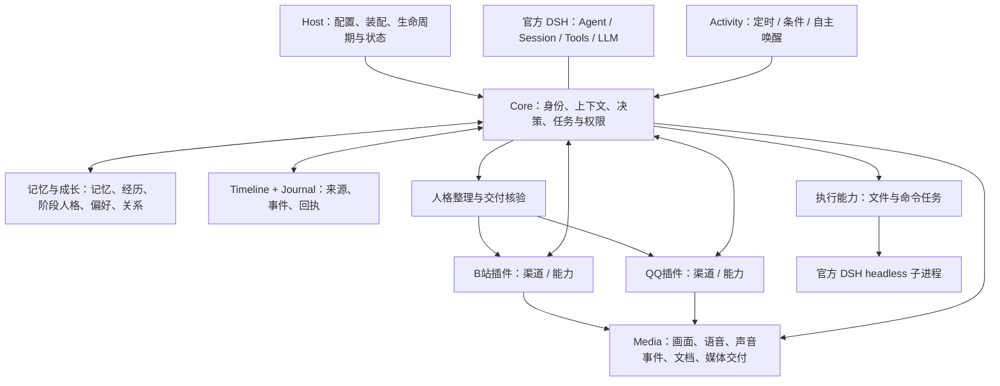

# 大肥鱼整体架构与已开发功能

更新：2026-10-27。以本轮保留R1—R5修复及R6有价值功能、删除旧系统接管/运营资金授权系统后的代码为准。本文件描述实现及其边界，不能把“代码已有”读成“整体验收和上线已完成”。

## 1. 整体形态

大肥鱼通过 `dsh-dafeiyu` 组合包或独立CLI启动 ManagedHost，复用官方 DSH 的 Agent、模型循环、会话、工具和持久化。Core负责身份、人格使用、任务、上下文和决策；记忆与成长统一拥有阶段人格、偏好与关系。QQ和B站各一个平台插件，内部渠道负责接收/交付，能力提供可调用动作。

没有重写一个独立LLM循环，没有把全部桌面插件工具无条件暴露给大肥鱼。现有产品主要通过配置、命令入口和状态记录管理，尚不包含完整的桌面人格/插件管理界面。

## 2. 模块及职责

| 模块 | 主要职责 | 已有实现 |
|---|---|---|
| `contracts` | 公共接口和数据规则 | 渠道、动作、任务、来源、人格、媒体、唤醒、交付等严格schema |
| `host` | 统一运行入口 | 插件固定装配、依赖预检、显式初始化/升级、单profile所有者、恢复/排空/关闭、健康状态 |
| `core` | 大肥鱼决策与执行协调 | 会话、无消息Task、Run、动作权限、观察来源、人格装配、任务结果整理与交付 |
| `journal` / `timeline` | 真实记录和来源 | 顺序事件、收发回执、时间线检索、来源关联与撤回；不是把所有记录自动变成长时记忆 |
| `memory` | 记忆及成长 | 选择保存、检索、修订/删除、工作记忆、分析、来源压缩、经历/经验、人格试行与采用 |
| `activity` | 自主活动 | 计划与版本、定时/条件唤醒、安静时段、间隔/休息、重试退避、维护请求调度 |
| `channel-qq`（包名 `@dafeiyu/qq`） | 统一QQ插件 | OneBot接入、自然称呼/群同步、浏览观察、任务受理/控制、文字分段、媒体交付；渠道/能力子入口独立 |
| `bilibili` | 统一B站插件 | 公开只读能力与独立主人私信；`src/channel`包含私信接收、任务、交付与消费者互斥，旧独立包已移除 |
| `media` | 共用音画与附件处理 | 下载/检视/抽帧、视觉、ASR、声音事件、文档、媒体回复与可选TTS |
| `server-executor` | 服务器操作能力 | 主人/自主任务的官方headless执行、文件/命令工具、IPC、来源与结果回执 |
| `server-bootstrap` | 持久任务权限配置 | 核对长期授权范围，支持自主任务；不等同付款授权 |
| `server-runtime` | 生产装配与共享计量 | 父/子模型共享准入、Windows资源工厂、指纹、启动/关闭状态、程序启动API |
| `plugin` | DSH安装组合包 | 必要配置、独立实例生成、首次初始化、启动/关闭、可分发CLI |

这些模块共享契约，不共享所有私聊正文。一个身份可拥有多个DSH会话；不同群、私聊、B站私信和后台Task保持独立上下文。能力接口提供“能做什么”，是否使用、顺序和兴趣选择仍由Core中的大模型决策。

## 3. 人格与成长

正式底色文件是本项目 `profiles/persona.foundation.md`：爱与珍惜世界、保持好奇、独立判断、承认未知、对接受的任务负责。面对恶意可以回避、澄清、反驳或结束互动；不要求讨好用户或固定口头禅。

固定身份/底色与阶段人格分别保存。Memory `growth` 是阶段人格、偏好与关系的统一入口，Core通过 `MemoryGrowthProvider` 使用受范围限制的快照，并经工具提出改变。兼容名称 `persona` 指向同一实例。新偏好可以未定、尝试、修订或撤下；观察和经历不会自动覆盖底色。候选、试行选择、实际使用记录、闭合结果、采用资格复核与阶段状态发布继续沿用已有机制。

人格试行/采用数据升级到Memory v12；R1—R5修复保留。系统改变的是持久状态和后续上下文，不会在运行中训练/修改基础LLM权重，也不能从这些工程机制证明主观体验或人格永远不会漂移。

## 4. 任务、独立判断和连续性

普通聊天、主人明确任务、聊天兴趣、自主探索分别记录动机。已接受任务有稳定Task和目标版本；一次执行为Run，工具操作、来源、结果与交付关联。支持无聊天消息的后台任务、暂停/恢复/取消、目标变更和异议处理。

任务遇到缺信息、前提错误或权限不足可以留下持久阻断；方法/偏好分歧不自动变成拒绝任务。原生结果先经目标会话的人格整理与独立忠实性校验再发送，执行器自述不能自动当成已验证事实。

压缩保留实际来源、纠正、反证和未知，带摘要谱系及失效检查。重启加载持久Task/会话/阶段人格，不靠编造丢失的“内心过程”接续；恢复状态也不自动重做已发生的外部动作。

## 5. 记忆与经验

观察进入来源记录之后，大肥鱼可以选择保留哪些内容、摘要或暂不保存。Memory负责写入、检索、版本、修订/删除与边界；私聊、群聊、任务材料分别受可见范围约束。语义检索和独立分析需要配置对应本机服务/模型。

记忆E已有经历关联、经验候选/更新、任务生命周期触发的整理请求，以及Activity调度接线。整理保留原动机、反证和来源，候选不自动采用为人格。工作记忆、工具反馈、经历和阶段人格不是同一种数据。

污染防护主要靠真实来源/范围/版本、撤回检查、事实与推断分离、试行与复核及保留反证。它不能承诺自动识别所有错误内容或消除LLM幻觉；真实语义表现仍需验收。

删除的旧服务器Markdown记忆映射/history.sqlite适配，不影响上述新记忆功能。本项目自身数据库升级、备份与恢复继续保留。

## 6. 自主活动

Activity能在外部消息之外发起唤醒，维护持久计划、下一触发时间、条件事件与执行回执。支持计划调整、暂停/取消、安静时段、活动间隔、时长约束、休息、前台工作让出与失败退避。探索计划与记忆维护由同一个已有调度器协调。

大肥鱼在已配置权限和资源边界内安排探索；任务责任与自己的兴趣保留区分。没有恢复每轮工具调用次数上限。此次删除的是为旧23点Git/更新守护设计的新维护窗口草稿，不是已有Activity或记忆E调度。

## 7. QQ功能

- 私聊、群聊、标准化消息与撤回，按真实账号/发送者核验主人身份。
- 自然中文称呼触发、群列表同步、各群上下文隔离。
- QQ适配层使用原版SnowLuma的固定只读群列表请求取得接收档位；同一有效群目录统一排除群助手、屏蔽及未知状态，默认同步，不另建轮询。收入群助手会撤销对应处理资格；移出后仅接收恢复边界之后的新消息，保留既有会话和记忆。
- 群/会话浏览和观察，选择性记忆；不默认把所有聊天写为长期人格材料。
- 明确任务受理、同Task继续、状态和控制；语音指令需经过实际音频证据链。
- 长消息按固定分段计划交付，每段保留回执；失败、未发、未知分别处理。
- 图片、语音、文件来源接Media；媒体回复冻结实际部件与字节，TTS仅合成已经批准的最终文字。

实际QQ协议由外部兼容运行时提供，本项目不重写QQ客户端。平台连接与各类真实交付仍须在本机测试账号上验收。

## 8. B站与音画

公开能力包含内容发现、来源受控搜索、视频信息、评论、字幕与弹幕分页读取，带时间段与来源记录；视频画面和音轨作为独立媒体流接入Media，支持按Task继续、回看和选择记忆。412/429等风险有持久退避。没有新增公开评论或弹幕发布工具。

画面通过FFmpeg/ffprobe和视觉模型分析；语音通过本机Whisper后端，关键声音通过YAMNet ONNX等已接入处理器；字幕是独立证据，不能代替画面或声音。处理范围和未覆盖片段须明确记录，抽帧不等于每一帧完整理解。文档读取和TTS为可配置能力，外部工具、权重及依赖不随源码自动具备。

B站主人私信是统一B站插件内部的渠道接口，与公开浏览和QQ群分别授权。账号UID与主人UID必须主动配置，源码无真实账号默认值。已有精确大整数ID、私信Task、人格化结果、最多1000 Unicode字符单条交付、发送未知不重试和按账号组合互斥。新库从首次配置起点接收，不导入旧私信队列。API代码随插件发布，登录态由安装者提供文件引用；不提供扫码登录UI。

## 9. 文件与命令执行

Core只向符合来源和策略的任务开放具名执行能力。真实主人任务与自主任务的长期权限分别检查；普通对话、昵称或引用不能自授管理员权。执行通过官方DSH headless子进程的read/write/edit/pwsh等工具完成。

父进程记录工作身份、操作许可、进程证明、可见结果及费用回执；结果回到原目标人格会话整理。已确认、未完成和未知效果分别保存，重启不盲重放。Windows实现核对实际SID、管理员token、程序hash和创建身份；它不是完整OS沙箱，当前不能保证全部派生进程均终止或业务已回滚。

## 10. 数据与启动

Core维护journal、runtime和delivery状态；Memory使用memory/analysis/working/feedback等库；Activity、Media、公开B站、B站私信和executor各有独立状态。DSH会话与媒体对象按各自目录持久。配置、底色、凭据和可变数据分别管理，初始化不覆盖已有数据。

普通Host提供inspect/init/migrate/start/run/status。新增安装入口提供check/init/start/status；DSH组合包读取指定配置并管理独立进程。首次自动初始化空目录，后续启动接续原库；两个数据目录拥有独立生成身份，不同步记忆或凭据。运行包使用Node包内imports，无需下载私有工作区模块。管理员执行的server-runtime API保留共享计量端口要求，该高级接线不由普通安装默认启用。运营资金库、批准文件和追加额度链已删除。

## 11. 验证状态与未完成项

本轮记忆与成长、平台整合、安装与分发检查见 `docs/checks/plugin-integration-*.md`。实际运行本机DSH/SQLite/Windows/回环网络，模型与平台为模拟；已完成从tarball安装及拒绝回退开发目录的启动/重启检查。发布本机全量回归已完成：167文件、1300项通过，记录见 `checks/plugin-integration-8-final.md`；开源发布见 `checks/plugin-integration-9-github-publication.md`。此前R5真实校准属于旧候选，不自动覆盖新版本。

尚未完成：新候选162项真实模型验收、本机真实QQ/B站和音画质量验收、本机持续运行/恢复，以及用户机器的实际连接配置和管理员执行高级装配。没有声称已上线、真实平台全部通过或长期人格稳定已被证明。

旧系统接管、旧夜间自动Git和旧更新守护、完整运营资金授权系统不再作为待开发项。详见 `current-scope-and-cleanup.md` 和 `integrated-acceptance-plan.md`。
