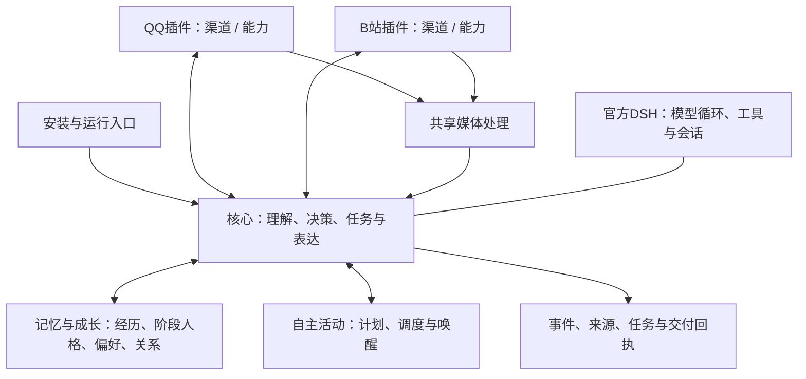

# 架构与数据流

平台事实经渠道进入核心，核心读取当前范围内的记忆与成长快照，再决定回复、接受任务或使用能力。能力返回观察、覆盖范围和回执；核心选择是否保存原文、片段或摘要。记忆与成长负责版本、来源和人格变化资格；自主活动只调度唤醒。后台任务结果回到原场景整理后交付。

固定底色独立于阶段人格。兴趣、偏好、看法和关系的候选、试行、采用、撤下统一存储在Memory。Core只保存本轮实际装入的快照与使用记录，不能自行另写一份阶段人格。外部材料、自述与任务写作不直接成为人格。

QQ/B站各一个代码包，渠道与能力接口内部独立。历史扩展标识和数据库名保留，以接续来源证明及未完成交付；这不代表用户需要安装多个QQ或B站插件。

数据保留沿用现有实现：QQ每个会话保留最近200条浏览正文，快照默认1小时；进入Core的消息、任务、DSH会话和长期记忆继续持久保存。QQ私有媒体定位信息按72小时/2048项回收；共享媒体文件默认1GiB容量、按需回收无租约文件，派生文字与证据不因此全部删除。B站结构化页面默认4096项，满额拒绝新增，不自动淘汰旧页面。未选择为长期记忆，不等于其它存储中没有副本。记忆删除为逻辑删除并保留修订历史。

两个安装实例有不同的生成身份、会话、数据库与凭据；昵称只是交流识别，不是身份主键或权限依据。原库升级使用Host迁移流程；安装入口不会用新模板覆盖已增长的记忆或关系。
