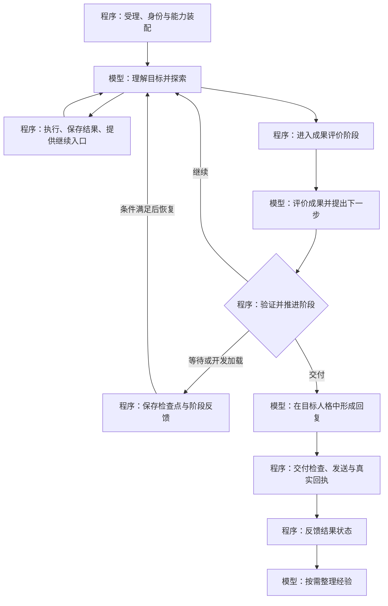

# 大肥鱼整体流程与上下文职责审查及调整方案

日期：2026-10-27。审查基线：`b2fc462702b99852c4a89f42c665044bb9066100`。

本轮产物是审查与方案，不是功能实现或上线验收。只读取本机源码、已有检查记录和相关测试源码；未连接服务器、调用真实模型或平台、修改运行代码、重启、重放任务或发送消息。证据索引与源码指纹见同目录 `process-context-responsibility-review-20261027.evidence.json`。

## 一、采用的设计原则

1. 程序负责精确事实、接口、权限、记录、阶段转换、失效和恢复；模型负责理解目标、选择方法、解释结果、最终评价和表达。
2. 通用提示只描述角色、目的和判断原则。精确工具名、参数、来源、状态、计时和协议由当前程序装配；插件开发文档中的 API 名、适配器常量和工具 schema 仍然是必要接口数据，不做全仓删名。
3. 程序成功、模型评价、外部送达分别记录。模型评价不能改写真实操作状态，程序的退出码、排序分或哈希匹配也不能代表目标已经令人满意。
4. 固定大阶段由 Core 管理；探索阶段内部的方法、工具选择与开发由模型掌握，继续使用官方 DSH Agent/Session/Tools 和模型循环。
5. 本轮方案保留既有人格底色、记忆、关系和 R1—R5 保护。不重新初始化，不恢复旧服务器接管、夜间版本或 update-guard，不增加调用次数上限或群列表同步周期。

## 二、范围与结论

全库检索覆盖 15 个包、243 份 src TypeScript 文件；重点审读实际入口和职责边界。重点包括 Core 任务/普通会话/结果交付、DSH 桥接及安装交接、QQ/B站、Media、Memory/Growth、Activity、Host，以及保留的 headless 执行/长期权限/共享计量接口。Journal/Timeline核对其事实记录与来源接口；模拟渠道作为测试设施保留。

这是围绕已约定分工进行的架构与源码审查，并非逐行证明全部功能正确。静态发现、此前实机故障和后续待验项目分开记录。

主要结论：核心、渠道、能力和来源层已具备可复用的程序基础；需要调整的是任务收尾、跨层上下文、结果读取、最终交付和自主开发的连接方式。识别 11 项调整，其中两项已有本机故障证据，其他主要是明确的源码事实及由此产生的设计风险。

优先级：P0 为先解除已出现的阻塞；P1 为落实已约定分工需要补齐；P2 为后续统一与扩展。优先级不是未经验证的安全漏洞评级。

## 三、逐项审查

### R01 · P1：通用提示和渠道说明承担了硬流程

**源码事实。** `core/src/native-runtime.ts:43` 的任务规则直接写进阶段反馈、工具发现、任务异议登记和 requestId 行为；`contracts/src/qq-expression.ts:9` 的表达默认规则还包含进度与长期偏好工具；`channel-qq/src/index.ts:151` 用长字符串串起历史、转发、媒体及表情的具名步骤。职责混合分布在多个入口，修改一个工具时可能留下旧提示。

普通会话的 `core/src/context-runtime.ts:45` 保留其他 DSH 上下文，任务路径的 `native-runtime.ts:48` 则只保留两类提示段和自有上下文；`contracts/src/dsh-tools.ts:9` 的桥接目录只包含工具和安装交接状态，未同时传递技能目录。调整时需要把当前版本的 DSH 技能目录、运行时 API 与开发说明作为能力信息按需装配，保留大肥鱼身份与会话隔离。最终人格整理使用干净材料的约束也要继续保留，不能将所有宿主提示或执行历史一并放行。

**调整。** 将这些内容分到：描述性原则、结构化阶段事实、程序生成的能力声明、按需技能说明。必须发生的任务收尾、状态保存、路由和失败反馈落实到阶段转换。模型提出行动意图，程序校验和执行转换。

**边界。** API 说明和工具描述可以包含精确字段与操作方法。工具具体名称仍由动态声明提供；不能只删除名字、却保留对模型手工执行硬流程的依赖。

### R02 · P1：缺少独立、持久的成果评价阶段

**源码事实。** `core/src/execution-coordinator.ts:520` 在 DSH 回合正常结束后，检查是否有阻断异议，随后选择 waiting 或 complete。`core/src/agent-session.ts:26` 检查的是回合完成与可见最终文本。`core/src/target-renderer.ts:15` 用结果锚点的 waiting 或默认 completed 装配 `taskState`。这不能独立表达“运行结束，但目标只完成一部分”。Task 自身状态也与 Run 状态不同，不能把所有 completed 都读成任务目标完成。

**调整。** 在探索与交付之间加入由程序管理的成果评价阶段。模型提交有 schema 的判断：目标满足程度、结论及引用、未完成事项、限制、建议的下一阶段；程序保存模型身份、材料版本和判断。程序事实另存，不能由模型填报实际回执、收件人或来源权限。

**转换。** 正常回合结束进入待评价；模型可以建议继续、等待或交付。程序验证所需材料与转换条件。缺少有效评价时保持待收尾/可恢复错误，不能凭未登记异议自动视为目标已满足。允许交付明确注明局限的部分成果。

### R03 · P1：动机、授权和工具效果的分类过度耦合

**源码事实与既有故障。** `contracts/src/message-task.ts:10` 由提交参数选择 explicit-task/self-exploration；`core/src/execution-coordinator.ts:224` 同时使用来源 kind 与 motivation 判断外部任务资格。此前主人连通性检查被选成 self-exploration，导致目录可读、调用能力缺失。`host/src/dsh-tools.ts:21` 将统一调用入口声明为 external-write；`plugin/src/bridge-parent.ts:23` 再按工具名集合识别只读工具。

**调整。** 明确区分真实来源/已授权限、模型对意图的判断、模型当前动机。受理阶段仍让模型理解语义，程序绑定原消息、目标与资格，不能用正则接管全部意图，也不能因主人发言就无条件授予机器执行。能力效果与约束以带版本的适配元数据和 DSH 实际策略表示，未知工具保持保守。

**自主开发关联。** 新工具注册后应通过同一能力描述与效果协议进入目录；不能依赖不断往通用提示或只读工具名集合补名字。工具自报“只读”本身不能成为授权。

### R04 · P0：结果协议会截断内容，并混淆执行与后处理

**源码事实与既有故障。** `plugin/src/bridge-parent.ts:77` 同时投影 value/content，超过 100 KB 整体 omitted；`host/src/dsh-tools.ts:27` 超过 7000 字符后截取序列化 JSON 前 6000 字符。`host/src/dsh-tools.ts:32` 写回执后记录观察，观察失败仍可能使操作落为 unknown。`core/src/registry-v3.ts:98` 的结果超限会抛错，敏感内容分支还会清除来源与回执。具体影响须区分已有故障与其它静态分支风险，不能假定每种分支都已发生。

**调整。** 引入通用、受当前任务范围约束的结果引用与分页读取。首页返回可读视图、来源、覆盖、继续入口及真实回执。优先使用结构化 value，文本结果按完整片段分页，二进制使用受控附件引用。存储配额不足时如实返回覆盖缺口，不承诺无限保存，也不无界放入上下文。

**状态拆分。** 执行状态/操作效果、内容处理状态、观察保存状态分别提交。先持久化执行事实，再做脱敏、投影和观察。执行后失败保留已取得的回执，避免再次执行；脱敏在结构层处理并保持幂等，不保存密钥原值。脱敏后的正文不应被再次误认为新增私密输入。

### R05 · P0：最终交付的来源核验开销与时限失配

**源码事实与既有故障。** `memory/src/expression-runtime.ts:16` 每个流式片段调用 guard；`memory/src/native-expression.ts:61` 的包装再次 open，open 会 build 全部材料。外层 `core/src/native-task-delivery.ts:66` 同样 open 并复核；`host/src/dsh-tools.ts:14` 同步读回执并计算哈希。本机搜索已完成而交付核验持续约14分钟，最终命中15分钟来源锚点有效期，详见 `local-dsh-search-stall-20261027.md`。CPU与核验结束相关，但尚无性能调用栈证明各函数耗时比例。

**调整。** 准备材料时完整核验并冻结快照；流式过程中检查取消和来源失效标记；发送前再验证关键边界。缓存按来源版本/撤权/删除/插件变化失效。没有可靠变更通知的来源须在关键边界重新核对，不能用不失效的缓存换取速度。

**复用与边界。** `core/src/provenance.ts:59`、`core/src/compaction-runtime.ts:461` 已有版本与会话变化驱动的缓存思路，可复用；`ExecutionEvidence.validate` 的 memo 当前只在一次外层验证内有效，不能据此宣称跨片段已缓存。其它生成/摘要/媒体路径也有逐片段 guard，但未实测它们出现同样停滞，需要按实际开销分类。

**时限。** 评价、人格整理、可选独立复核、平台发送分别配置总截止时间，不沿用两倍任务时限兜底。先使用有界、聚焦的模型复核；程序核验只证明资格与记录，模型评价负责目标满足程度与语义。来源过期与发送资格过期分别处理；合法证据可以重新核对，不能通过延长旧票据跳过撤权检查。

### R06 · P1：模型与用户缺少统一的交付反馈

**源码事实。** `channel-qq/src/progress.ts:5` 只注册可选模型动作；`core/src/execution-coordinator.ts:170` 的会话任务状态返回 Run/Task/异议，没有最终交付状态。`core/src/native-task-delivery.ts:39` 将已发送结果装入后续会话，失败结果没有对应的统一阶段事实。最终交付使用原会话路由队列，长时间核验也会占用该路由。已有搜索任务全程未调用阶段工具，失败后未得到最终正文。

**调整。** 将执行阶段、成果评价、交付状态和失败原因统一投影给状态接口、后续模型上下文及用户界面。程序在进入长等待、阻断、失败等状态时发起一次必要的反馈阶段，模型组织公开表达。去重、节流、目标绑定和回执仍归程序，不固定每次工具调用播报，不增加群列表轮询。

**并发。** 耗时的证据准备/评价不持续占住聊天接收与发送队列；仅在需要冻结会话材料和实际发送时按路由协调，再检查来源。必须验证新消息、撤回和来源变化不能造成旧草稿误发。对发送 unknown 保持不盲重试，对生成或处理失败允许恢复已保存的工作。

### R07 · P1：自主开发缺少开发至恢复原任务的完整交接

**源码事实。** `plugin/src/bridge-parent.ts:70` 将插件管理写操作统一延迟到交付并空闲之后；`plugin/src/deferred-plugins.ts:29` 处理安装状态，但没有该文件内与原 Task 检查点相连的加载后恢复过程。如果当前任务依赖新插件，存在“先完成交付才安装、先安装才能完成”的设计风险。本轮没有用真实更新制造或验证此风险。

**调整。** 明确候选开发、候选验证、持久安装、等待加载、能力目录刷新、恢复 Task 各阶段。临时脚本可先用 DSH 现有文件/命令能力验证；复用价值由模型评价。需要安装重载时，先保存检查点与必要阶段反馈，DSH 安装后核对实际加载，再恢复同一 Task 的新 Run。加载成功不能由配置已保存推定。

**实现边界。** 使用当前 DSH 的技能、运行时 API 查询和插件管理器；不另建规划器、安装器或旧更新守护。中断与 unknown 继续保持已执行事实，不能自动重复安装或写操作。

### R08 · P2：精确输出协议与描述性提示存在重复维护

**源码事实。** QQ消息序列、视觉观察、记忆分析、摘要和表达复核均同时维护代码 schema 与手写 JSON 格式说明。当前严格解析是有效程序控制，不能因整理提示而删除；但手写字段、上限和示例存在漂移空间。例：`contracts/src/qq-expression.ts:10`、`media/src/service.ts:31`、`memory/src/maintenance-service.ts:17`、`memory/src/expression-runtime.ts:15`。

**调整。** 以契约为唯一协议来源，程序按阶段提供当前输出结构与精确限制，并严格解析。根据当前 DSH SDK 实际支持选择原生结构约束、受控提交动作或契约生成的说明，不预设不存在的 SDK 接口，也不重写模型循环。文本内容、分几条、顺序及语气由模型决定；实际发送计划、部件、延迟与回执由程序控制。

### R09 · P2：记忆成长保留资格链，补齐模型评价与精确信息分工

**已有良好分工。** `memory/src/persona-adoption-policy.ts:24` 明确程序只验证采用资格；实际使用、来源、反证和版本核验与模型评审分开。`memory/src/maintenance-service.ts:16` 已明确 Run 完成不等于任务成功，受托行为不能直接证明喜欢。`memory/src/retrieval.ts:180` 标注算法分数种类，它是检索排序，不是最终真实性评价。

**调整。** 将 R02 的模型成果评价与程序事实一并接入经历整理，并保留二者身份和材料版本。经验内容、价值、是否保留及人格候选仍由模型判断；反证、范围、真实试行和发布资格继续由程序控制。不以一次“评价好”自动采用人格，不清空或重写现有人格/关系。

**精确信息。** `memory/src/semantic.ts:31` 要求模型逐字复制程序提取的保护条款，再由代码检查。可以将保护原文、数值与引用作为程序保存的独立材料，和模型摘要并列装配。需先证明原有否定、纠正、限定和来源保护不退化，再迁移现有检查；算法关键词命中不能决定某段材料的最终意义。

### R10 · P2：跨渠道和多媒体观察使用统一状态，保留各自语义

**已有良好分工。** QQ群助手、历史观察、批次和发送延迟已有程序层实现；历史不进入实时触发管线。Media区分实际字节、画面、音轨、文档覆盖与模型描述；B站起点前记录不入站并保留账号/对象限制。这些规则应保留。

**调整。** 把“尚未读取/部分读取/不可读/处理失败/已观察”与下一读取入口作为结构化能力结果，减少 QQ 渠道提示中的具名步骤。模型决定读哪些材料及其意义；程序保证实际读取、当前范围和覆盖。平台API差异留在各自适配层，普通会话、任务及最终表达使用同一含义的事实字段。B站任务复用 Core 结果阶段，但不借用 QQ 机器执行授权。

**保留产品约定。** 5秒合并、既有群列表入口与周期、群助手全自动处理停止、移出后仅新消息、24小时观察上限、2—10秒发送延迟、消息序列、表情库和主人管理入口均不因本次职责重构改变。

### R11 · P1：阶段可观测性与验收需要匹配新流程

**源码事实。** `host/src/status.ts:20` 提供交付计数，`native-delivery-store.ts:50` 提供状态，但缺少统一阶段开始时间、截止时间、最后有效进展和模型成果评价。Host ready 只说明相应运行依赖就绪，不能被当成当前任务已完成或交付正常。既有桥接/QQ测试采用脚本模型，部分核验响应固定为 faithful=true，不能证明真实长结果核验质量。

**调整。** 各阶段记录开始/结束、材料版本、耗时、当前等待原因与恢复入口。区分程序检查、模型判断和真实发送回执。排查信息不记录密钥、私人全文或模型内部思考。面向用户显示自然阶段名称，技术字段供检查记录使用。

**验收边界。** 本轮未执行测试，没有新增通过数；此前故障复用既有只读排查证据，不重放。后续先做相关组件检查，再按明确授权进行少量真实模型/平台验证；原7C账本、失败和额度不改变。

## 四、目标结构

上下文由程序按阶段装配以下部分，分别说明来源、适用范围和版本：身份底色与当前人格；描述性判断原则；原始目标与触发来源；当前阶段与程序事实；实际能力与技能目录；已观察材料、覆盖及继续入口；相关经验与适用条件；当前阶段输出契约。

成果记录使用三组独立内容：

- **程序事实**：实际操作、效果、覆盖、已执行检查和原始回执引用。
- **模型评价**：目标满足程度、结论及证据、价值/局限、未完成事项和下一步建议。
- **交付事实**：拟发版本、目标、发送计划、每段回执和最终状态。

模型可引用前一组事实，但不能重写；程序保存中间一组判断，但不能把它提升为已经证明的外部事实。下游经验整理消费这些带身份的记录。

## 五、建议实施批次及退出条件

| 批次 | 调整范围 | 完成条件 |
|---|---|---|
| A：解除阻塞 | R04、R05、R06的失败反馈及R11基础计时 | 大结果可继续读取，执行后处理失败不丢执行事实；核验有独立截止；失败可见且不重发 |
| B：明确职责 | R01、R02、R03、R08共用契约 | 正常回合结束必进入结果收尾；模型评价与程序事实独立；上下文与能力目录准确，通用提示无需具名流程 |
| C：贯通探索 | R07、R09、R10及R11联合检查 | 候选工具经验证/加载后可恢复原Task；经验可消费真实评价；渠道和媒体原有保护与人格/记忆保持 |

批次内按契约、程序流程、模型装配的顺序调整，不能先批量删除提示、再等待程序补齐。分批保留可审阅提交；每批只运行相关检查。实际启用或发布另行按冻结版本和部署范围进行，本轮不实施。

## 六、必要检查清单

1. 长结果使用中文、转义字符和大结构化数据；分页可还原允许内容，永远不产生半截JSON；未读取部分不冒充已观察。
2. 工具成功后在脱敏、结果投影、观察保存处分别失败，仍保留真实执行状态和回执；重复脱敏稳定；恢复不重做已确认写入。
3. 大证据配合大量流式片段，验证重型检查次数不随片段线性增长；来源变更/撤权仍立即失效；核验到期能释放资源。
4. 模型正常停笔但没有成果评价、部分完成、建议继续和等待补充分别推进正确阶段；无法伪造程序事实或直接跳到已送达。
5. 受托指示、普通闲聊、自主兴趣和授权唤醒分别核对来源、模型意图和能力；保留主人身份与语音完整证据检查。
6. 未调用主动进度动作、最终复核超时、发送失败/unknown时，任务状态与后续模型上下文一致；聊天仍可接收，已发送不重复。
7. 使用虚构本机工具验证候选开发、测试、安装交接、目录刷新和同Task恢复；中断安装保持真实状态。
8. QQ群助手/24小时回看/批次/多条及延迟、B站对象隔离、媒体实际覆盖、记忆删除和人格试行/采用运行受影响回归，不扩成全量或服务器测试。

脚本模型只证明程序流程。最后成果价值、实际探索选择和表达质量需要真实模型检查；模型自身给出的评分不替代独立验收。现有失败记录保留。

## 七、本轮保存与后续边界

本轮仅新增此审查方案及机器可读证据索引。原未提交 `docs/memory-phase-1.md` 保持 SHA-256 `CB9A2383531A39461C50D7CA8F58C6C1879CF12A0A0DAFDF8CFA5B387911F730`，不纳入提交。没有修改程序、身份、记忆、配置、运行库或已发布产物；没有新增付费调用、真实QQ消息、服务器操作或GitHub发布。
