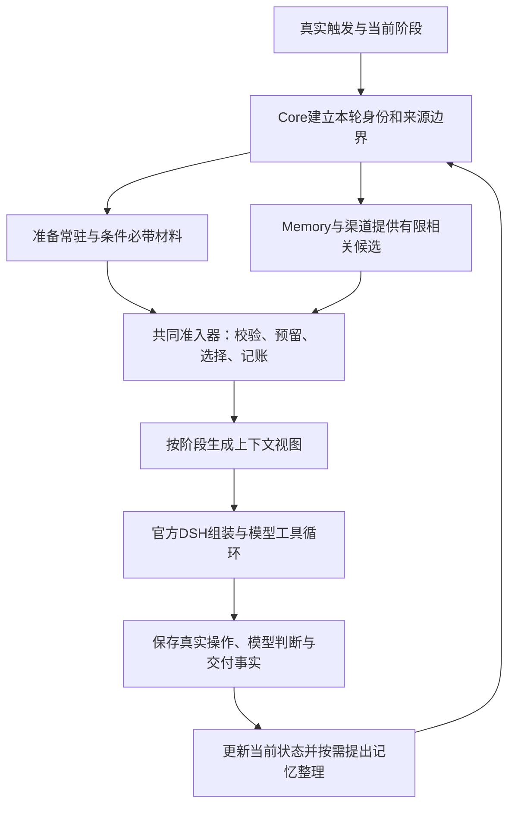

# 大肥鱼上下文组装与连续状态开发方案

日期：2026-10-28。状态：用户已授权完整开发。本文落实本轮用户确认的方向：稳定人格持续存在；近期关注、试行和未完成责任有条件地跨会话延续；相关材料自动唤起，详细资料由大肥鱼主动查找。

最新授权调整：P6改为本地程序与组件测试通过后冻结发布并部署，实际交互验收由用户完成。真实模型/平台样本保留为用户后续验收参考，不是本轮部署前置条件；不自行执行付费生成或真实外发验收，不延续旧7C预算。服务器仍仅部署和最小状态核对。

## 1. 开发目标、基线与范围

目标是让大肥鱼每次推理能够知道自己当前是谁、正在与谁交流、正在处理什么、已经做过什么、仍承担什么责任，并在需要时想起相关经历。来源、权限、事实与推断的区分继续保留；不会因为材料进入上下文就自动将其存为长期记忆或采用为人格。

| 基线 | 已核对事实 | 对本方案的影响 |
|---|---|---|
| 服务器发布基线 | v0.22.3，公开提交 `c2406206432cec61e16ff8ed1a1d9aba3236a25c` | 解释已部署功能，不用本地未发布改动描述服务器 |
| 本地开发基线 | 编写时 HEAD `9fddd7ba5ba610c38dec1327bc760ae8bcb2c067` | 后续开发应整合该基线之后实际需要的变更，再冻结候选 |
| 已有本地修复 | growth 的 pin 已参与必带排序；HarnessRuntime、能力查询、原生工具循环及稳定序列化已有实现 | 保留并验证，不重复开发或恢复旧任务提示过滤方式 |
| 仍未贯通 | 三层内容契约、自动召回、条件性跨会话近期状态、统一阶段交接、完整请求容量与刷新策略 | 本方案的主要实施范围 |
| 并行修改 | 主工作区有QQ传输、交付、Core、安装及测试的未提交修改 | 本轮只新增文档；实施前读取现状，不覆盖或顺手提交这些修改 |

此前管理目录在17:14的只读记录显示服务器核心离线，错误为 `HOST_REQUIRED_QQ_UNAVAILABLE`；这是一个历史检查时点，不是本方案编写时的实时状态。本轮不连接服务器排障。未来部署前重新核对真实状态，不能把该故障预先归因于上下文。

本轮已获完整开发和本地测试通过后的冻结发布、部署授权；实际交互验收由用户完成。方案以[当前架构](architecture.md)、[范围约定](current-scope-and-cleanup.md)、[统一职责审查](checks/process-context-responsibility-review-20261027.md)、[本地上下文分析](checks/context-assembly-analysis-20261028.md)及[最新DSH接线记录](checks/dsh-harness-context-20261028.md)为依据。旧文档的历史状态不能覆盖当前源码。

## 2. 必须保留的架构分工

| 所有者 | 继续负责 | 本次扩展 |
|---|---|---|
| 官方DSH | Agent、Session、Tools、模型循环、持久化和计量接口 | 在现有装配/步骤边界使用共同上下文计划，不另建LLM循环或规划Agent |
| Core | 身份、Task/Run、权限、来源、阶段、交付与上下文准入 | 三层材料计划、必带内容预留、阶段交接、刷新边界及容量审计 |
| Memory/Growth | 记忆版本与边界、经历、阶段人格、试行/采用、表达偏好 | 近期自我状态、相关记忆候选及可复用的紧凑视图；不自行授予外部执行权限 |
| Journal/Timeline | 原始事件、会话来源、撤回与真实回执 | 提供有范围的近期材料和交接来源，不建立第二份聊天事实库 |
| QQ/B站渠道 | 接收资格、账号绑定、历史/附件读取和实际交付 | 提供受当前渠道资格约束的背景材料，不承担人格判断 |
| Activity | 已有计划、唤醒和记忆维护调度 | 按事件处理确有价值的整理请求，不增加第二个轮询/调度系统 |
| Host/安装入口 | 依赖、配置、初始化/迁移、启动与状态 | 正式配置映射、功能开关、迁移检查及能力缺失状态 |
| 模型 | 理解意图、选择方法、判断经历价值、形成表达和提出状态改变 | 判断相关性、提出近期关注、整理语义交接；不能自行声明来源合法、操作完成或扩大权限 |

继续保留R1—R5的人格资格链及R6有价值能力。已注册、当前可调用、依赖已验证、实际执行成功分别表示。能力目录不是世界事实证据；工具调用依然通过Core操作记录和DSH策略。

保留QQ现有5秒安静合并窗口、最长15秒/10条批次配置、24小时历史观察边界、群助手统一过滤、发送延迟与分段回执。B站私信需独立配置和登录，不因本方案自动接入。继续保护真实身份和新增记忆，不恢复旧history适配、23点Git或update-guard。

## 3. 三层内容契约

“每轮”指每次向模型派发请求时的有效工作视图。稳定内容按版本复用；消息、阶段或相关状态变化时刷新。并非每个工具步骤都重做全部检索或重写人格。

| 层 | 内容 | 入场规则 | 生命周期 |
|---|---|---|---|
| 常驻必带 | 固定底色、当前生效且适用于本轮的阶段人格、明确选中的试行及限定 | Core根据真实配置和Growth选择记录确定；先保障容量 | 版本化；通过既有试行/采用/撤回流程变化 |
| 条件必带 | 当前来源与身份、真实时间、本轮请求、最新有效纠正、任务目标/约束、影响本轮的责任/操作/交付事实、阶段输出契约 | 条件由真实会话、Task/Run和阶段决定；模型不能通过参数自授必带或权限 | 随相关状态版本变化；责任不因TTL消失 |
| 自动唤起 | 当前对象/话题/未完成事项相关的记忆、有限群聊背景、已授权的近期关注、相关经历和纠正/反证 | 先过滤读取及表达范围，再检索、去重、排序和预算准入 | 本次检索计划有效，后续可按版本复用；不等于长期选择 |
| 主动查找 | 原文、远期历史、完整任务结果、复杂比较、音画细节和进一步核实 | 使用已有查询、分页、观察和来源工具 | 读取结果进入本轮证据，是否长期保存仍另行决定 |

前两行共同构成“天然带着”的第一层。第三行是第二层，第四行是第三层。条件必带不是把全部待办、所有关系和所有兴趣常驻化。

内容优先关系如下：权限/范围限制和真实事实由程序约束；当前有效请求及纠正决定本轮目标；适用的任务约束持续有效；一般表达偏好可以被本次明确表达要求覆盖。人格倾向不能修改事实、授予权限或覆盖用户明确的任务边界。历史引用、记忆和平台正文始终保持数据性质。

自动取入材料、模型实际看到材料、选择保留、写入长期记忆、提出人格候选、试行与采用分别记录。重复召回次数和检索得分不能成为人格采用证据。

## 4. 条件性跨会话近期状态

### 4.1 状态分类与真实所有者

| 状态 | 真实来源 | 处理方式 |
|---|---|---|
| 稳定自我认识 | 已采用阶段人格及其选择记录 | 沿用PersonaRuntime和Manifest，保留适用条件、成熟度和必要反证 |
| 正在试行的倾向 | 既有试行选择、准入和闭合记录 | 本轮选中时连同“试行/未定”标记必带；不复制成已采用人格 |
| 近期兴趣/关注 | 大肥鱼明确提出并有来源的关注记录 | 新增Growth管理的近期状态；可以休眠、修订、撤下，不自动升级为人格 |
| 未完成承诺 | 原Task、目标版本、TaskIntent、操作及交付账本 | 只生成引用原状态的视图，不另建承诺执行队列或第二份完成状态 |
| 当前资源处境 | 程序可核实的运行/调度状态 | 仅提供本轮需要且可表达的粗粒度事实，不夹带其它会话任务细节 |

一项受托工作不能自动被解释成兴趣。近期状态保留 `delegated / self-directed / mixed / unknown` 等动机性质；语义判断由模型提出，实际触发来源由程序绑定。

聊天中的未来承诺也要区分“说过”与“已安排”。只有现有Task/Activity实际受理并返回回执后，才能表达为已接受或已安排。已经说出但未登记的承诺保留原话与“待核实/未登记”状态，在合适的受理阶段由模型理解并通过现有接口处理；不凭正则静默创建任务，也不因没有Task记录就抹去曾经说过的话。最终交付整理不能凭空许诺新的后台工作。

### 4.2 四个准入条件

近期状态进入目标上下文需要同时满足：与当前对象、话题或责任有关；其读取和表达范围允许；状态仍有效；原有事实/自述/推断/试行性质完整。缺少任一项，就不展开对应正文。

承诺只在完成、取消、合法目标变更或明确移交后改变责任状态。过期可以使某次展示快照失效，但不能关闭Task。近期关注的到期则意味着暂不主动展示，原记录仍可追溯；需要重新激活时形成新版本，不复活旧票据。

### 4.3 跨会话能力必须显式实现

当前 `MemoryBoundarySchema` 主要提供会话范围、任务范围或none；所有权相同不等于已经有全局读取许可。因此跨会话近期状态不能只通过去掉route过滤实现。

增加一个窄范围、版本化的“自我状态共享策略”，仅授权明确类型的自我状态视图。它与通用记忆读取、TaskMemoryGrant及外部表达授权分开核验。模型只能提交候选与理由，策略和目的范围由Core/Host提供。

第一版允许跨会话的材料来源为：已有资格向目标表达的阶段自我条目；明确按该共享策略发布的自我状态版本；不包含他人/任务内容的可公开程序处境。其它材料继续按原会话或已授予的任务范围使用。共享策略不能把任何原始记忆库变成全局可读。

私有来源的摘要不因去名字或改写而获得新权限。确需形成可跨场景表达的版本时，必须在获准的内部范围整理，保留完整依赖，经表达资格与独立语义检查，并为特定输出版本/哈希和目标范围形成明确发布记录。没有现有授权或合格发布依据时，保留原范围，不把私有原文送进公共回复模型后再要求其保密。

多来源视图继承完整依赖的限制；跨范围发布记录是对特定产物的许可，不是对其全部来源的公开。来源撤回、发布撤销或范围收紧时，视图及其缓存同时失效。语义复核结果保留“模型判断”的身份，不能宣称数学保证无泄漏。

### 4.4 形成与维护

近期关注可由普通对话中的显式保留动作、已完成任务的经历整理、已有Activity维护任务提出。Core提供提交阶段和严格契约；Growth负责保存。默认不在每条消息之前新增一轮后台LLM分析，也不自动扫描全部历史建立自我。

近期关注使用 `candidate → active → dormant / withdrawn / superseded` 生命周期。只有active且通过目标范围检查的版本参与自动唤起；转为阶段人格仍走已有候选、试行、实际使用、复核采用链。

## 5. 共同组装架构与数据契约

共同准入器管理内容和容量，不接管DSH会话重放或模型循环。普通聊天继续保留本会话历史；任务继续使用独立任务会话；评价、反馈、交付和修订继续使用相应受控会话。统一契约不等于所有阶段继承同一大段历史。

下列名称为拟新增或扩展的契约，不表示当前已经存在同名API。实现优先复用原类型和存储。

| 契约 | 必要字段/语义 | 所有者与持久化 |
|---|---|---|
| `ContextPlan` | schema/assembly版本、agent/route/Task/Run/阶段、输入版本、来源水位、计划版本、用途、截止时间、材料与容量决策 | Core；普通会话用Journal事件，任务用现有Run输入/事件保存清单，不建第二个日志库 |
| `ContextMaterial` | 原ContextItem、类型/层级、完整来源引用、claim性质、覆盖、适用范围、版本、失效分类、压缩或原文引用 | 内部包装类型；沿用现有SourceDependency/PersonaSourceRef，不造另一种来源身份 |
| `RequiredBinding` | 程序给出的必带原因、阶段与绑定状态；如selected-persona、active-constraint、unknown-effect | Core签发；不接受模型或插件任意提交required=true来提升优先级 |
| `SituationSnapshot` | 原请求引用、目标与约束、最新纠正、当前阶段、已做/未知/待办、已发/未发事实、表达要求及其适用阶段 | Core组合原Task/Journal/Delivery事实；语义摘要另带来源和解释身份 |
| `RecallPlan` | 有范围的查询依据、检索模式、候选/选中引用、得分类型、遗漏原因、索引和权限版本 | Memory提供候选，Core准入；缓存和清单可重建，不把候选集合写成长期选择 |
| `RecentSelfState` | ID/版本、关注内容、动机与claim性质、支持/反证、适用范围、生命周期、复查/退出条件 | Growth；使用现有memory.sqlite的受管新增表或扩展记录，不另建人格数据库 |
| `SelfStatePublication` | 共享策略版本、特定视图哈希、目标范围、依赖与检查结果、有效状态 | Growth保存发布事实，Core检查使用资格；不扩大原始来源范围 |
| `StageHandoff` | 父计划/Run引用、目标版本、必要原话与语义解释、约束适用阶段、结果/来源/交付版本 | Core；绑定既有Task和Run，原始资料仍由原存储拥有 |

`ContextRequest` 及ExecutionView继续保持Core签发的对象身份和不可信参数校验。可以为它们增加受信的阶段/检索视图，但不可让工具参数自报另一个route、账号或授权。旧V1 ContextContributor和V3贡献者通过适配器进入共同准入器，保留原prepare/validate接口；新元数据与旧条目分开校验，避免直接放宽全部历史schema。

模型输入只包含理解和继续读取所需的信息；完整哈希/清单优先留在程序侧，避免在正文重复堆积元数据。但追溯信息可以从模型可见的稳定引用解析回来。

## 6. 常驻人格与预算保障

### 6.1 现有修复的定位

v0.22.3的排序未将pin纳入必带优先；本地最新 `context.ts` 已修复。本项目后续发布应携带该修复及相关检查。方案的第一步是确认它仍在候选中，而非重写一次相同修复。

常驻保障对象是本轮已经生效的选定人格/试行材料，不是把人格候选库全部强制装入。PersonaRuntime若在准备阶段就省略候选，也必须在统一清单中说明；“后面排序正确”不能掩盖前面已发生的省略。

合法的“尚未选择任何成长条目”可以是空状态，固定底色仍然存在。已绑定的必需提供者不可用、预期条目丢失或来源失效，则不能伪装为正常空状态继续；两者的诊断和验收必须分开。

### 6.2 两次容量核对

准备阶段先计算固定system、当前输入、实际工具声明/能力目录、受保护历史和输出空间，再接纳受控材料。完整请求冻结后重新核对实际messages、tools、toolHistory与附件成本，防止DSH或插件后来加入内容导致超限。

现有字节保护不移除：`最终请求字节 + 输出预留字节 ≤ requestMaxBytes`。另使用SDK可取得的模型容量/计量信息检查估算token及媒体容量；信息缺失时明确标记估算和未知，不能把UTF-8字节/3当成精确tokenizer，也不能把1000000字节写成百万token。

能力与原生工具schema按授权真实提供，计入完整请求账；不通过截断参数或悄悄撤下当前必要工具换取空间。稳定system前缀和工具排序沿用HarnessRuntime；时间、随机Run ID、短期状态放在动态材料中。只有真实声明变化才改变相应稳定段。

### 6.3 准入顺序与超限行为

1. 校验并预留固定身份、已选人格/试行、本轮输入和条件必带事实的实际大小。
2. 为原始请求、当前有效约束、必要纠正及已确认/未知操作保留可理解的原文或合格紧凑视图。
3. 可选区按当前相关性、明确选择、时效、重复程度与既有区域权重分配。算法分数仅用于排序，不代表真实性或人格价值。
4. 可选材料超限时整条或按已验证的完整片段省略，保留coverage及继续入口；不切半个JSON，不删否定/单位/试行标记。
5. 优先减少重复和可选材料，再使用既有来源可追溯的历史压缩。不能为了放入背景而删除未完成责任或未知操作。
6. 必带材料自身确实装不下时，返回明确的容量状态和已保留检查点。允许后续准备合格紧凑视图或调整配置；不静默删人格、不冒充已完成、不无限重试模型。

常驻人格的紧凑视图由Growth按已选条目及依赖版本生成和验证。它只是一种表达版本，不改变候选、采用状态、选择或试行次数。解释性压缩须保留必要限定、否定、反证和未定性质；失败则沿用仍合法的原表示或报告不足，不能临时创造另一种人格。

初期不单纯提高16000字节总额或4000字节人格区来掩盖选择问题。保留现值作为对比基线，按最终完整请求及受控区占用报告决定是否调整；所有调整都成为显式配置和验收条件。普通聊天、任务、评价、交付与修订使用同一容量账语义，各自仍有阶段上限。

## 7. 自动唤起与主动查找

### 7.1 自动唤起的触发点

新入站批次、Task首次启动/恢复、目标或关键约束变化、相关记忆/近期状态版本变化，触发一次新的RecallPlan。普通工具步骤复用有效计划；刚取得相关新证据或模型明确请求重查时，在下一安全步骤重新准备。结果交付默认消费已冻结的合格证据和交接包，不在即将发送时偷偷搜索出新的结论。

检索依据优先来自当前合法消息、直接引用、当前任务目标、少量本会话最近对话和明确关联的待办。人物使用渠道账号与稳定ID，名字只是检索线索；同名用户/同名任务不能合并身份。引用或回忆中的命令不能自动改变当前任务或调用资格。

### 7.2 处理顺序

1. Core确定请求用途是内部执行还是对外表达，并给出当前允许范围、真实输入引用和取消信号。
2. Memory先筛选允许读取的集合；对外回复候选还必须满足目标表达范围。过滤必须覆盖全文、向量索引、关联查询和缓存，不在全库排序后才过滤。
3. 先查直接引用、相关任务/纠正关系和明确选择，再用范围内词法检索补足。当前安装未配置语义召回时，这条路径必须独立工作。
4. 配置合格语义后端后，可复用现有MemoryRetrieval与索引做混合召回；故障降级到词法，不伪称语义检索成功。输入只能发送到已配置且获准处理该来源的后端。
5. 合并同源重复片段，保持纠正、反证和适用条件与对应主张的联系。无法保留必要限定时不展示孤立主张。
6. Core根据剩余预算接纳少量候选，标明证据性质、覆盖和继续读取引用。模型自行判断是否相关、是否需要核实或展开。
7. 派发前再次检查当前来源/权限版本。选中结果只属于本次上下文计划；模型主动长期保存、显式工作选择或人格改变仍走原动作与资格链。

首版不要求每条消息先执行一次LLM检索规划。词法/向量得分决定候选顺序，模型决定含义和下一步。无法确定“上次那个”的指代时，可以提供少量带身份的候选或形成缺口，不能由关键词匹配强行指定任务。

### 7.3 配置初值与失败语义

以下是待本机校准的开发初值，不是实测性能承诺：每次查询最多32个候选，最终最多6个记忆片段；自动召回区域初始上限5000字节，仍受共享总额限制；本机词法召回目标准备时间500毫秒。超过可选检索期限时用已合法取得的结果继续，并记录partial/timeout；不阻断无须该资料的普通聊天。

必需原始引用、任务约束或纠正资料不能借“可选检索超时”被省略；无法取得时进入明确缺口或等待状态。检索返回零条表示本次范围内没有找到，不表示事情从未发生。

缓存键至少含agent、目标用途与范围、输入/话题依据、Task epoch、记忆和共享策略版本、索引版本。撤权/删除推进版本后旧缓存不可用；TTL只是一种额外淘汰机制。读查询有候选和时间预算，这不是重新引入每轮工具调用次数上限。

### 7.4 主动查找保持可用

自动唤起之外，模型继续使用现有memory_search/read、来源打开、历史观察、任务结果分页及媒体工具。回看时保留“未读取、部分读取、完整覆盖、不可取得”的区别。自动取入摘要不等于读过全部原文，读取字幕不等于观察了画面或音轨。

## 8. QQ现场背景

QQ渠道增加只读的背景提供接口，复用现有缓存、历史读取、来源登记和群资格检查。它只为已经合法触发的当前会话准备材料，不把未提及大肥鱼的消息重新送进入站触发器。

默认先读当前群缓存：直接引用链、当前批次之前的一段近期消息、与当前发言有关的邻近对话。保留发言者、顺序、时间与消息ID，剔除已包含在本轮批次/会话历史中的同源重复项。未知时间、撤回、群助手禁用、旧群资格版本和恢复接收边界之前的资料继续按现有规则排除。

建议初值为最近15分钟、最多12条、区域最多4000字节；全部值可配置但不得突破既有24小时观察边界。这里的15分钟只是自动背景选择窗口，24小时是现有历史观察上限，两者不同。内容超限使用完整消息/合法片段和coverage，不将截断正文伪装为完整对话。

首版自动背景只使用本机已合法缓存的材料，避免新增平台轮询。缓存缺口明确记录，模型可按需调用现有历史工具；如后续允许触发一次平台补读，也只能在该真实触发的范围和限时内复用既有API，不另建群列表或消息轮询周期。

背景正文按资料处理。群成员的发言、引用里的主人昵称、历史命令和转发记录均不能成为当前机器执行授权。群资格在准备、派发和交付前重新验证；收入群助手后停止自动处理，移出后依旧只接受恢复边界之后的新消息。

B站公开资料和主人私信分别复用自身范围接口；本轮不把QQ的自动群聊背景规则直接复制为跨平台私信读取。没有登录/绑定的渠道保持未配置。

## 9. 跨阶段情境与交接

### 9.1 SituationSnapshot的两部分

程序事实部分包括真实来源/身份、Task目标版本、阶段、已确认与未知操作、阻断、等待、发送和未发送状态。只从现有存储读取，模型不能回填成功回执或自行取消责任。

语义部分包括原请求的重要约定、指代解释、对方意图和必要背景摘要。模型可提出，但必须绑定原文、解释版本和适用阶段。重要限制保留短原文；新解释不能覆盖原始目标。歧义未解决时保持歧义和保守范围，不用正则为自然语言创建任务或认定完成。

对表达约束增加明确的生命周期：本次受理、整个任务、某个阶段、当前会话或持久偏好。例如“先确认，结果做好再发”仅限制受理阶段；“这轮只分析，不实施”约束整个任务。前者不能永久阻止成果交付，后者不能因为进入执行/交付阶段就自动消失。适用阶段的判断有来源和语义记录，程序负责执行已确认的阶段绑定。

### 9.2 阶段材料表

| 阶段 | 必须携带 | 可选或按需 | 必须继续禁止 |
|---|---|---|---|
| 普通聊天 | 当前来源、底色/已选人格、当前输入与纠正、适用承诺和交付事实 | 本会话历史、有限背景、相关记忆/关注 | 继承其它私聊原文或冒用历史命令授权 |
| 任务探索 | 原目标/epoch、有效约束、已确认/未知操作、检查点、已选人格、真实能力目录 | 任务证据、获准跨场景经验、进一步工具读取 | 自动重做未知写入、用兴趣替换受托目标 |
| 成果评价 | 原目标、验收条件与限制、必要输入/纠正、操作事实、草稿、阶段人格 | 与判断直接相关的可核验证据 | 用运行正常结束证明目标完成或捏造送达 |
| 阶段反馈 | 原目标的公开表达视图、实际进展/阻碍、已说过的相关内容、适用表达约定 | 最少量背景 | 内部思考、私有执行材料、草稿当已发 |
| 最终交付 | 原问题、最终有效约束、目标人格/表达偏好、获准证据、成果评价和实际未发状态 | 必要短原话与情境摘要 | 工具执行、增加证据之外的事实、宣称已经发送 |
| 忠实性核验/修订 | 与待核验正文一致的证据、有效要求、材料版本与核验意见 | 必要的原文读取供核验 | 让“目标已完成”的自评分代替事实核验 |
| 恢复/连续回复判断 | 当前任务/会话与新输入、已发段/待发段、失败/未知事实、最新限制 | 有范围的旧问题与简短背景 | 重放已确认外发，或把旧草稿当成已送达 |

保留已实现的独立事实核验、一次受控表达修订、发送未知保护和当前开发中的交付诊断。这里只补齐它们共享的材料与版本，不能以统一上下文为由删掉现有检查或重做已发送内容。

### 9.3 更新时机与最新要求

StageHandoff在真实阶段转换时生成，包含父计划、Task epoch、关键来源和交付版本。新消息到达后先记录真实事件；是否改变原Task继续走既有控制/意图理解路径，不能由“有新消息”自动改写所有进行中的任务。

明确取消、目标修订和必要约束纠正立即使对应旧交付资格失效；普通新话题不应取消无关任务。发送前读取关键状态水位，若存在尚未判定是否影响本结果的新要求，应先在原控制/恢复流程中解决，不能直接发送旧答案，也不自动再次执行任务。

后续聊天保留任务结果的可读摘要和可继续打开的完整结果引用。当前1000字符摘录可以继续作为首页，但不能成为唯一恢复依据。追加读取仍校验目标、来源、实际已发送内容和覆盖。

## 10. 刷新、失效、压缩与准备时限

### 10.1 冻结与刷新

每个实际模型请求冻结一份ContextPlan。独立只读准备可以有界并行，任何状态写入保持原事务/幂等规则；并行结果进入同一请求前统一复核版本，不假定跨库读取自动构成一个数据库事务。

普通聊天和任务探索在DSH步骤边界使用共同计划接口。任务新选中的证据应能在下一步骤出现，不再永远沿用Run起点的contexts；本轮人格选择继续绑定Run/Manifest，不在流式生成中悄悄换人格。新的人格选择在下一合法Run生效；若当前来源被撤回，则立即失效。

评价、反馈、交付和修订保持输入材料冻结。核验关键变化后需要新材料版本时，重新准备该阶段，不在同一请求中途替换正文。是否重做已产生外部效果的动作由原Task/操作账本决定，组装器不能发起重放。

### 10.2 区分变化类别

| 变化 | 当前请求 | 下一步骤/发送前 |
|---|---|---|
| 权限撤销、来源删除/撤回、目标取消、群资格失效 | 立即取消或使守卫失败；停止后续派发 | 旧快照、摘要、结果资格和缓存不可复活 |
| 已使用事实被纠正、必要约束/目标版本变化 | 标记当前结论不再可交付，保留真实已做事项 | 重新准备受影响阶段，按已有任务控制接续 |
| 不相关新记忆、可选关注增加、一般进度更新 | 不因全库版本变化否定所有请求 | 只刷新受依赖影响的区域，按实际关联性重查 |
| 工具目录/能力声明变化 | 保留已经确认的历史操作事实 | 下一步骤刷新声明；实际调用时重新检查权限和参数 |
| 到期或旧版本被替换 | 已冻结且仍合法的历史事实按其时点解释；当前适用状态不冒称最新 | 重新投影当前状态，旧票据不能用于新调用 |

不能简单删除现有guard来换取流畅度。引入按来源版本和变更类别的失效通知；没有可靠通知的提供者在准备、派发、阶段结束和发送边界完整核验。流式期间优先检查取消与失效代数，不每个字符重建全部证据；必要的源检查必须保留。

### 10.3 历史压缩与完整请求压力

继续使用CompactionRuntime、SourcePolicy、摘要谱系、精确保护原文及工具成对边界。当前48,000输入预算、75%触发/58%目标和最近两轮保护作为对比基线；不可把摘要计为新的长期经历或事实证明。

统一容量报告必须解释压力来自哪里：系统提示、工具schema、当前输入、普通历史、工具结果、必带状态、可选材料或媒体。当出现protected-or-insufficient时，给出具体受保护类别与可恢复入口，不能反复请求同一无收益压缩。

工具密集历史按现有反馈归档/结果引用处理：仅对已闭合、来源可追溯且工具调用/结果配对完整的旧材料使用合格摘要或分页引用。未决工具、未知外部效果、当前关键约束和无法重新取得的必要证据不能删除。先减少重复声明/快照，再压缩合格旧材料，最后才报告真实容量不足。

### 10.4 准备期限

新增整次组装截止时间，贡献者期限不得超过剩余总期限；避免“每个提供者5秒”累加成不可预期等待。可选候选超时可以降级，必带状态失败需报告原因。取消后迟到结果不得写入当前计划或以旧来源覆盖新状态。

初始仍采用5秒整体准备预算作为本机验证候选，自动词法召回争取在其中500毫秒内结束。测量真实提供者开销后确定发布值；这些期限与已有模型阶段/发送期限分别记录，不增加全局工具次数上限。

## 11. 存储、迁移与正式配置

近期自我状态及其发布记录归Memory/Growth，使用现有memory.sqlite内的版本化记录；Task承诺归原Task/Run/Delivery，情境/交接清单归Core现有事件与Run输入。缓存和检索索引可重建，不作为权威事实库。相关来源变化使用既有outbox与幂等事件机制传播。

当前Memory schema为12。真正实施迁移时按届时最新已占用版本分配下一版本，不能预先抢占正在并行开发的版本号。迁移添加必要表/索引、验证application_id与版本并事务提交；保留旧记忆ID、revision、删除状态、来源依赖和人格选择，首次新表为空，不从旧聊天猜出一批“人格/兴趣”。

旧ContextItem与既有会话快照通过适配读取，更新仅退休本项目拥有且已替代的视图。不得清空DSH会话、重写既有事件或重新初始化实例。未知共享范围保守留在原场景；不得默认授予全部历史跨会话资格。

配置入口需要同时修改 `plugin/src/settings.ts`、`plugin/src/installation.ts` 和 `contracts/src/host-config.ts`。不能只改生成的host.json，因为安装入口会重建它。拟增加的显式配置包括：组装模式、自动召回开关/模式/限额、现场背景窗口、近期状态策略与共享策略引用、整次准备期限，以及完整请求/受控区容量。

| 配置组 | 开发与升级原则 |
|---|---|
| 组装模式 | 开发阶段保留legacy与unified；shadow仅在本机比较合法材料选择，不能额外向模型暴露内容 |
| 自动召回 | 初期使用本机词法路径；语义/混合需配置现有后端并通过相同范围检查，不复制其它机器配置/密钥 |
| 现场背景 | 当前合法会话、本机缓存优先、既有24小时边界；开关不改变触发资格 |
| 近期状态 | 读取与维护可分开；停维护不丢已保存状态，停自动装入不删除记录 |
| 跨会话共享 | 通过明确、窄范围的策略启用；缺策略回到原场景，不能隐式全部共享 |
| 正式启用 | 最终候选通过后由部署材料明确写入所选模式与参数，不依赖模糊默认值改变旧实例行为 |

功能关闭只停止新增自动投影/检索，不撤销已经接受的任务责任，也不删除记忆。数据库升级后不能直接降级旧二进制读取新schema；回退优先用支持新库的兼容版本关闭新功能。若必须恢复备份，需先完整保存升级后增量并制定合并方案，不能用旧备份覆盖期间产生的真实记忆。

## 12. 开发批次、代码落点与退出条件

所有批次由当前代理按项目约定执行，不使用子代理。每批先读取相关现状，保存检查记录并提交明确属于该批的文件；不接管其它工作。各批是可审阅增量，未完成的路径由配置隔离，不把半套共同组装默认装入正式实例。

| 批次 | 交付 | 主要代码落点 | 退出条件 |
|---|---|---|---|
| P0 基线和内容契约 | 冻结实际开发基线、确认pin修复、定义阶段/必带/来源/容量语义 | contracts/context、host-config；core/context、harness-runtime；相关设计/检查 | 现有pin修复和稳定前缀仍有效；新契约明确哪些字段只能由程序提供 |
| P1 共同准入与容量清单 | ContextPlan、旧/V3适配、必带预留、完整请求账、原因审计 | core/context、context-runtime、execution-frame、execution-evidence、runtime、native-runtime；拟新增context-plan/context-admission | 聊天和任务用同一准入规则；评价/交付接口可消费计划；旧路径与新路径对相同材料的资格一致 |
| P2 当前情境与阶段交接 | SituationSnapshot、阶段约束、Task/交付视图、完整结果继续引用 | core/execution-coordinator、task-assessment、target-renderer、native-task-delivery、runtime-store；contracts/task-assessment、native-expression；既有恢复/连续回复模块 | 原要求/最新纠正跨阶段保留，阶段性要求正确退出；没有新工具执行或重复发送 |
| P3 近期状态和人格紧凑视图 | RecentSelfState、共享策略/发布记录、状态维护、版本化人格视图 | memory/persona-service、persona-store、persona-trials、maintenance-service、store、boundary；core/persona-runtime；contracts/persona、memory-boundary；相应迁移 | 近期关注与任务服从可区分；试行未被采用化；跨会话仅进入有资格的视图，撤回有效 |
| P4 自动唤起与现场背景 | RecallPlan、词法基线、语义可选接线、缓存失效、QQ只读背景 | memory/working、retrieval、retrieval-index、store、source-policy；timeline；channel-qq/history、store、index；core装配适配 | 无语义服务也可首轮取得相关候选；群背景不触发回放，遗漏/超时/覆盖明确 |
| P5 步骤刷新、压缩与运行诊断 | 任务下一步骤刷新、按来源失效、整体期限、工具密集压力处理、统一状态报告 | core/native-runtime、context-runtime、compaction-runtime、feedback-runtime、provenance、reply-sources；host/status/runtime；plugin/settings/installation | 正常可选更新不误杀无关请求；撤回硬失效仍有效；完整请求容量可解释且有界恢复 |
| P6 本地验收与部署 | 本机程序/组件、安装迁移、全量回归，冻结公开发布并部署 | tests、受管测试入口、docs/checks、发布与部署工具 | 本地必要检查通过后部署；服务器只核对状态，实际交互验收交给用户 |

依赖为P0→P1→P2；P3在P1后实施；P4消费P2/P3和原记忆能力；P5的基础审计从P1开始，最终刷新/性能检查在P4后收口；P6只针对最终集成候选。此顺序不要求每个批次都启动正式本机实例。

文件名是职责落点，不要求机械新增同名类。优先扩展已有Core/Memory接口；如果拆文件，仅为减少重复和使所有权清楚，不新增一套独立“记忆大脑”、规划器、任务状态机或调度器。

实施前特别核对：`core/index.ts`、`registry-v3.ts`、`native-task-delivery.ts`、QQ传输与local-owner等当前并行修改。后续以实际文件和用户任务范围合并，不拿v0.22.3整个目录覆盖。若其它变更已实现本表的一部分，改为检查并整合，不重复实现。

## 13. 验收方案

### 13.1 检查类型与结果身份

开发使用统一入口 `npm test -- <相关文件>`，只运行本批受影响组。新增测试文件先登记现有受管入口，不通过裸命令绕过预算、白名单或临时目录回收。文案变化不做逐字镜像测试，检查真实输入材料、派发与状态变化。

每份报告区分：静态分析、脚本模型、真实本机DSH/SQLite/文件/回环组件、真实模型语义、本机真实平台、服务器连接核对。脚本模型返回faithful=true只证明程序路径，不能证明真实表达忠实。旧100项或原发布通过数不能自动算作本方案的新验收成绩。

### 13.2 必须覆盖的程序场景

下面是测试场景要求，并非已经执行的测试数。新场景可并入现有文件，避免为了表格重复运行同一事实。

| ID | 场景 | 必须观察到的结果 |
|---|---|---|
| A01 | 高优先级可选材料占满预算 | 已选人格先获得容量；可选材料省略且原因可查 |
| A02 | 必带材料自身超限、已绑定的必需人格提供者缺失/失效 | 模型派发前明确失败/等待；正常未选成长仍可为空，不补造条目 |
| A03 | 前置人格准备省略、试行超限 | Manifest与最终清单一致，未装入不能记为实际试行使用 |
| A04 | 中文、JSON包装、巨大工具声明或媒体导致请求增长 | 受控区和完整请求分别核对；不把字节当token，不截断schema |
| A05 | 多步骤材料不变 | 稳定system/工具序列化不变；无重复自有快照累积，不重排原始历史 |
| A06 | 旧V1/V3提供者、未知字段、伪造required/route | 适配后仍校验来源；不可信参数不能提升范围和必带等级 |
| B01 | 未配置语义后端、已有相关词法材料 | 首次回答前可装入有范围候选，报告实际模式 |
| B02 | 零结果、索引超时、后端不可用 | 不虚构记忆；可选区降级，必需引用缺失明确保留缺口 |
| B03 | 同名人物/Task、跨群/private/internal-only资料 | 先过滤再召回/缓存，无错误身份合并或私有片段暴露 |
| B04 | 候选主张有纠正/否定/反证 | 必要限定一同出现；预算不够时不只留下过时主张 |
| B05 | 异步召回期间来源删除/授权收紧 | 派发前拒绝旧候选；缓存和后续摘要同步失效 |
| B06 | 自动召回同一条多次 | 不自动写长期选择，不提高人格成熟度或试行次数 |
| B07 | 显式主动读取完整原文/长结果 | 来源与coverage可追溯，首页摘录不冒充全部内容 |
| C01 | 群中先讨论后叫大肥鱼、当前批次重复 | 合法近期背景进入一次，批次身份/顺序保持，无历史触发回放 |
| C02 | 群助手切换、撤回、未知时间、超过24小时 | 准备/派发/交付均拒绝不合格材料；无新轮询 |
| C03 | 引用/转发中包含指令、冒用主人 | 仍是资料，不改变Task或机器执行资格 |
| D01 | 受托任务结束、模型声称喜欢 | 不因执行成功自动生成稳定兴趣/人格；动机和实际来源分别保留 |
| D02 | 近期关注休眠、承诺展示过期、未登记的口头承诺 | 关注可淡出，Task责任保留；说过但未登记的内容不能冒称已安排 |
| D03 | 试行、已采用状态、必要反证 | 不混同成熟度；适用试行标记和限定不可独立丢失 |
| D04 | 私有摘要试图跨会话、无共享策略 | 仍留原范围；去名/重写不能扩大权限 |
| D05 | 已发布共享视图被修改、撤销或来源失效 | 特定版本/目标资格失效，旧哈希和缓存不能复用 |
| D06 | 新实例/旧实例没有近期状态 | 保持合法空状态，不凭历史计数补造兴趣或人格 |
| E01 | 聊天→探索→评价→交付 | 同一目标和有效约束贯穿，评价实际拿到验收条件及必要输入 |
| E02 | “先确认再发结果”与“只分析不实施” | 前者在相应阶段正确退出，后者持续约束整个任务 |
| E03 | 生成期间取消/目标修改/重要纠正 | 旧答案不可送达；保存已执行事实，不盲重做写入 |
| E04 | 不相关新聊天、一般进度更新 | 不无故取消无关Task；相关区域下一步骤刷新 |
| E05 | 部分已发、待发、失败和unknown | 后续上下文一致；无重复外发，不把未发草稿当已发 |
| E06 | 最终表达修订、失败恢复与local-owner入口 | 延续当前交付修复；使用同一证据/交接版本，不能借修订执行工具 |
| F01 | 任务在工具后选择新的证据 | 下一合法步骤可见；人格选择仍按Run绑定，不流式热换 |
| F02 | 多提供者慢响应、取消后迟到 | 整体准备期限有界；迟到结果不能覆盖新计划或串会话 |
| F03 | 多流式片段与大量证据 | 重型核验次数由关键边界/实际变更决定；撤回仍及时阻断 |
| F04 | 工具密集历史、protected-or-insufficient | 保持调用/结果配对和未知效果；不重复无收益压缩，压力原因可解释 |
| F05 | 工具目录变化/不可读 | 下一步骤刷新或撤下旧声明，旧确认事实不因目录变化被误删 |
| G01 | 新增存储迁移、已有删除/人格/Task/会话数据 | 身份、ID、来源、删除状态和责任保持，迁移幂等且失败事务回滚 |
| G02 | 重启、维护重复事件、功能关闭再开启 | 不重复写近期状态、不重放外部动作、不复活撤回来源 |
| G03 | 关闭新功能/兼容回退 | 保留升级后的真实增量；不让旧二进制误读新schema |
| G04 | 审计与只读解释查询 | 可解释入选/省略原因；无密钥、私聊全文或内部思考落入普通日志 |

现有相关入口包括：`context.test.ts`、`harness-capabilities.test.ts`、`execution-memory-continuity.test.ts`、`memory-boundary.test.ts`、`memory-retrieval*.test.ts`、`persona-*.test.ts`、`task-assessment.test.ts`、`qq-history.test.ts`、`qq-message-batch.test.ts`、`qq-task-delivery.test.ts`、`native-delivery-store.test.ts`、`compaction.test.ts`、`host-memory-flow.test.ts`、`installation.test.ts`、`lifecycle.test.ts`。使用真实已存在的文件展开通配范围；新增的计划/近期状态/交接测试在实施时登记。

### 13.3 真实语义与完整联合流程

先冻结一套新增小样本，覆盖：“上次那个办法”、跨天未完成承诺、同群先聊后点名、同名人物不同群、试行与稳定人格、私有来源的抽象视图、阶段约束差异、正文中反证、发送失败后的追问、长工具结果后接续。每个样本冻结关键事实、必要约束、允许材料与禁止传播内容，不把正确答案写进提示或调整失败问法直到通过。

使用相同合法来源比较旧/新组装，记录首轮相关候选是否到位、关键限制是否保留、需要多少额外查找、语义矛盾/误召回、输入成本、阶段等待和最后表达。排序分、模型自评分、一次顺利回答均不能单独判定语义通过。AI复核标注AI身份，真人主观体验评价单列。

本轮用户已明确将实际交互验收放在部署后亲自进行。原162项及新增真实语义样本作为参考保留，不作为本轮部署门槛，不执行新增付费真实调用，不续期或清零原7C账本。程序/组件检查和用户交互验收分别记录。

实际QQ/B站和音画检查只用已授权本机账号/场景；尚未配置的能力标明待验，不能用服务器替代。跨会话共享的权限越界、私人内容泄漏、撤回无效、承诺丢失、重复发送、未知效果冒称成功属于阻断项，不能用平均分抵消。

性能检查在本机固定夹具上记录相同规模下的p50/p95、完整请求字节与可得token估算、准备耗时、候选/选中数、压缩收益、重型核验次数及资源增长。确认没有每条普通消息新增固定LLM前置调用；500毫秒检索和5秒组装只是待校准目标，最终报告据实际值和冻结配置判断。

## 14. 观测、风险与发布

### 14.1 最小诊断能力

扩展现有context.admitted及任务事件，统一记录计划/阶段版本、来源类别、必带原因、available/selected/invalid/overBudget/unavailable、候选模式、区域与完整请求成本、缓存命中、刷新/失效原因及准备耗时。记录引用和计数，默认不记录正文、检索词原文或私人关联细节。

提供受当前范围限制的只读解释入口，用于回答“本轮用了哪些类别、什么没有装入、缺口在哪里”。模型/用户只看到适合当前对象的说明，运维清单保持去正文的元数据。它不能成为跨会话枚举私人记忆的后门。

### 14.2 主要风险与处置

| 风险 | 处置 |
|---|---|
| 共同组装重构破坏已有Harness/交付修复 | 适配现有接口，保留当前原生工具、稳定前缀和独立核验测试，分批接线 |
| 近期状态越积越大或人格随摘要漂移 | 明确状态生命周期，版本化紧凑视图，保留采用链和必要限定，不按请求重写自我 |
| 自动召回把相关性当真实性或放大错误记忆 | 候选身份与claim性质保留，纠正/反证联合取入，不因召回次数自动采用 |
| 跨会话摘要绕过权限 | 原始范围不扩大，发布绑定特定视图/目标/依赖，无资格继续留在原场景 |
| 每步骤重查导致延迟与成本增加 | 输入/状态驱动刷新、版本缓存、有界准备，默认词法，无固定LLM前置规划 |
| 必带内容无限增长、工具历史无法压缩 | 条件必带与可选分开，完整请求记账，合格旧结果引用化，真实超限时明确等待 |
| 单库版本或并行开发冲突 | 实施时重新核对版本与差异，增量迁移；只提交本批文件，不覆盖用户未提交内容 |
| 冷启动接近DSH时限 | 不在启动关键路径重建全量检索或分析旧历史；ready之后复用现有维护调度做必要准备 |

### 14.3 发布与回退顺序

开发先在本机夹具中启用新契约，再完成阶段/召回/状态联合检查。需要正式本机体验时，按既有停用、构建、启用同一实例的流程进行，保护正式数据；本方案本身不启动实例。

本机必要程序与组件检查完成后，冻结同一提交、锁文件、模型/配置/样本指纹与迁移材料；发布前只在本机运行一次对应候选的全量回归。公开发布使用既有独立审查快照，排除私人配置、运行记录、登录态、内部验收原文和无关未提交材料。

服务器只安装GitHub冻结资产。部署前使用现有Inspect-Server核对真实在线/空闲、安装与实际加载版本、备份和身份；需要先诊断环境故障时单独记录，不用新上下文功能掩盖旧连接问题。保留服务器账号认证、隔离pnpm布局与管理员任务配置。

升级后仅核对启动、账号、连接、路径、权限和 `runningVersionMatchesInstalled`。不在服务器跑本方案任何测试矩阵、语义评分、压力或长稳；不主动外发QQ测试消息。异常先关闭新功能或使用兼容修复版本，保留新增数据；不重跑初始化、不恢复旧守护、不用本机身份/记忆覆盖服务器。

## 15. 完成定义与已确定的设计取舍

开发完成应同时具备：各阶段共用内容/来源/容量契约；本轮必带内容先获预算；有限词法自动召回无需语义后端即可工作；语义接线与故障降级可配置且按实际验收状态报告；近期关注与任务责任不同生命周期；跨会话状态只在合格范围出现；阶段交接保留有效约定和已做/未知/未发事实；完整请求成本和省略原因可解释；迁移与关闭功能不丢真实增量。正式发布满足第13节本地程序/组件检查及用户最新P6约定，实际交互验收保持待用户完成。

本轮已经选定的实现方向是：

- 以统一内容契约连接现有模块，不建立新模型循环、人格库或任务调度器。
- 常驻人格优先保障；本轮责任条件必带；近期关注相关时出现，历史细节按需展开。
- 首版自动唤起使用本机词法与缓存群背景，语义检索是可配置增强。
- 近期关注由模型提出和整理，资格、来源、状态和范围由程序核验。
- 已采用人格与试行沿现有资格链，近期状态不形成采用捷径。
- 各阶段共用必要情境，独立会话、工具权限和对外材料隔离继续保留。
- 准确性、权限与真实交付要求先于平均评分；容量和延迟参数依据本机数据校准。

待实施时校准的是候选数量、区域容量、窗口和时间目标，以及实际共享策略所允许的目标集合；这些值通过明确配置与样本确定，不需要在开发前凭想象扩大所有范围。若校准要求改变本节的产品原则，再回到讨论，而不是由实现细节偷偷改变约定。

相关背景：[智能体级记忆与五轴边界](agent-memory-continuity-plan.md)、[人格成长](persona-growth-continuity-plan.md)、[部署边界](runtime-deployment-plan.md)。本轮方案检查及源码依据见[文档检查记录](checks/context-development-plan-20261028.md)。
