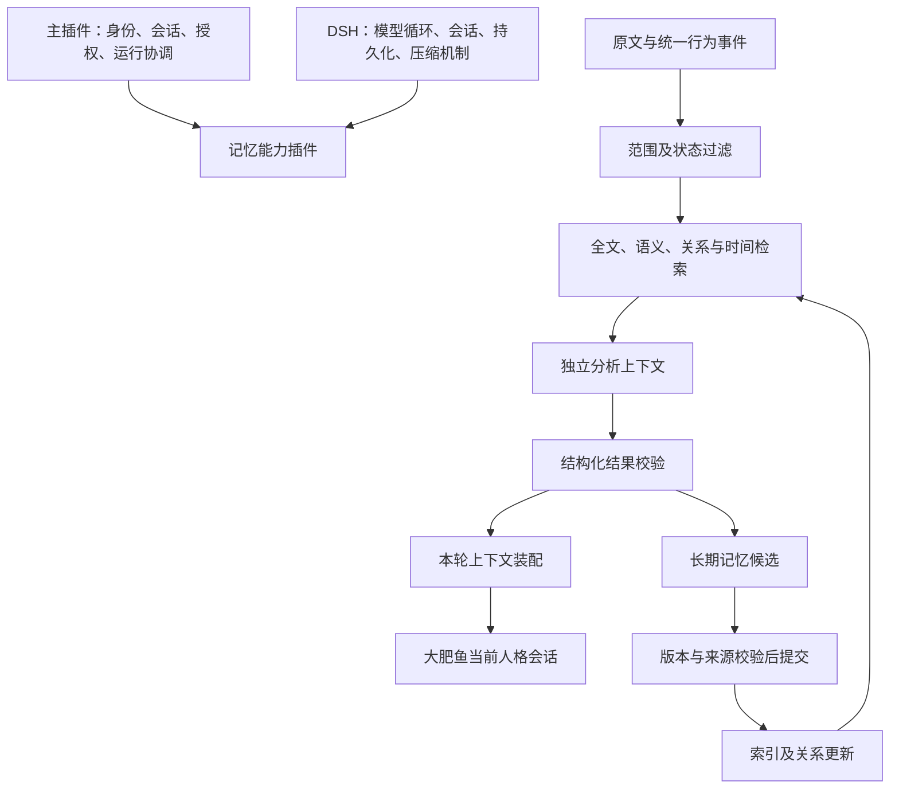

# 大肥鱼记忆能力插件完整开发方案

日期：2026-10-23（北京时间）

文档版本：1.3（ONNX本机契约验证、现有服务复用及4GB服务器上的2GB规划预算）

性质：本轮讨论共识与建议实现方案；不代表功能已经开发或通过验收。

实施进度补充：2026-10-23完成用户指定的 [第一阶段存储闭环](memory-phase-1.md) 与 [第二阶段中文全文、BGE召回、token分片及profile缓存](memory-phase-2.md)。embedding已完成产品插件的本机接入，不代表服务器部署；候选流程、自动分析、语义关系扩展与上下文装配仍待开发。原文级删除覆盖与既有聊天上下文回收不在当前删除范围内，不能将本次验收扩大为完整记忆架构已经实现。

## 1. 目标、共识与实施边界

记忆能力插件负责原文检索与信息分析、记忆候选与长期记忆更新、关系检索、工作记忆管理，以及定制压缩和检索结果装配。主插件拥有大肥鱼身份和会话，DSH 继续提供模型循环、会话持久化、原文查询与压缩基础机制。

核心目标是：可靠保存经历，在正确的会话和时刻找到相关证据，将有限且有用的内容装配进大肥鱼当前上下文，并能解释一次认识的来源与变化。

### 1.1 已达成的共识

1. 四类记忆：上下文记忆、日志记忆、关系图记忆、长期保存记忆。分类表达职责，不强制对应四种数据库。
2. 索引是服务于记忆的派生层，可以从符合当前状态的权威记录重建。
3. 检索、独立分析、记忆提交和上下文装配分别承担责任。
4. 大肥鱼当前上下文只接收选中的材料和必要来源，不持续携带全部候选、索引说明与分析过程。
5. 删除默认指逻辑删除：内容保留，退出正常使用，允许专门查找及独立恢复。
6. 降低权重用于关系、时间线、工作区、插件及当前任务等相关性判断，不代替删除、失效或权限控制。
7. 可见范围、有效状态、关系相关性分别管理。
8. 记忆和索引重建不重放历史操作，不恢复先前已经清除的旧档案。
9. 固定人格由主插件管理；记忆插件不自行改写固定身份和原则。
10. 不增加每轮工具调用次数上限，不将普通记忆更新变成逐条人工审批流程。

### 1.2 待实现验证的选择

本方案建议采用 SQLite 结构化存储、可替换的检索后端和独立分析工作进程。用户已确认服务器总内存4GB，考虑其他程序占用，本方案当前按2GB规划预算设计，后续由用户依据实际表现调整。固定采用 BGE-small-zh-v1.5、512维、CPU部署；Qwen仅保留本机对照材料。模型选择见 [中文记忆 embedding 本机评测](embedding-benchmark-2026-10-23.md)，现有服务复用验证见 [FastEmbed兼容与资源报告](fastembed-compatibility-2026-10-23.md)。

具体向量索引引擎、中文分词方案、生产排序参数、上下文预算、整理触发阈值及 DSH 接口适配方式，仍须通过后续实现测试确定。模型评测完成不表示记忆插件已接入运行实例。

已完成文档、独立模型评测、用户授权的现有服务器 embedding 只读核查，以及同源FastEmbed/ONNX的本机接口、召回和资源验证。后续开发沿用本机独立项目和 Git 管理；服务器接入、迁移、部署和运行实例重启均不由本文自动授权。

## 2. 现有基础与新增范围

本机独立项目源码基线为 0.3.0，已有主插件、能力注册、统一事件记录、真实模型及 QQ 接入，以及 `@dafeiyu/timeline` 的行为时间线检索和来源回查。

现有时间线查询是范围内事件元数据检索，不是聊天原文全文或语义检索。当前原文查询组合以精确读取为主，未启用 FTS。第三阶段能力也不能仅因源码存在就视为已加载到真实 QQ 实例。

本方案新增：记忆状态与版本、候选管理、逻辑删除及恢复、全文与关联检索、小型模型语义召回、独立分析、工作状态、上下文装配、专用压缩适配和诊断能力。

保留现有时间线接口作为兼容入口，逐步抽取公共的授权与证据访问服务。先复用接口和实现，不复制原始会话库，也不立即删除或重命名现有插件。

本机基线不能代表服务器现状。任何未来服务器工作均须另行读取实际布局、加载版本及 Git 差异，不以本方案或旧镜像覆盖线上自主开发成果。

## 3. 总体架构与责任划分

记忆插件内部建议分为证据访问、存储与状态、索引与检索、关系管理、分析任务、候选整理、工作记忆、上下文装配和压缩适配九个模块。首先保持一个能力插件的统一配置和生命周期；内部模块可测试、可替换，不必全部拆成独立插件或服务。

主插件提供真实会话范围和运行边界；模型参数不能决定智能体身份、目标会话或权限。后台分析使用主插件签发的任务范围，不伪造或复用已经结束的 ActionContext。

## 4. 四类记忆及存储边界

| 类型 | 内容与职责 | 生命周期 |
|---|---|---|
| 上下文记忆 | 当前话题、近期原话、参与者、任务状态、最新纠正、未完成事项、本轮证据 | 可替换、截取、摘要、过期和移出；关键状态可持久恢复 |
| 日志记忆 | 入站、能力调用、执行结果、交付、检索、分析、记忆提交、删除和恢复等事件 | 仅追加；纠正通过新事件表达 |
| 关系图记忆 | 人物、任务、操作、经历、知识及其支持、冲突、替代、引用等联系 | 增加有来源的关系，调整状态和情境相关性 |
| 长期保存记忆 | 完整档案与整理后的有效长期记忆 | 档案保持可回查；有效认识采用版本及状态管理 |

长期保存区内部区分：

- **完整档案**：回答当时说过什么、发生过什么。通过稳定引用访问 DSH 原文和附件；会话外材料由相应能力保存并提供引用。
- **有效长期记忆**：回答当前应如何理解和使用材料，分为经历、知识、偏好关系、行为经验。

完整保存不表示全部内容真实、永久有效或每轮注入。已删除内容也不因保留在完整档案中而可被正常读取。

日志不重复保存全部工具参数、全文候选和分析文本；详细结果保存在所属存储，日志保存必要标识和状态。不得记录凭据及模型内部思考。

## 5. 数据契约与版本模型

下列名称为建议接口字段，并非已发布 API。所有模型输出必须经过结构、来源与权限校验。

### 5.1 通用记录

记忆条目至少包含：`id`、`agentId`、`kind`、`revision`、`content`、`sourceRefs`、`visibility`、`createdAt`、`recordedAt`、`validFrom/validTo`、`schemaVersion`。

- `sourceRefs` 包含稳定来源定位、片段范围、内容版本或摘要值；引用不赋予权限。
- 发生时间、记录时间和适用时间分开；迟到记录不能仅按入库顺序解释因果。
- 来源关系与内容变更可追踪。历史内容版本保留，当前有效指针可事务化更新。
- 模型自报的信心不是校准概率，不能直接代替证据等级。

### 5.2 状态分开建模

| 轴 | 示例值 | 作用 |
|---|---|---|
| 候选流程 | pending、accepted、rejected、needs_review | 是否已经完成记忆提交判断；needs_review 不等于必需人工审批 |
| 有效性 | active、superseded、invalid、expired | 是否仍可作为当前有效认识 |
| 删除状态 | present、deleted | 是否退出正常检索和使用 |
| 可见范围 | 核心签发的会话范围或明确共享范围 | 当前调用是否有权访问 |

删除状态独立于有效性，避免恢复时遗失“原来已经被替代”等信息。归档或冷热存储位置也不代表逻辑删除。

### 5.3 关系记录

`Relation` 至少包含端点标识、关系类型、来源证据、确定性类别、有效时间、版本、状态与可见范围。

关系类型包括：属于任务、回复、引用、操作结果、支持、反驳、替代、同一实体、主题相关、时间先后。程序明确记录的行为因果与模型推断的因果分开；时间先后不自动产生因果边。

涉及多个来源的派生记录，只能在所有依赖来源都可见的范围使用，或拆分成独立有依据的条目。图遍历逐节点、逐关系执行授权检查。

## 6. 存储与索引实施建议

### 6.1 初版存储

- DSH 会话持久化：继续保存原始会话，不另写一套聊天历史引擎。
- 统一事件库：继续保存行为事件及操作链。
- 记忆数据库：建议使用独立 SQLite 文件，保存条目版本、状态、候选、关系、分析任务、装配清单与索引更新任务。
- 派生检索层：全文索引、向量索引、关系投影与必要缓存，可重建，不成为第二份权威记忆。

建议表组：`memory_items`、`memory_revisions`、`source_dependencies`、`relation_revisions`、`analysis_jobs`、`analysis_results`、`memory_candidates`、`working_states`、`context_manifests`、`deletion_events`、`index_jobs`。

具体分表随实现调整。大段分析正文可独立存储，表中保留版本化引用。运行数据、私人记忆及凭据不入 Git。

### 6.2 一致性与恢复

有效记忆版本提交与索引待办在同一记忆数据库事务内写入。索引消费者按幂等键处理，记录水位和世代；重试不重复产生有效版本。

DSH、事件库、记忆库之间不假定存在一个跨库事务。使用稳定来源标识、增量游标、幂等写入和补录协调。对短暂不可读来源标记不可用，不能捏造成功。

读取候选后、读取原文时、装配前再次检查有效状态与权限。索引滞后不能绕过逻辑删除。重建新索引完成校验后再切换，重建不调用历史能力或发出旧回复。

### 6.3 索引选择与中文检索

按访问方式配置：实体和编号精确索引、原文及长期记忆全文索引、时间索引、关系邻接索引、向量索引。语义召回纳入首版目标；运行时模型不可用仍允许明确降级。

中文分词或字符 n-gram 需要用短姓名、两字简称、中英混合、项目代号、错误码和插件名验收。不能假定默认 FTS tokenizer 已解决中文检索；SQLite trigram 全文查询对不足三个字符的查询有明确限制。

向量记录绑定 embedding profile（模型提交、分词器版本、查询／文档指令格式、池化、归一化、维度和数值格式）、内容版本和可见范围。更换模型或改变向量生成契约必须重建相应向量，不能混用不同向量空间。仅调整权限、删除状态或相关性元数据不要求重算未变化的文本向量，但必须及时更新过滤与缓存。向量服务失败时保留全文、精确和关系检索，并明确当前能力降级。

### 6.4 已完成的小型模型选型

100 条虚构记忆、47 个查询（43 个有答案），统一 float32、8 个 CPU 计算线程，分别完成 CPU 和 CUDA 实测。BGE 的 Recall@5 为 95.35%，CPU 单查询编码 P95 为 5.53 ms、进程峰值 RSS 688.3 MiB；Qwen 对应为 97.67%、131.12 ms、3992.4 MiB。两模型在 GPU 上主召回指标不变。

Qwen 多完整召回一题，但没有达到运行前规定的 5 个百分点提升门槛；首版采用较轻量的 BGE。测量仅覆盖短记忆，最大实际输入 BGE 52 token／Qwen 40 token，不能外推到长文本或服务器。

- 原PyTorch基线模型：`BAAI/bge-small-zh-v1.5`，提交 `7999e1d3359715c523056ef9478215996d62a620`。部署契约改为下节的服务器同源ONNX profile，旧基线向量不直接混入新索引。
- 向量契约：512 维、CLS 池化、L2 归一化；查询加 `为这个句子生成表示以用于检索相关文章：`，文档不加指令。
- 部署取向：4GB服务器上按2GB规划预算使用CPU，复用现有FastEmbed/ONNX服务；PyTorch评测环境不作为生产部署包。后续量化或更换后端需重新验证。
- 检索起点：精确／全文＋语义多路召回，固定 RRF 可作为实现基线；本次提升第一条排序，不代表生产最优。
- Qwen 仅保留本机评测记录；当前服务器不部署 Qwen，不启动双 embedding 模型，也不隐式向远端发送记忆。
- 继续依赖独立分析和关系判断处理工作情境、否定、事实更新；逻辑删除和可见范围由程序实现。

### 6.5 现有ONNX服务复用与2GB规划预算

服务器物理内存4GB；当前按2GB保守规划本方案运行组合，不代表整机只有2GB或当前恰好有2GB空闲。操作系统、DSH、QQ及其他程序仍需一起核算，后续依据实际部署表现调整。

服务器6190服务已加载BGE、512维，使用FastEmbed 0.9.0、ONNX Runtime 1.31.0、CPUExecutionProvider、单推理线程；6191是缓存层，上游为6190的 /v1/embeddings，批量8。服务器只读核查，没有发送推理请求、压力测试或修改服务。

本机复现已验证7个模型／分词文件SHA256、服务代码指纹及所核对的关键包版本一致。ONNX源为 Qdrant/bge-small-zh-v1.5，revision `46fbe35fd4374a00fee7de77dfddaeb6dd6a2c59`；模型SHA256为 `1294ea4b6331115a353d81f96b85e8c8d7fdcc284453d5b2fab5b016230aad38`。

原服务对输入调用 model.embed，不自动加查询指令。新插件客户端负责给查询加一次中文前缀，文档不加；本机该模式Recall@5为95.35%，与原BGE基线相同。ONNX与PyTorch向量余弦非常接近但未通过1e-5逐元素严格等价检查，建立独立ONNX profile与索引世代，不直接混用旧向量。

正常本机ASGI短查询P95约9.33ms，正常阶段OS峰值RSS约231MiB；20批长输入压力下峰值RSS约408MiB、commit约439MiB。后者计入预算，不假定压力后立即回到常态内存。这些不是线上时延或整机组合验收。

同源服务有512-token截断，字符请求上限不能保证完整编码。本机两条结尾相反的长文本因尾部超限得到相同向量。第二阶段已实现相同分词器的token检查、分片及码点定位，并通过长文本尾部和Unicode覆盖验收；不直接向服务发送会被截断的查询或文档。

实施要求：

1. 新记忆插件优先复用6190单实例推理；主插件、各会话和分析任务不分别加载模型。现有6191及既有调用方保持不变。
2. 新插件缓存键绑定完整profile、文本哈希和查询／文档角色；不把6191的“模型名称＋文本”键当成版本证明，不清空或直接混用既有缓存。
3. 单推理并发，每批不超过8条，长片段可采用更小批量；后台增量建库分批让出执行机会，不照搬本机PyTorch评测的8线程配置。
4. 向量和全文数据优先持久存储，限制缓存与单次候选体积，避免无界全库驻留或重复构建索引。
5. 独立分析保持上下文、权限和生命周期隔离，但不得为每个任务保留一个常驻模型进程；分析继续沿用DSH已配置的模型路由。
6. 部署前重核模型／分词器／运行时指纹。健康接口只有名称和维度，不能单独证明完整profile一致；变化时构建新索引世代。
7. 验收覆盖启动、建库、长片段、查询、压缩和后台整理重叠时的峰值，并观察换页与延迟。未来线上接入必须单独验收，不预设当前有足够余量。

预算草案按2,000,000,000字节总额：共享embedding服务512MiB，记忆协调／分析任务容器／数据库与索引缓存384MiB，剩余约1011MiB用于DSH协同及余量。后两项尚未实测，不是已部署硬限制；共享服务已有占用不能与新增占用重复计算。本轮不自动调整服务器资源或重启服务。

初版不预设必须采用专用图数据库或外部向量服务。以范围过滤后的召回质量、耗时、内存及维护成本对比后再选型。不得在未配置并授权的情况下将私人材料发送给新的嵌入服务。

## 7. 正常检索与相关性判断

正常读取顺序：

> 核心确定权限与查询模式 → 限定可见范围及状态 → 多路召回 → 受控关系扩展 → 重排去重 → 必要的独立分析 → 装配选中的材料。

默认仅使用未删除且有效的记忆。历史查询可以显式包含已替代、失效或过期记录，并展示状态；已删除查询采用独立入口。

### 7.1 多路召回

- 精确召回：账号、项目代号、工具名、文件名、错误码。
- 全文召回：包含关键表述的原文与记忆。
- 语义召回：表达不同但含义接近的材料。
- 关系召回：同一任务、实体、操作链、支持和冲突证据。
- 时间召回：问题指向的时间段、某事件之前或之后的记录。

各检索后端必须在输出候选内容前落实授权过滤；不能先把全库候选交给模型再筛选。图关系和缓存也不能成为跨会话旁路。

### 7.2 权重的含义

不为每条记忆设置一个永久、统一的重要性分数。按当前情境计算相关性，考虑主题、实体、任务、工作区、插件、时间意图、行为链、未完成事项、证据覆盖、重复度及输入成本。

关系依据强度与本轮相关性分开。已经确认的关系不会因为久未使用而变得不可信；旧记录在明确追问历史时可以优先召回。未完成承诺不能仅因时间久远而自然消失。

不同召回器的分数不能直接相加。初版可用可解释的排序规则或名次融合，具体权重通过同预算对照实验确定。检索频率、共现和重复转述不能自动证明内容更真实。

扩展深度、候选条数和输入体积作为单次检索的资源参数，不是每轮工具调用次数上限。没有足够相关材料时不填满上下文预算。

## 8. 独立分析方案

### 8.1 两条分析路径

**本轮理解分析**：针对当前问题解释证据、指代、冲突和证据缺口，按需运行；结果可以只用于本轮，不成为长期记忆。

**后台记忆整理**：处理增量材料，识别经历、偏好、约定与经验，提出记忆候选；可在对话阶段结束、操作完成或明确记忆请求后触发。

不必为每条消息调用模型。连续事件可合并处理，但需要最大等待策略避免活跃会话一直得不到整理。具体触发参数待测试确定，不在本轮新增定时任务或修改既有夜间流程。

### 8.2 输入与隔离

`AnalysisRequest` 包含任务标识、用途、核心签发的范围、输入截止位置、证据集合、相关有效记忆、当前必要工作状态及分析配置版本。

每个任务具有独立上下文，不继承大肥鱼人格会话的全部历史，也不沿用其他范围任务的隐藏状态。仍通过 DSH 模型运行接口使用配置路由，不编写另一套私有模型循环。

分析工作进程只获得范围内的证据读取接口与结果提交接口，不获得 QQ 发送、命令执行、任意文件读取或有效记忆直接写入能力。进程隔离用于故障隔离；若需要抵御恶意代码，必须另外配置操作系统权限或沙箱，不能将独立进程等同于安全沙箱。

### 8.3 输出协议

`AnalysisResult` 至少包含：

| 字段组 | 内容 |
|---|---|
| 归属 | jobId、purpose、inputRevision、sourceSnapshot |
| 结论 | claims，每条表达一个可核查的主张 |
| 证据 | supportingRefs、opposingRefs、必要的原文片段 |
| 判断类别 | observation、self_report、reported_claim、inference |
| 限定 | 适用时间、适用对象、歧义、未解决冲突 |
| 缺口 | evidenceGaps 与需要继续查询的问题 |
| 候选 | 可选 memoryCandidates、relationCandidates |
| 追踪 | 模型路由、分析规则版本、输出格式版本、完成状态 |

提供简短证据依据，不保存或回传模型内部思考。程序复核来源引用是否属于实际输入或授权读取结果，不接受虚构引用；权限由程序计算，不采用模型自填权限。

格式通过不等于内容真实。关键事实与原文核对；证据不足保持未知或待核实。对玩笑、转述、假设、助手自述和真实工具结果分别处理。

### 8.4 提交与故障行为

分析结果提交前检查输入状态、版本与任务是否仍有效。分析期间出现纠正、删除或权限变化时，拒绝受影响的旧结论或重新分析，不覆盖新状态。

新纠正先进入当前工作状态，后台整理随后跟进。分析失败标记失败或未分析；正常对话可使用已验证材料或明确缺少证据，不能伪称分析完成。

任务队列持久化，采用租约、幂等键和版本检查处理崩溃恢复；同一任务的重复完成不能重复提交记忆。

## 9. 长期记忆候选及关系更新

候选流程：

> 增量材料 → 提炼候选 → 核验来源与范围 → 判断新增／补充／纠正／冲突 → 提交有效版本 → 更新索引与关系。

明确、有来源、无冲突的条目可自动提交；证据不充分的保留待核实状态，明确拒绝的记录原因。只有确实需要用户解释的歧义才询问，不要求用户确认每次普通写入。

原文相似不等于同一事实，较长文本不等于更准确，分析失败不能默认合并。模型回答和摘要的重复转述不是独立支持证据；来源链应指回原始依据。

关系更新时间：

1. 入库时记录确定关系：回复、引用、任务归属、操作与结果。
2. 分析完成后产生语义关系候选：主题关联、可能原因、偏好解释等。
3. 纠正、删除、恢复和阶段整理时检查受影响关系，撤销或替换不再成立的联系。

图中相同关系累计有效证据，不无限复制边。临时检索联想默认不持久化；持续有用且有依据的关联才进入关系记忆。检索统计作为派生统计保存，不自动改变事实关系。

## 10. 工作记忆与上下文装配

### 10.1 当前上下文的归属

工作状态绑定智能体、渠道、账号、会话、当前任务及输入位置。统一人格和统一存储不意味着统一所有聊天上下文。

工作状态包含当前目标、话题、参与者、最新约束与纠正、未完成事项、已核实结果、当前证据缺口和必要来源。固定人格单独装配。

### 10.2 装配包

`ContextPacket` 是分析与检索到主会话的唯一受控交付形式，包含 packetId、目标会话、turn/step 边界、工作状态版本、实际选入条目及版本、来源片段、冲突与不确定性、输入预算、有效期及生成配置版本。

装配器负责授权与状态复核、去重、输入体积控制和来源标记。模型可以辅助选择相关条目，但不能决定权限、放宽状态规则或直接改写主会话。

本轮材料通过锁定版本的 DSH 运行时上下文接口装配，保持稳定人格与检索数据分离。具体接口先做适配验证，不能将本地源码接口当作已安装包兼容承诺。检索材料不能伪装成用户新指令、固定人格规则或助手已经确认的事实。

模型请求前冻结一份装配快照；迟到分析结果只在下一明确请求边界重新校验后采用，不能改写正在发送的模型输入。删除发生后立即阻止未来读取和新装配，并清除待装配缓存；已经发送给模型的内容无法追溯收回，须标记受影响回合并按运行策略取消或重新生成。

### 10.3 搜索替换与注意力管理

- 主上下文获得最终选中片段及来源后，不持续携带完整命中列表、搜索过程或索引说明。
- 独立分析的中间候选按任务保留策略释放，不逐条写入长期记忆。
- 持久索引继续供后续检索使用，不因本轮命中而删除。
- 普通审计只保存范围、版本、数量和最终选入引用；完整候选诊断仅在显式诊断模式按有限保留期记录。
- 已装配到历史会话的条目不能靠修改数据库从模型上下文中消失；需在后续请求通过 DSH 投影或压缩机制移出、替换或标记失效，专项验证。
- 必要反证和不确定性不能为了简短而删掉。来源仍可按需打开，允许继续检索。

## 11. 工作记忆压缩、截取与分类保存

原始记录产生时即持久化，压缩不承担首次归档职责。压缩改变当前可见工作材料，不改变档案内容。

| 材料 | 处理方式 |
|---|---|
| 近期对话、准确措辞重要的约定 | 保留原文片段 |
| 已完成的过程 | 事件摘要及来源引用 |
| 当前任务、未完成事项 | 独立工作状态 |
| 最新纠正、关键限制 | 保留当前值及替代依据 |
| 大段工具或网页内容 | 移出主上下文，保留可读取引用 |
| 有长期价值的内容 | 提交候选，单独核验 |
| 重复或无关内容 | 从工作上下文移出，不等同于删除档案 |

检查点保留场景、目标、结论、来源、纠正、未结事项和证据缺口。摘要尽量逐条对应证据；仅有大范围来源时应如实标注，不能猜造精确定位。

复用 DSH 的工具调用边界、持久化、取消、并发检查与失败恢复。一个会话只使用一个明确压缩提供者；记忆插件提供适配与内容策略，不改写 DSH 主循环。

压缩失败保留原上下文，不用空摘要替换。多轮压缩对照稳定记录和原始来源，减少反复转述漂移。摘要不会自动成为长期记忆，也不触发历史命令。

容量计算应包括人格、工具定义、工作状态、检索材料及输出余量。输入预算与调用次数限制不同；不恢复旧调用次数上限。

## 12. 逻辑删除、专门查询与恢复

### 12.1 默认语义

“删除／遗忘”默认是逻辑删除：内容保留，正常检索、关系扩展、分析、摘要、装配和索引重建均排除。降低权重不能替代删除。

删除事件记录操作主体、时间、范围、理由和受影响版本。覆盖“条目及已有历史版本”还是“指定版本”、是否包含来源，必须在操作结果中明确；不能把删除一条分析结论自动扩大为删除原始证据。

原文由 DSH 保存时，由记忆服务建立来源状态覆盖表，并让时间线回查、全文及其他面向模型的来源访问统一经过状态检查。该覆盖只约束受控记忆接口，不宣称管理员直接打开底层 DSH 文件时内容已消失。

### 12.2 派生传播

根据来源依赖定位影响：完全依赖已删除来源的结果退出正常使用；混合来源的结果先暂停受影响部分，再用剩余有效证据重新分析。索引、缓存、工作状态和待装配包同步失效。

普通重建仅使用允许状态的数据。删除标记及其历史需随备份、迁移和恢复保存；恢复旧备份后先对齐删除状态再提供检索，防止旧数据重新成为正常记忆。

### 12.3 查找已删除数据

专门入口在明确请求下启用，继续遵守原有可见范围。可返回已删除原文、版本和删除历史，所有结果显式标记为“已删除，仅用于本次查找”。

查看不等于恢复。此类结果和后续转述携带来源状态，不作为后台普通记忆提炼的新证据。若需检索已删除内容，可建立独立受控索引或按范围扫描；不得混入正常索引召回。

恢复是一项单独操作：解除指定删除状态后仍检查原有效性、更新版本和冲突。旧记忆可能恢复为“已替代”，不能自动覆盖现有认识；旧派生结果逐项校验或重算。

物理清除不属于本方案普通记忆接口。如将来需要不可恢复清除，另行设计和授权。

## 13. 服务、工具与事件接口

建议插件标识为 `@dafeiyu/memory`，名称待实现时与现有包约定核对。

| 接口组 | 建议职责 |
|---|---|
| EvidenceReader | 范围与状态内读取原文、事件及邻近片段 |
| MemoryQuery | 正常、历史、已删除三种明确模式的检索 |
| AnalysisService | 提交独立分析任务、读取状态和校验后的结果 |
| MemoryWriter | 记录候选、补充、更正、停用、逻辑删除、恢复 |
| WorkingMemory | 保存工作状态与版本，处理当前纠正 |
| ContextAssembler | 生成并提交绑定目标会话的 ContextPacket |
| CompactionAdapter | 连接 DSH 压缩生命周期与定制检查点 |

模型工具按用途暴露记录、检索、来源回查、更正、遗忘、查找已删除记录和恢复；精确名称与参数须在实现阶段发布接口版本。保留 `dafeiyu_timeline_search` 和 `dafeiyu_source_open` 的兼容路径，并加入统一状态过滤。

模型不直接操作数据库，不提供任意 SQL、任意目标会话或无限制底层文件读取。工具结果统一标明状态、来源、版本、截断、降级及未知情况。

事件包括分析受理／完成／失败、候选创建、版本提交、关系更新、删除、恢复、索引完成及上下文装配；继续关联 traceId、operationId 和 causedBy。每个事件只记录必要安全元数据，详细内容通过受控引用读取。

## 14. 配置方案

以下为建议配置分组，不是已经存在的可用开关。

| 分组 | 配置内容 |
|---|---|
| storage | 数据路径、迁移版本、备份与诊断保留策略 |
| retrieval | 启用的召回器、中文处理器、候选规模、关系扩展范围、排序策略版本 |
| embeddings | 本地 BGE 基线、设备与线程数、完整 profile、512 维、缓存与重建版本；显式可替换模型路由 |
| analysis | 模型路由、任务并发、超时、取消、合并窗口与最大等待 |
| workingMemory | 近期保留、输入预算、当前状态策略 |
| compaction | 触发水位、输出余量、近期截取、摘要策略与来源要求 |
| relations | 允许关系类型、推断关系提交策略、临时关联有效期 |
| deletion | 逻辑删除模式、派生失效、专门查询与恢复规则 |
| diagnostics | 指标、轻量追踪、可选候选诊断及保留期 |

行为参数可按全局默认、渠道、会话覆盖；界面或配置检查输出生效值与来源。授权规则不能通过低层配置或模型参数放宽。修改评分或分词产生新索引／策略版本，执行中的请求保持快照。

参数先在固定测试集上选择，不使用未经验证的“最佳阈值”。凭据由现有凭据服务管理，不写入公开配置或 Git。

## 15. 分阶段开发与交付

每个阶段独立提交和验收；真实 QQ 验收在本机隔离实例按明确方案进行。前一阶段通过后再扩大接入范围。

| 阶段 | 交付内容 | 完成条件 |
|---|---|---|
| M0：接口验证 | 锁定包版本核对、DSH 上下文／压缩适配实验、现有BGE服务的本机兼容验证、2GB资源预算、数据契约与虚构样本 | 能隔离装配、验证向量契约及持久恢复边界，明确低内存部署的待验收项 |
| M1：记忆存储与状态 | 版本库、来源依赖、候选状态、逻辑删除、专门查询、恢复 | 事务、幂等、越权拒绝、删除不复活和恢复冲突测试通过 |
| M2：检索与关系基础 | 中文全文、精确时间检索、ONNX服务适配、按token分片、完整profile缓存、确定关系、索引重建与混合排序 | 同名、短词、长片段尾部、操作链、profile变化、降级及跨会话隔离通过 |
| M3：独立分析与候选 | 分析任务、结构化结果、证据核验、自动提交策略、语义关系候选 | 失败不误写、纠正竞争、重复任务和来源污染测试通过 |
| M4：工作记忆与装配 | 工作状态、ContextPacket、预算选择、来源清单、缓存失效 | 并行会话不串用，迟到结果不覆盖，删除材料退出后续装配 |
| M5：定制压缩 | 截取、摘要、状态分离、来源索引、DSH 压缩适配 | 自动／手动／溢出场景及多次压缩后的回查通过 |
| M6：检索优化与综合验收 | 索引规模、长片段、混合排序、必要关系扩展、较大独立样本及模型对照 | 在同输入预算下验证整体收益，随后完成本机模拟渠道和 QQ 验收 |

M2同时保留全文／精确基线与BGE召回。已完成中文FTS5、BGE产品接口、token分片、profile缓存及当前会话／删除过滤的本机验收；M0的DSH上下文装配适配、M2剩余关系检索与时间意图策略、整套资源组合验收仍待开发。M6不以“必须引入外部数据库”为完成标准。

## 16. 测试与验收标准

### 16.1 必须通过的正确性测试

- 同名人物、重复消息编号、不同账号、不同群、不同智能体不错误合并或泄漏。
- 无权限来源在全文、向量、图扩展、分页、缓存、删除查询及诊断元数据中均不可见。
- 同一事件、分析任务、候选提交和索引任务重试不产生重复有效记录。
- 最新纠正不被延迟分析覆盖；“工具执行成功”和“消息发送成功”独立判断。
- 逻辑删除立即阻止新读取与装配；重启、重建、重新分析后不复活。
- 专门找到已删除数据不会自动恢复；其转述不会重新成为有效证据。
- 旧版本恢复不会覆盖更新认识；混合来源的派生条目正确失效和重算。
- 摘要保留不确定性、纠正、未完成事项及有效来源；缺失来源不伪造。
- 多次压缩、工具调用边界、取消和持久化失败保持可恢复。
- 分析或嵌入服务不可用时如实降级，不影响其他隔离会话。
- 检索及重建不触发 QQ 发送、发布或历史命令。

测试中越权内容暴露和逻辑删除复活必须为零；这表示固定验收集内全部通过，不是对所有未来输入的绝对保证。

### 16.2 效果与性能评估

使用虚构且标注相关证据的固定数据集，对比：无召回、精确／全文、加关系、加向量。保持模型路由及输入预算一致，分别统计：

- 有用证据召回率、最终选入材料的相关比例。
- 当前版本回答准确率、来源引用准确率、冲突识别率。
- 未完成事项保持率、多次压缩后的证据回查成功率。
- 每轮新增上下文体积、模型实际使用证据的情况。
- 检索与分析耗时分布、索引积压、存储增长、失败与降级率。

性能门槛在 M0/M2 根据本机数据规模和模型延迟建立并冻结，不能用第三方插件自报成绩代替。评分时区分“找到证据”和“最终正确使用证据”。

### 16.3 真实接入验收

先使用真实 DSH 服务、模拟模型及虚构消息验证确定性行为；再使用当前模型路由与模拟渠道验证分析质量；最后在本机测试 QQ 中验证会话隔离、逻辑删除查找、最新纠正和压缩恢复。

不将模拟模型验收宣称为真实模型验收；不复制线上私人记忆、真实登录态或已清除的历史档案作为测试样本。真实接入明确实例、账号和启动方式，不能默认重启现有进程。

## 17. Git、数据迁移与运行维护

- Git 管理代码、接口、迁移脚本、虚构测试样本、配置模板、方案及验收记录。
- 数据库、索引、分析正文、真实会话、登录态和凭据不入库。
- 数据结构迁移版本化，先备份并验证，失败不重置数据库；不得以测试初始化覆盖真实新增记忆。
- SQLite 备份使用一致性备份方式，不在活跃 WAL 状态下仅复制主数据库文件充当完整备份。
- 代码回退与记忆状态回退分开；回退程序不得将用户已删除的记录恢复为有效。
- 可观测状态应区分：未配置、未启用、等待中、已完成、降级、失败、来源不可用。没有观测证据不能宣称正常。
- 按项目约定，提交前运行 `npm test` 与 `git diff --check`。不自行建立远端或推送；服务器部署另行授权。

## 18. 参考资料与采用边界

1. [本项目既有记忆方案](memory.md)、[第三阶段时间线与来源接口](phase-3-timeline.md)：复用已有会话隔离、事件与来源访问设计。本文更新删除、关系相关性、独立分析及装配方案；既有文档中的实现状态仍以对应验收记录为准。
2. [Cairn / chenhw7/dsh-memory](https://github.com/chenhw7/dsh-memory)：参考提炼、整理、检索和注入职责划分；不直接移植其全局／项目范围或默认策略。
3. [zhbcher/dsh-memory 检索实现](https://github.com/zhbcher/dsh-memory/blob/5175f98b3e7bec1a6aca64c6f6ed2fe8242bf0c0/lib/relevance.js)：参考有界选择与混合召回；不因预算剩余而强行注入无关材料。
4. [dsh-agent-soul ECHO 权威口径](https://github.com/cyanwell/dsh-agent-soul/blob/5126bc2fc6aafa301dae08c7af707a0ba2bababf/docs/ECHO-%E6%9D%83%E5%A8%81%E5%8F%A3%E5%BE%84.md)：参考工作台与档案分离、来源回查；固定身份仍由大肥鱼主插件管理。
5. [LangMem 结构化提炼](https://langchain-ai.github.io/langmem/guides/extract_semantic_memories/)及[延迟整理](https://langchain-ai.github.io/langmem/guides/delayed_processing/)：参考分析输出与存储控制分离、后台增量处理，不引入另一个必需运行框架。
6. [Mem0 架构说明](https://docs.mem0.ai/core-concepts/how-it-works)：参考提炼与检索分开、由应用决定提示词材料；不把其平台能力直接视为开源版本或 DSH 的现成功能。
7. [SQLite FTS5](https://www.sqlite.org/fts5.html)及[隔离机制](https://www.sqlite.org/isolation.html)：作为本地存储候选的技术依据；事务隔离不代替业务授权。
8. [Lost in the Middle](https://arxiv.org/abs/2307.03172)：作为测试上下文位置与有效使用的动机，不等同于当前 DeepSeek 模型的验收结果。

参考项目提供设计材料，不意味着已经在本项目安装、移植或完成兼容验证。最终实现以锁定依赖、源代码核对和本机验收为准。
