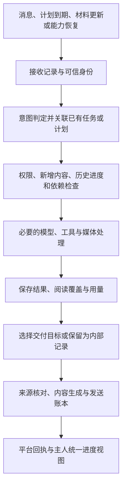

# 消息、任务、自主探索、媒体与主动分享：完整开发及验收方案

日期：2026-11-03。基线：0.27.0 / API 6 / runtime v3 / activity v2 / media v2 / QQ v8 / B站 v6。建议目标版本：0.28.0。本文件是待实施方案，不表示功能已经开发、验收或部署。

## 1. 目标、边界与完成定义

完成以下整条行为链：用户消息被接收并正确关联任务；主人能了解跨群消息与进度；自主活动能选择有新价值的事情、复用已读材料并处理能力故障；成果有来源、有实际阅读覆盖，能在获准的目标中自然分享；最终能核对送达及用量。

已确认的约束：

- 主人私聊可以统一查询机器人已加入群的消息、任务和活动记录；群与群继续隔离，主人私聊不向群泄漏。
- 保留 `contextCapacity.maxTokens = 1000000`，不新增隐含的任务总 token、总步骤、视频数量上限。调度冷却、外部请求超时、权限和技术上限要与上下文容量分别表达。
- 先在本地开发和验收；服务器的记录用于分析和脱敏回放，不并入本机实例的记忆、身份或业务库。
- 当前服务器实例已经停止。本方案不授权本轮恢复运行、切换服务器包或发送新的测试消息。以后进入已授权部署范围时按清单完成，不引用历史维护窗口反复询问。
- 不采用子代理方案；在现有单实例架构内完成本轮改造。
- 不关机。

“本地开发完成”和“服务器部署验收完成”分别记录。接口返回成功、任务执行 completed、模型写出一段总结，都不能替代最终行为验收。

## 2. 本轮依据与需要先复现的问题

统计窗口为北京时间 11 月 2 日 22:43 至 11 月 3 日 18:42：

| 现场事实 | 设计影响 |
|---|---|
| 账号已加入 5 个群，群内 @ 收到并回复，主人私聊仍只能查询当前私聊 | 需要主人统一查询入口，并区分账号成员关系与本次读取权限 |
| 要求定期看群后没有建立计划，调用活动状态工具得到 unknown tool | 消息意图必须进入真实计划入口；目录、注册、权限必须一致 |
| 分段回复被新消息打断后，后两条请求只有 turn-open/turn-seal，报 MODEL_INCOMPLETE | 必须复现会话及发送中断边界，补足内部阶段诊断 |
| 指定视频任务执行完成，10 段汇报中 8 段确认、1 段未知、1 段待发 | 任务状态与交付状态分开；禁止整批重发 |
| 248 次自主任务，192 次完成、56 次失败，间隔中位数约 61.5 秒 | 默认一分钟重开探索与“休息”语义需要改造 |
| 270 次视频资料查询涉及 133 个 BV；同一官方视频进入 30 轮 | 新探索、续读、回访和重复无进展必须有可核对的区分 |
| 约 1.614 亿累计 token，约 1.380 亿缓存读取，约 99% 来自自主探索 | 应减少重复启动和重复上下文，不能把账面 token 全部当作非缓存费用 |
| 411 个媒体处理失败回执；FFmpeg/FFprobe 版本命令可执行 | 需要定位获取、解码和理解阶段，不能用“已安装 FFmpeg”作为媒体健康证明 |

`MODEL_INCOMPLETE` 的具体内部原因和媒体处理失败根因尚未确定。阶段 P0 必须给出可复现证据，不能先假定是某个句柄、参数或提供方错误再宣布已修复。平台第 9 段消息是否已送达也仍未知。

完整私有证据位于本机工作区报告及忽略目录 `.runtime/server-diagnosis-20261103-*`；公开仓库只放脱敏夹具和必要统计，不放账号、Cookie、私钥、原始聊天或服务器数据库。

## 3. 统一处理流程与职责

程序负责身份、权限、去重、进度、依赖状态、调度和交付一致性；模型负责理解意图、选择有价值的问题、判断材料及自然表达。无需模型判断的空队列、无新消息、重复故障和重复候选，由程序直接处理。

保留现有 SQLite、`message_intents`、执行请求、检查点、活动计划、阅读记录和交付账本。扩大现有能力的适用范围，不另建一套任务引擎、聊天发送器或数据库服务。

## 4. 必须保持的行为约束

1. 每条平台消息有唯一接收记录；批次保留原消息顺序、ID、引用关系，重复投递不能创建重复任务。
2. 一个逻辑任务可以经历多个运行段，但目标、纠正、实际结果与交付记录能够连续追溯。
3. 同一用户消息的意图回执持久化；恢复不重新猜测已经接受的意图，不取消后又重复创建同一个任务。
4. 查询范围由可信身份、实例配置、成员关系和计划授权决定，不能由模型填一个 `owner:true` 或目标群号扩大。
5. 读取、缓存命中、解码成功、交给视觉模型、形成理解、发送结果是不同状态，记录分别可查。
6. 数据读取资格与对外分享资格分开；主人能看见多个群，不代表其中内容可以互相转发。
7. 同一结果对同一目标的发送有稳定去重标识。平台回执未知时保留未知，不能用本地去重声称外部“恰好发送一次”。
8. 请求重试、进程重启、计划取消和权限撤回后，旧代次的回调不能提交新结果或继续发送。
9. 缺失模型计量为 unknown，不能记为 0；一个用量回执不能被多个钩子或重放事件重复累加。
10. 主人已经授予的明确计划按授权执行；不会每次巡视、每次回复都重新请示。

## 5. 消息隔离与主人统一查询

### 5.1 读取范围

| 发起位置与身份 | 可查询范围 | 可对外表达范围 |
|---|---|---|
| 已核对身份的主人私聊 | 本机器人已加入且配置允许查询的群、主人私聊、任务与活动记录 | 默认回到主人私聊；向群发送仍核对目标授权 |
| 群 A 的普通对话，包括主人在群 A 发言 | 群 A 及该轮可用的公开资料 | 群 A；不自动取得主人的跨群查询身份 |
| 群巡视计划 | 该计划声明的目标群及对应新增消息 | 仅计划允许回复的目标群 |
| 自主兴趣探索 | 获准公开资料、可用的自身认识和探索记录 | 按主动分享策略发给主人；进入群须有独立目标授权 |

账号加入关系不能证明历史数据完整。目录要分别返回 `joined`、`readable`、`writable`、接入状态、最新同步时间、读取时间范围、缺口及原因。

实现落点：

- 检查 QQ 接入到本地缓存的完整路径：获准群里实际收到的消息先保存接收索引，是否触发立即回复另行决定。不能只保存 @ 自己的消息却称已覆盖群巡视；平台未推送、历史无法补拉时返回真实缺口。
- 调整 `ExecutionCoordinator.resources()` 的消息分支，增加可信主人查询策略；不要对所有 conversation 统一放开。
- `qq_groups` 展示目录及权限事实，`qq_browse` 使用明确目标、时间窗和续读游标；主人查“刚才有没有收到 @”优先读取接收、运行和回执索引，无需导入整段群聊。
- 同步修改 timeline、source_open、记忆检索、媒体引用、任务证据及检查点的授权校验。不能只让列表看到群，真正读取仍被其它层拒绝。
- 主人统一查询结果以有来源的只读结果呈现，不改写原群会话的 route，不把所有群拼成一个聊天历史。
- 同步状态过期、退群、权限撤回时拒绝新读取与尚未发送的旧结果；在读取前、返回结果前和发送前核对授权代次。
- 修订此前“没有加入群”等错误认识：引用本次实际接收证据，用现有记忆修订接口纠正并标明旧判断范围，不清空记忆库。

## 6. 任务承接、工具衔接与中断恢复

### 6.1 一条消息对应明确处理结果

复用持久意图入口，支持查询状态、继续、补充、纠正、取消、新任务、计划创建/修改和分享偏好。每次保存：来源消息、目标对象、意图版本、完整约束、采用的权限及实际处理结果。

- “可以”“继续”关联尚未解决的确认或既有任务，不能仅凭最近一个任务就擅自新建目标。
- “进度怎么样”读取任务与交付账本，不从头执行视频读取。
- 用户补充、纠正与新目标分别处理；多条未处理消息按顺序关联，不能只拿最后一条文本覆盖前文。
- “每隔一段时间看看已加入群，有兴趣就回复”进入计划创建路径，产生计划 ID、目标、首次检查时间和执行方式，不能只口头答应或留反思。
- 查询工具直接可用；安装、写文件等 DSH 操作继续走已授权的任务路径。目录应说明本阶段可调用动作、参数和转入执行阶段的方法。

### 6.2 修复此次执行前失败

加入脱敏的阶段诊断：接收、意图提交、会话取得、工具装配、请求构建、模型请求、结果持久化、渲染、发送。记录原始异常类别和可定位堆栈，不输出凭据或完整请求正文。

复现“分段发送时收到新消息，下一轮约百毫秒内失败”的真实序列，检查会话状态、取消信号、工具清理、`followup/whenIdle` 顺序和持久化边界。只有根因证据支持时才采用重建句柄、等待启动回执或其它修复。必要的恢复必须复用原任务与工具回执，不重新执行已确认的操作。

`MODEL_INCOMPLETE` 可保留为对用户的概括，但内部必须能区分没有发出请求、请求失败、没有正常结束、结果保存失败等具体原因。

### 6.3 回复被打断与交付未知

- 分开显示 execution 与 delivery：已完成工作、已发送几条、剩余几条、是否有未知回执。
- 新消息打断发送时，保存准确发送位置；继续接收并处理新消息，根据其意图决定旧回复继续、合并解释、失效或保留待处理。
- 已确认的段落不重发；明确未发送的段落可以从原冻结正文继续。
- 未知段落优先查询可靠平台回执。仅靠文字相同、时间相近不能认定是同一条消息；缺乏可靠证明时保持 uncertain，不自动补发它，也不把整批标成成功。
- 重启、重复回调、发送超时和“平台已经接受但本地未落盘”都进入同一恢复流程。

## 7. 自主调度与重复探索

### 7.1 分开三类活动

1. 主人任务：明确目标优先，延续至完成或有证据的阻塞；不得被自主探索替换。
2. 群巡视：按计划检查新增消息，决定是否值得在获准的群回复。
3. 兴趣探索/记忆整理：依据自己的兴趣和未完成问题选择工作，可休息，有成果时选择分享。

沿用活动计划与唤醒回执，增加类型、目标、进度游标、阅读许可、发送许可及下次可运行条件。活动状态和计划管理工具在主人入口可见，生成的工具目录与实际注册、权限结果一致。

“已加入群”可以保存为动态目标选择方式，逐次按当前成员关系和授权求交集；指定群计划使用固定目标。巡视游标区分已接收、已检查、已决定回复和已交付，只有对应步骤已持久化才前移，不能先推进游标后丢失消息。

建议默认调度值如下，实施时作为可见配置，不作为任务 token 限额：

| 配置 | 建议默认行为 |
|---|---|
| 主人交互与明确任务 | 优先于自主活动；保存后台进度后让出 |
| 群巡视 | 每 5 分钟检查本地增量；新 @、主人直接请求走正常消息路径，不等待巡视周期 |
| 无新群消息 | 不调用模型做“是否有新消息”的判断，不创建空任务 |
| 自由探索启动间隔 | 30 分钟；到点只检查候选，不保证启动模型。显式任务和已有任务续办不受此间隔限制 |
| 休息 | 保存 `resumeAfter` 或唤醒条件；未指定时自由探索默认休息 60 分钟。明确用户消息可立即响应 |
| 后台并发 | 沿用单个自主活动；与主人任务的并发由当前运行器协调 |
| 主动分享冷却 | 主人 30 分钟、同一群 60 分钟；关联明确用户任务的最终结果和直接回复不套用该冷却 |
| 断线与重启 | 合并错过的巡视，不把停机期间每个周期补成独立任务 |

固定探索间隔本身不能解决重复，以下准入规则必须同时实现。

### 7.2 探索记录与准入

在活动库建立轻量探索索引，关联现有 B站阅读记录、媒体覆盖和自身反思。记录资源 ID、问题/目的、内容版本、已读区间、已有结论、未完成部分、阻塞原因、健康版本、上次执行、下次可尝试时间及是否分享。

每次选择后、调用模型或重型工具前，明确判定为：

- new：新的材料或尚未处理的问题；
- resume：已有任务的明确未完成部分；
- update：原材料有可核对的新内容；
- compare：明确的新比较问题，优先复用已有阅读证据；
- blocked：所需能力仍不可用；
- unchanged：内容、问题、覆盖和依赖状态均未变化。

`blocked/unchanged` 不重新启动完整阅读、不再为同一故障生成一轮反思。标题变化、热榜排序变化、重新起一个任务名，不能自动成为“新材料”。

允许主人明确要求重看，也允许模型提出新的有效问题；保留该原因及与旧结论的差异。目的不是禁止回访，而是让回访有依据。

公开 B站材料可按来源版本复用，但新任务必须取得当前有效的来源绑定和阅读证据；不能把其它任务的权限证明直接复制过来。私人群聊材料始终包含群与授权版本，不能使用公共缓存规则跨群复用。

探索候选领取使用唯一键和代次，避免同时被巡视、恢复和定时器启动。成功、无进展、阻塞、休息分别结算；“停止当前轮”不再等于“一分钟后自动开同样一轮”。

## 8. 媒体读取故障与恢复

### 8.1 先定位，再修复

以现场失败素材为线索，在隔离本地环境按顺序验证：

1. 媒体定位：BV/CID、分 P、有效期、视频与音频轨、必要请求头和凭据范围。
2. 字节获取：HTTP 状态、Range 行为、实际长度、内容类型、完整性与过期定位符刷新。
3. 探测：FFprobe 是否真的识别容器、时长和轨道。
4. 解码：FFmpeg 的输入方式、偏移、编码支持、参数、Windows 路径、退出码和脱敏 stderr。
5. 输出检查：帧/PCM 文件确实存在、可解码、时间覆盖正确，不能仅检查返回对象有字段。
6. 模型理解：视觉输入确实到达支持该输入的模型；ASR 和声音事件后端实际运行，无语音不编造文本。
7. 证据持久化：成功覆盖、失败区间与模型实际接触到的材料能够延续到任务最终汇报。

最小本地样本先区分网络、解码器和模型问题，再使用真实 B站样本。不得通过扩大超时、不断换视频或把所有错误吞成 MEDIA_PROCESSING_FAILED 宣布完成。

### 8.2 处理回执

扩展现有媒体任务与覆盖契约，返回 `stage`、错误类别、作用范围、可重试条件、诊断 ID，以及每帧/区间的成功或失败。参数名与状态枚举在契约冻结时定稿。

- 批量帧中某一帧失败时保留其它成功帧及位置；失败部分可以独立重试。
- 字节下载、画面提取、视觉理解、字幕读取、ASR 和声音事件分别记录，不互相冒充。
- 复用结果的键包含资源版本、区间/帧位置、处理器与模型版本、需要的授权范围。重试失败任务不能返回一个旧的“成功”壳。
- 缓存命中和已有观察重新绑定仍需记录本轮实际提供给模型的内容。
- 源码与部署路径含空格或中文、截断数据、错误 Content-Type、过期 URL、无音轨、静音、部分帧失败均有覆盖。

### 8.3 按实际作用范围暂停

B站已有的分范围诊断继续使用，新增媒体处理与模型依赖的同类健康事实；由各模块维护本模块事实，活动调度读取统一视图，不重复维护互相矛盾的状态。

- 参数错误只阻塞该操作；单视频不可用只阻塞该资源；解码器或视觉后端不可用阻塞相应能力，不能把视频资料/字幕也一起封死。
- 401/402 等账户或授权问题保存“需要恢复条件”的状态；不靠每分钟新开任务重试。
- 429/503 等暂态问题按已有回执及退避处理，不能在外层新建任务绕过内层退避。
- 同一个故障同一时刻最多一个恢复探测持有者；恢复后仅唤醒依赖它的待办，并分批接续。
- 用户或配置变更、可信健康事件、到期的有限探测可解除相应暂停；未知状态不擅自改成健康。

## 9. 上下文、模型调用和用量

### 9.1 百万上下文的使用

保持一百万单次上下文容量，尊重实际提供方的共享窗口与输出能力。不要用新的总任务 token、步骤数、视频数或历史条数硬上限截断必要工作。

每次输入优先保留完整任务意图、最新纠正、当前进度、必要原文与续读引用。旧工具正文和已完成支线可以存放在持久记录中按需读回；不能因未装入而丢失任务或声称从未发生。

- 同一模块只保留当前有效快照，旧快照退出当前状态；已撤销材料继续退出可用证据。
- 按工作阶段提供实际可调用的工具和参数；查询已知工具不需要重发完整宿主目录。
- 工具结果分页、批量读帧、稳定引用和已有来源索引继续使用。检查真实发往模型的输入，不能仅比较调试日志大小。
- 同一已知故障与其说明不在每轮输入重复扩展成整段历史。
- 简单状态查询与巡视判断使用适合的推理强度，复杂阅读保留所需能力；调整必须通过行为质量对照，不能统一降档后只看 token 下降。

### 9.2 可核对的计量

以每次真实模型请求尝试为单位建立唯一计量记录，关联消息、任务、阶段及重试原因；同一个逻辑请求的多次真实尝试分别记账，重复回执只记一次。

分别保存非缓存输入、缓存读取、缓存写入、输出、提供方总数、未知状态、模型及请求配置。归一化遵守 SDK/提供方字段语义，不能把已经包含缓存的输入再加一遍缓存；推理 token 若已包含在输出也不能重复加。

管理界面按主人任务、对话、巡视、兴趣探索、媒体理解、审查/渲染展示调用数与用量。费用只有在当前账户计价已知时另行计算，否则只展示 token 和未知项。

原有 `roundTokens` 不再被呈现为执行中硬预算：本轮迁移为历史结算/提示信息并在当前公开配置中明确弃用其硬限制含义。若以后需要费用配额，单独讨论、显式配置，不与一百万上下文混用。

## 10. 主动分享与结果交付

### 10.1 值得分享的条件

活动完成时可产生分享候选：新发现、对旧判断的重要修正、与主人兴趣相关的具体材料、计划完成结果或需要主人处理的实际阻塞。无新证据的重复失败、例行状态检查、内容不变的重复反思不产生新候选。

复用已有结果与反思生成候选，避免为了判断“是否值得分享”又完整重跑阅读。保存候选的依据、可公开材料、目标、有效期、是否重复、被暂缓或丢弃的理由。

默认主人私聊是私人探索的分享目标；群回复必须来自该群巡视计划或其它明确授权。主人统一查询权本身不授予跨群发言权。

### 10.2 接入现有交付管道

扩展结果来源锚点，区分用户任务结果与自主活动结果，绑定计划/活动、授权版本、目标和证据版本；不能伪造用户 inboundId 以绕过现有发送检查。

分享候选 → 目标与来源核对 → 生成具体正文 → 冻结 → 发送 → 分段回执，全部复用原有 `native_deliveries` 与 QQ 分段账本。

- 同一结果版本、同一目标、同一分享目的有唯一标识；冷却期间合并或保留候选，重启不重复发送。
- 主人正在布置任务时，普通兴趣分享后移；实际任务结果和必要故障说明不被普通分享冷却挡住。
- 主动分享通常 1—2 条，每条 1—2 句，说明具体发现和实际阅读范围；不是把内部长篇反思直接发给用户。
- 用户明确要求详细汇报时按内容组织多条，不额外设固定总消息条数。模型能查询计划条数、确认条数和未知条数。
- 发往群的生成上下文仅包含该群允许的材料与可公开证据，不能先把主人私聊/其它群放入模型再期待模型自行保密。
- 来源撤回、退群、计划取消或目标失效后，发送前重新核对并拒绝过期候选。

## 11. 存储、协议与故障一致性

采用本地事务与现有 outbox。状态改变和待传播事件在所属数据库的同一事务中提交；跨库消费者按事件 ID 去重，保存处理水位。不能假设 runtime、activity、media 与 QQ 四个库之间有一个自动的全局事务。

索引和主人查询视图从已有记录增量构建，可重建；不能成为第二份互相独立的业务真相。恢复使用已提交记录、唯一键和代次，时钟用于安排时间，顺序使用单调序号/版本。

拟定迁移清单如下，P1 契约冻结时形成准确 SQL 和检查项；不能在实现过程中偷偷增加库版本：

| 部分 | 目标变化 |
|---|---|
| 公共 API | 建议统一 API 7：主人查询、计划类型、诊断回执及活动交付来源同步更新提供方、调用方和管理界面 |
| runtime v3 → v4 | 增加请求用量及细分故障记录；支持分享候选与活动结果锚点；调整 native_deliveries 单 run 唯一约束为按合法结果目标唯一，保留用户任务的原去重语义 |
| activity v2 → v3 | 扩展计划/休息语义、增量游标、探索索引与候选领取代次；复用既有 occurrence 和 outbox |
| media v2 → v3 | 增加处理阶段诊断、逐项覆盖和处理能力健康记录；复用已有 job、asset、exposure、lease 与 outbox |
| QQ v8、B站 v6 | 原则上复用当前消息、阅读及回执表；若实现确需结构变化，先更新本清单与独立迁移验收，不直接改版本号 |
| 记忆与 journal | 保留身份及原始记录；用现有版本修订接口纠正错误认识，新增事件契约有版本标识 |

迁移必须：停止并确认占用释放 → 一致性备份 → 校验身份与旧结构 → 按库显式迁移 → 逐表行数与内容摘要核对 → 重复执行仍保持同一结果 → 新包初始化生成配置 → 启动检查。

旧来源与回执的不可变内容、哈希和版本保留。新字段使用新契约版本，不能靠重新生成历史哈希、伪造本轮阅读或放宽来源校验来完成迁移。

多库迁移中途失败应报告已完成步骤并允许安全续办或匹配回退；不能一半迁移后继续启动。回退同时恢复匹配程序、配置和数据库，先保留升级后新增记录的副本。

旧探索索引从可信的阅读和运行记录重建，不能把 192 个 completed 直接当成 192 个完整视听结果。历史活动不因迁移而批量生成新的主动分享。既有 uncertain 交付保持 uncertain。

## 12. 管理中心与仓库清理

管理中心增加可操作的信息：当前正在做什么、任务来源、关联群、最后有效进展、下一步/阻塞、下次唤醒原因；探索的新读/续读/跳过/重复次数；媒体各阶段健康和实际覆盖；分享候选及已发送/未知条数；分类型 token 与未知用量。

配置分别表达查询范围、活动类型、巡视间隔、自由探索间隔、休息与分享策略。不要用一个“启用自主活动”开关隐含决定所有行为，也不把开发者诊断字段塞进正常聊天。

所有工具说明由真实能力定义和权限生成；构建生成的管理目录、提示词目录和客户端通过 `npm run build` 更新。

发布前清理被替换的分钟级无条件重开流程、重复工具清单和无调用的兼容代码；兼容读取只保留在显式迁移/配置转换入口。历史证据文档标为历史，当前 README、安装、配置、任务、媒体、B站、验证范围和更新说明只描述新版本实际行为。

## 13. 开发阶段与退出条件

| 阶段 | 主要工作与代码位置 | 必交付结果与退出条件 |
|---|---|---|
| P0 复现与基线 | core/runtime、agent-session、conversation-recovery；media/process、range-broker、decoder、analysis | 固定脱敏消息序列与媒体样本；复现两类未知根因或明确仍未关闭；记录当前调用、输入及发送状态 |
| P1 契约与消息 | contracts、core/execution-coordinator、message-intent、channel-qq/capabilities、tasks、memory/source-policy、timeline | 主人可查跨群；群不互通；意图与计划入口真实可用；中断后消息能够进入执行 |
| P2 媒体与依赖 | media、bilibili/media/diagnostics、host 模型装配 | 正常素材实际完成画面/音频读取；失败定位明确；范围暂停和恢复探测成立 |
| P3 自主与重复治理 | activity/idle、scheduler、rounds、store；bilibili/reading-* | 持久巡视计划、有效休息、增量读取、探索复用和依赖恢复续办，无分钟级无进展循环 |
| P4 分享与计量 | core/native-task-delivery、native-delivery-store、usage、context-*；channel-qq/delivery；plugin 管理中心 | 主动分享实际可交付；分段中断和未知回执正确；用量归属、去重及上下文选择可核对 |
| P5 整体验收与打包 | tests、迁移器、build-public-release、check-public-release、check-fresh-install、当前文档 | 全链路回放、真实平台样本、24 小时连续观察、独立发布包新装与升级回退通过 |

各阶段可以在本地做增量集成，但本轮只交付一个完成上述范围的正式版本，不让用户重走中间 A/B 版本。不能在 P1 通过后就称全部开发完成。

本方案不承诺固定的一小时完成。两个未知根因在 P0 复现后再细化开发时间；24 小时连续观察的实际墙钟时间不能用模拟快进替代。

## 14. 验收数据、环境和测试方法

测试分四层：确定性状态/故障测试；脱敏真实对话回放；真实模型与平台小样本；独立发布包与持续运行。

- 将本次原始消息映射为 owner、bot、群 A、群 B 等别名，保留相对时间、引用、批次、新消息打断点与失败状态。服务器原库仅留在私有证据区。
- 在独立临时数据目录运行回放；固定模型决策或协议夹具用于验证状态机，真实模型另测，不混称真实平台验收。
- 真实 QQ 使用已经授权的测试账号、主人私聊和测试群；发送前后记录平台消息 ID。真实媒体样本与故障注入分开标注。
- 每个断点至少覆盖：提交前崩溃、提交后未通知、平台处理后回执丢失、重启、重复事件、取消与旧回调晚到。
- 修改契约后运行全量 `npm test`；启动/迁移相关运行 `npm run test:smoke` 和独立新装检查。先跑有针对性的回归，稳定后全量，不无理由重复整套昂贵样本。

## 15. 必须通过的完整故事

### E2E-1 主人安排巡视到真实回复

主人私聊提出“每隔一段时间看看已加入群，有兴趣就回复” → 意图与计划落库 → 展示计划和目标范围 → 群 A 产生新消息并 @ → 正常收到与回复 → 主人在私聊追问该 @ → 查询实际接收、执行和发送证据 → 下一次巡视只读取新增消息 → 在明确值得回复的夹具下形成一条有来源的群回复 → 主人查询该次巡视和最终送达。

通过标准：一份计划；无重复接收与回复；主人查得到群 A；没有把群 B 或私聊内容带进群 A；没有新消息的巡视不调用模型；任务状态能解释每一步。

### E2E-2 指定视频到中断后的最终交付

提交现场指定视频 → 回执承接 → 读取元数据、必要字幕/评论、实际画面和音轨样本 → 保存覆盖与缺口 → 用户追问进度/补充要求 → 原任务继续 → 准备分段汇报 → 在发送若干段后插入新消息 → 再发送“查一下记录” → 新请求实际执行 → 对旧结果保留已发段、核对未知段、处理未发段 → 重启并复核。

分别注入“明确未发送”和“平台结果未知”。通过标准：不重跑已完成工具；已发送段不重复；未知段不冒充成功；后一条用户消息确实调用到需要的查询工具；用户可得到准确的最终状态与可用结果。

### E2E-3 重复探索、媒体恢复与主动分享

发现一条已探索视频 → 无变化时跳过 → 给出新的有效问题时复用已读记录 → 媒体通道故障导致必要部分阻塞 → 多次调度不重复整轮读取 → 恢复事件触发单个探测 → 恢复后仅补缺少的帧/音轨 → 保存新增认识 → 形成给主人分享的候选 → 冷却与主人任务优先级处理 → 实际发送 → 重启不重发。

通过标准：跳过、回访与续读的原因明确；失败期间不靠换任务 ID 绕过暂停；补读结果包含真实媒体证据；分享是新增内容，且有平台回执。

## 16. 重点测试矩阵

| ID | 场景 | 必须满足 |
|---|---|---|
| AUTH-01 | 主人私聊列群、读取群 A、查询该群 @ | 目录、读取和来源打开一致；说明覆盖与缺口 |
| AUTH-02 | 群 A 请求群 B/主人私聊；非主人伪称 owner | 拒绝，正文、摘要、媒体和缓存均不泄漏 |
| AUTH-03 | 排队后退群/撤权/取消计划 | 旧代次不能读新内容或发送旧候选 |
| INTENT-01 | 补充、纠正、进度、“可以”、取消及重复消息 | 正确关联原任务，无重复创建或丢弃最新纠正 |
| INTENT-02 | 两条消息几乎同时到达、批次拆合 | 顺序、来源、引用均保存；每条恰有可核对的意图结果 |
| INTENT-03 | 原现场两次 MODEL_INCOMPLETE 路径 | 修复前可失败、修复后进入实际请求/工具执行；异常可定位 |
| TOOL-01 | 主人查询活动与 DSH 工具 | 可见工具可调用；受限动作有明确转入执行路径；无 unknown tool |
| DEL-01 | 四句诗与普通多消息回复 | 计划与确认条数一致，模型可查询真实条数 |
| DEL-02 | 第 9 段平台接受但回执丢失 | 前 8 段不重发；第 9 段保持未知或可靠核对；第 10 段有清楚处理状态 |
| DEL-03 | 分段中途新消息、取消、重启和晚到回执 | 新消息可处理，旧发送代次不能乱续发，已确认段无重复 |
| EXP-01 | 同视频同问题同版本触发 100 次 | 首次完成后无新增内容时不再开完整模型阅读；每次跳过有原因 |
| EXP-02 | 新问题、内容更新、主人明确重看 | 可以合法进入；优先复用原证据，不被去重误杀 |
| EXP-03 | 同候选同时被定时器、恢复事件选中 | 只有一个有效领取与实际执行 |
| EXP-04 | 已完成记录、明确缺口、能力恢复 | 仅续办缺口，结果仍具备新任务的有效来源绑定 |
| ACT-01 | 无新消息的群巡视、重启后错过多周期 | 不调用模型做空检查；不补发一堆历史巡视任务 |
| ACT-03 | 群消息未 @、历史补拉、重复推送和游标提交中断 | 实际收到的获准消息可被巡视；不漏读、不重复触发；缺口明确 |
| ACT-02 | 休息、主人插话和优先级 | 休息期间不自主重开；主人交互及时进入，后台进度保留 |
| MEDIA-01 | 已知本地样本：图片、批量帧、语音、静音 | 实际文件/时间点/转写与样本一致，静音不编造语音 |
| MEDIA-02 | 真实 B站样本：含字幕与无字幕、可用画面/音轨 | 分别确认获取、解码、模型接触和理解覆盖 |
| MEDIA-03 | 部分帧失败、过期 URL、截断数据、错误类型 | 错误阶段明确；保留成功部分；重试遵守来源与能力范围 |
| MEDIA-04 | 文件路径含空格/中文、子进程失败、超时/取消 | 进程与临时资源可回收；诊断不泄漏凭据 |
| HEALTH-01 | 402 持续、503 持续、媒体持续失败 | 不每分钟创建新任务重试；不同资源/能力不会无依据连坐 |
| HEALTH-02 | 恢复、配置版本变化、多个等待任务 | 一个探测，按实际依赖恢复；旧回调不覆盖新健康状态 |
| SHARE-01 | 新发现、重复反思、重要修正 | 只对合适候选交付；重复内容不刷屏；不直接转发内部长篇笔记 |
| SHARE-02 | 群目标与主人私聊目标 | 构建正文前完成来源隔离；来源/许可撤回后停止发送 |
| SHARE-03 | 冷却、正在处理主人任务、重启 | 候选不丢失、不重复，任务最终结果不被普通分享冷却阻塞 |
| USAGE-01 | 流式重复计量、重试、缓存、缺失回执 | 每次真实尝试最多记一次；分类总和一致；未知不算零 |
| CONTEXT-01 | 长任务、多材料、接近百万容量 | 目标、纠正和进度不丢；不恢复旧的步骤/视频/128 KB 总结果硬限制 |
| CONTEXT-02 | 动态工具、失效来源和旧快照 | 正确更新可调用集合；被撤回资料不继续参与回答 |
| MIG-01 | 新装、旧库升级、中途失败、重复迁移 | 身份不变、原表数据一致、半迁移不启动 |
| MIG-02 | 旧包打开新库、匹配备份回退 | 明确拒绝不兼容版本；匹配程序和数据回退可启动 |

## 17. 用量、性能与连续运行验收

先记录相同环境、相同输入、相同提供方配置下的基线。缓存命中变化与模型输出随机性分别报告，不能仅比较两次总 token 就宣布优化有效。

硬性通过标准：

- 群巡视单独启用且无新增消息的连续 8 小时场景：模型请求数为 0；本地检测与同步次数可另计。
- 已处理且内容/问题/依赖均不变的同一候选重复触发 100 次：新增完整阅读任务数为 0。
- 依赖已经进入阻塞状态、没有恢复条件的期间：该依赖新增重型业务请求数为 0；明确安排的有限健康探测另列。
- 同一结果重复回放、重启和重复回执：新增已确认对外消息数为 0。
- 近百万上下文测试仍可完成已知首/中/尾目标核对；与长业务任务连续性验收分别记录，不能互相替代。
- 请求级计量与按任务、类型聚合的已知计量完全对账；未知项有独立数量和原因。
- 既有明确任务在新机制下完成同等要求，不能通过跳过媒体、少读材料或不发结果换取低用量。
- 固定本地 1,000 条入站消息回放中，接收事件到接收记录持久化的 P95 不超过 1 秒；无依赖阻塞时，已就绪前台工作进入调度不超过两次配置的调度周期。两项都不把外部模型或 QQ 网络等待算作本地耗时，也不以提前写“开始执行”回执冒充实际调度。

优化报告同时给出每次真实输入、工具说明开销、上下文快照开销、调用次数、重复/失败调用、缓存读取、输出、有效成果和实际送达。平均单任务 token 降幅作为测得结果，不预先编造百分比。

持续运行至少包含：虚拟时钟的 20 小时原场景回放，以及本地真实墙钟 24 小时观察。真实观察保持自主活动开启，覆盖正常任务、群新消息、无新内容、休息、依赖故障和恢复；不能关闭活动后声称修好了自主循环。记录接收延迟、排队时长、进程/数据库增长、重复任务和发送数量。未解决的增长或卡住必须能定位到具体记录。

## 18. 发布、新装与服务器接入

1. 本地契约与针对性回归通过后运行全量测试，记录当前 run ID 和代码修订，不累加旧报告的测试数量。
2. 执行 `npm run build`，生成管理目录、提示词目录和客户端。运行发布包构建及检查，输出新版本的新目录。
3. 发布清单必须有已验证的代码修订、构建时间、内容摘要和各库存储版本；源码归档缺少 `.git` 时使用可验证的构建来源，不能把 revision=null 当作正式发布完成。
4. 发布包独立安装依赖；检查不得依赖工作区 node_modules 链接。使用发布入口执行 check、init、重复 init、真实启动/停止/重启和当前进程就绪核对。
5. 用旧版本数据副本完成显式迁移、故障中断、重试及匹配回退演练。原身份、记忆、已读进度、计划和发送回执均需核对。
6. 更新 README、安装指南、配置示例、当前契约、管理说明及验收说明，让新 DSH 从当前版本直接初始化；不要求回放历史中间版本。
7. 本地验收后交用户检查。进入后续授权的服务器部署时，先确认实例停止、保存可验证备份，再新目录部署、迁移、对齐 profile 声明/锁/实际解析，使用 UTF-8 无 BOM 原子更新配置。
8. 服务器先做基础连接与媒体小样本，再开启群巡视、兴趣探索和主动分享；核对实际加载版本、回执和运行健康。旧版不确定消息先对账，不自动重发；历史探索不补发成分享洪水。
9. 本地通过只能报告本地完成；服务器的实际环境、账号和交付样本通过后再报告服务器验收完成。

## 19. 最终交付清单与未通过规则

必须交付：根因与修复记录、统一契约、实现与删除冗余清单、脱敏全过程夹具、单项及整体验收记录、用量对账、24 小时观察报告、独立发布包、发布来源清单、迁移/回退证据、当前安装文档与已知限制。

以下任一情况不得宣告本轮完整完成：主人仍无法统一查询；新消息因上一次发送中断而无法执行；仍以一分钟循环重复失败探索；正常媒体样本只有元数据没有实际理解；主动分享没有真实交付路径；跨群或私聊材料泄漏；用量无法区分缓存与未知；迁移靠清数据或改库版本号通过；只完成单接口测试而未完成上述故事与持续运行。

外部平台暂时不可用时可单独报告“代码及离线验收通过、真实平台项待完成”，保留阻塞与证据，不能写成全部功能可用。方案中的新版本、字段和默认值在实施前由契约阶段冻结，后续范围变化同步修改本方案和验收矩阵。
