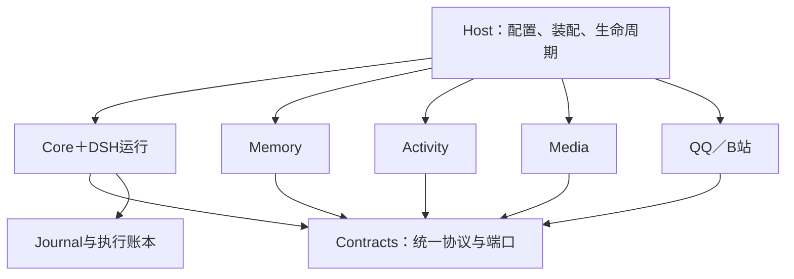
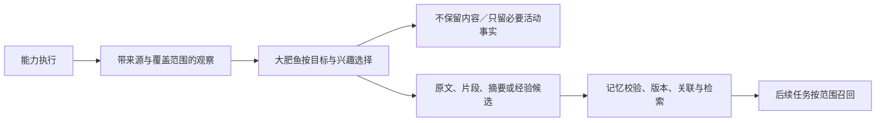

# 大肥鱼统一运行、唤醒与插件协作接口方案

日期：2026-10-24（北京时间）。方案版本：1.2（人格成长与连续性修订）。

状态：**总体设计，按阶段实施，尚未整体完成**。第一阶段1A—1C已完成，1D为中途检查点，后续按各阶段验收判定。本次1.2修订只更新人格成长相关方案与文档、运行既有回归并提交Git，不修改功能代码、配置、运行数据或实例，不连接服务器。

实施进度补充（2026-10-25）：上段保留方案1.2提交时的基线；当前本地开发已完成1A—1F，529项回归通过，详见[第一阶段进度](unified-runtime-phase-1-plan.md)和[Host使用／验收](host-usage.md)。用户已将真实模型及整体验收调整至整体开发完成后，保留[1G样本与门槛](phase1g-deferred-samples.md)并继续阶段2开发；1G未通过，阶段2—8尚未整体完成，未连接或切换服务器。下文各阶段的真实验收出口在统一验收时逐项核验，开发期间继续做程序回归。

初版代码基线为项目`0.19.0`、Git `1046653`；本轮核对`685221c`，包版本未提升。`contracts/core/memory`为`0.15.0`，`channel-qq`为`0.3.0`，`journal/channel-simulator`为`0.4.0`，`timeline`为`0.8.0`。DSH `0.2.1-rc.2`、Cordis `4.0.5`、Node开发基线`24.13.0`。第2节保留初版代码依据；后续实现状态以各步报告及第一阶段方案为准，不把本轮新增设计当作已发布API。

本文确立后续阶段共同遵循的边界、接口语义、迁移原则与验收门槛。各阶段开工前仍需编写该阶段的详细实现方案、迁移清单和测试用例。旧阶段验收继续描述当时实际结果；涉及未来职责分工时，以本文及后续明确修订为准。

阅读指引：第2节核对现状；第3—5节说明归属、依赖与装配；第6—12节定义接口和运行语义；第13—14节说明数据迁移与恢复；第15—16节给出验收矩阵和开发顺序；第17—19节记录版本管理及本次交付边界。

第一阶段已细化为[核心与统一运行入口开发方案](unified-runtime-phase-1-plan.md)，1A—1C及[1D检查点](phase1d-checkpoint.md)已有分步记录。本轮新增[大肥鱼人格成长与连续性方案](persona-growth-continuity-plan.md)：明确稳定底色、阶段人格、独立判断／任务边界、污染防护、压缩接续及新验收，未继续功能开发。

## 1. 已确认的目标与范围

1. 大肥鱼核心拥有智能体身份；能力的使用目的、操作选择、兴趣判断和记忆选择由大肥鱼决定。
2. **渠道接口与能力接口独立**。同一插件可以提供两者，也可以只提供其中一种。具备读取能力不要求注册聊天渠道。
3. 核心、记忆、自主活动是共同支撑大肥鱼的基础模块。QQ、B站等平台插件经统一接口与其协作。
4. QQ 指示、聊天中产生的兴趣、时间或条件触发的自主活动，使用相同的任务与操作机制。自主运行不依赖伪造一条 QQ 消息。
5. QQ 后续补齐记忆与任务整合、浏览观察、自然称呼、群列表同步、长消息分段，以及图片、语音、文件能力。
6. 记忆 E阶段实现经历关联、经验更新、兴趣与关系变化及任务触发整理。记忆插件管理知识与整理规则，自主活动插件安排执行时机，核心协调执行。
7. B站首版必须支持自主搜索、选择视频、浏览真实画面、**理解实际视频音频**、读取字幕、弹幕及评论，并选择是否继续观看、保存原文或片段、形成摘要或经验。
8. B站首版不注册公开评论、弹幕发布等对外发布能力。B站私信不属于本轮确认的首版必需范围；将来接入时单独实现渠道接口并保留既定账号边界。
9. 每一步先设计完整方案，完成开发和验收后更新 Git。现阶段在本机开展；服务器接入是后续独立阶段。
10. 初始固定部分为身份、形象与爱世界的笼统底色；阶段人格通过交流、学习、探索及有依据的修订形成。允许面对恶意回避、反驳或结束互动，负面事实不被强制改写。
11. 兴趣、偏好和看法独立判断；明确任务认真履约并可提出异议。任务受理、业务动机、个人认识和人格更新分别记录；日常探索由大肥鱼在既有范围内安排。

继续遵守：DSH 管理模型循环与原始会话；不新增第二套聊天历史引擎；不记录模型内部思考和凭据；不恢复已清除的历史人格或聊天档案；保留重置后新增真实记忆；每轮调用不按次数截断。任务时间、并发、媒体体积和存储预算与调用次数限制分开建模。

## 2. 现有代码与需要演进的边界

### 2.1 事实依据

本节是`1046653`的初版核对，保留作为改动依据。`685221c`已新增受控生命周期、journal v2／memory v7／runtime v1及1D中途运行适配；未完成的人格服务、Host与后续能力不能由初版或检查点推定已经具备。

| 代码入口／文档 | 当前实现 | 本方案对应变化 |
|---|---|---|
| [contracts/index.ts](../packages/contracts/src/index.ts)，`Extension` | `channels`、`actions`、`contexts` 已分别声明；API_VERSION=2 | 保留分离方向，增加协议协商和独立服务端口 |
| 同文件，`ActionContext`、`MessageSchema`、`Reply` | 操作要求 `conversation/sourceMessageId`；消息及回复主要为文字 | 引入通用执行上下文；聊天来源成为特定触发类型；媒体和交付锚点类型化 |
| [core/index.ts](../packages/core/src/index.ts)，`observationAuthority` | 无活动 ActionContext 时，生产者须拥有对应渠道账号 | 为无渠道能力签发任务／资源范围；不允许插件自造范围 |
| [core/runtime.ts](../packages/core/src/runtime.ts)，`DshRuntime.run` | 输入来自 `PendingMessage`；工具结果用 JSON 文字呈现 | 将运行入口与聊天消息解耦；增加实际图像及媒体分析结果装配 |
| [core/context-runtime.ts](../packages/core/src/context-runtime.ts)及压缩模块 | 上下文、来源记录和压缩跟踪绑定既有会话与入站对象 | 增加任务运行适配；保留旧会话的来源与退出语义 |
| [task-workspace.ts](../packages/contracts/src/task-workspace.ts)、[task-coordinator.ts](../packages/core/src/task-coordinator.ts) | 核心签发原生任务引用、工作票据；任务提供者由记忆插件实现 | 保留不可伪造引用；补充运行、唤醒、执行状态和持久协调 |
| [memory-boundary.ts](../packages/contracts/src/memory-boundary.ts) | 来源场景为 conversation／legacy-route；默认权限是原会话或 none | 增加资源与内部活动场景；旧权限不自动扩大 |
| [observation.ts](../packages/contracts/src/observation.ts) | 观察已区分收到、处理、模型曝光和贡献；要求 conversation；原文类型为 text／digest | 支持无聊天观察、媒体引用、实际覆盖范围和独立选择记录 |
| [memory/index.ts](../packages/memory/src/index.ts) | 注册观察、任务、检索、表达、上下文、压缩等提供者；多项配置显式开启 | 复用现有服务，补 E阶段与通用执行适配，不重新实现已有记忆体系 |
| [analysis-policy.ts](../packages/memory/src/analysis-policy.ts) | 自动分析提交主要接受严格的逐字用户自述；观察贡献另有路径 | 为经历、跨来源经验和兴趣更新设计独立、有来源的提交策略 |
| [task-delivery.ts](../packages/core/src/task-delivery.ts)、[delivery.ts](../packages/contracts/src/delivery.ts) | D3要求原入站问题、目标会话及模拟渠道；发送前多次复查 | 增加真实渠道、任务结果和主动消息的明确交付锚点 |
| [channel-qq/index.ts](../packages/channel-qq/src/index.ts) | 真实文字接入；发送要求缓存中存在原消息；未注册浏览等 actions | 渠道／操作分别实现；增加主动读取和不依赖引用消息的授权交付 |
| [local-host.mjs](../scripts/local-host.mjs)、[run-local-qq.mjs](../scripts/run-local-qq.mjs) | 验收入口装载核心、渠道及可选时间线，没有完整记忆／活动装配 | 新增正式 host 装配层，保留现有验收驱动 |
| DSH 本地 `dsh-llm/lib/types/types.d.ts` | 有结构化 ImageBlock、FileBlock；文件会投影为句柄文字；模态能力由路由披露 | 复用 DSH 图像／附件机制；文件须解析后才能声称已理解；音频另接实际处理服务 |

代码有媒体类型不等于完整媒体管线已经实现。[1A](phase1a-adaptation.md)后来已验证真实图像、本地语音／声音事件及DSH来源通路；B站媒体取得与完整组合仍未验证。本次人格文档修订未调用这些模型或平台。

### 2.2 已有能力的保留范围

保留会话五元组键、入站去重、操作因果关系、插件卸载撤销、上下文预算、旧贡献退出、记忆版本与删除屏障、跨场景内部使用与对外表达分离、D2干净重建、D3正文绑定凭据。新接口必须同时验证允许路径和拒绝路径。

现有 QQ 基础真实验收见[第二阶段验收](phase-2-acceptance.md)；最新任务交付仅为模拟渠道验收，见[D3记录](agent-memory-phase-d3.md)。不能把两者合并描述为新版完整真实 QQ 验收。

## 3. 领域概念与数据归属

| 概念 | 含义／不变量 | 责任模块 |
|---|---|---|
| Agent | 稳定的大肥鱼身份；一次部署、一次唤醒不生成新人格 | 核心 |
| PersonaSnapshot／PersonaManifest | 底色快照与独立的本轮阶段／来源／连续性采用清单；旧快照格式保留 | 核心；阶段与成长内容由记忆提供 |
| StageProfile／GrowthCandidate | 有来源、反证、适用范围的阶段条目与候选；不自动覆盖底色 | memory管理状态，大肥鱼经核心决定 |
| TaskIntent／ContinuityCheckpoint | 任务动机／异议与接续引用；不竞争Task目标或DSH历史 | 核心语义＋memory持久化 |
| Conversation | 与特定对象交流的 DSH 会话；同群成员共享群会话，不共享其它群原文 | 核心＋渠道 |
| Task | 跨时间的目标、状态和选中证据；可包含多个 Run | 核心拥有任务语义，既有任务仓储提供持久化 |
| Run | 一次实际运行尝试，有触发来源、上下文、执行与中断状态 | 核心 |
| WakeOccurrence | 一次确定的唤醒机会；重复投递不能创建重复 Run | 自主活动生成，核心持久接收 |
| Schedule | 活动安排及版本；保存何时／何种条件唤醒，不复制长期兴趣正文 | 自主活动 |
| Observation | 实际取得、处理和曝光的材料及覆盖范围；不是已经采纳的知识 | 能力产生，核心核验来源，记忆管理留存 |
| Contribution | 大肥鱼选择保留的原文、片段、摘要、发现或经验候选 | 记忆 |
| MediaAsset | 可定位、可授权读取的媒体及版本；URL或文件名不等于模型已看过 | 媒体服务＋来源能力 |
| DeliveryIntent | 面向确定目标的一次交付意图；与运行完成、模型产出分别记账 | 核心；渠道持有平台回执事实 |

任务定义与已有 `task_workspaces` 暂不搬库。将其封装为核心领域的 `TaskRepositoryPort`，由记忆侧兼容适配器实现；任务创建、目标和生命周期变更统一经过核心，记忆服务不能另建一份竞争的任务状态。新 `runtime.sqlite` 只保存 Run、唤醒接收与执行事实，不再复制一份权威 Task 目标／状态。记忆整理任务、活动安排和交付各自保存自己的状态，并以稳定 ID 关联。

每项可变领域对象采用版本检查；修改追加必要历史与事件。同一幂等键、相同参数返回原结果；相同键、不同参数报冲突。发生时间、观察时间、记录时间与程序顺序分开；并发先后不自动被解释成因果。

## 4. 模块依赖与装配

### 4.1 依赖原则

下表是目标依赖，不要求本次重写包结构。`port` 指 contracts 定义、运行时注入的接口。

| 包／模块 | 可依赖 | 不承担的职责 |
|---|---|---|
| contracts | 校验库、无副作用类型／值对象 | DSH运行实例、数据库、平台网络调用 |
| journal | contracts、SQLite | 决定兴趣、调度活动 |
| core | contracts、journal、DSH服务；注入的任务／记忆／活动／媒体端口 | QQ/B站协议、平台解析、记忆整理算法 |
| timeline | contracts、DSH会话查询、核心证据访问端口 | 取得全库授权或重新执行历史动作 |
| memory | contracts、持久化与时间线／核心端口、DSH分析机制 | 平台抓取、自己的周期定时器、另一套主模型循环 |
| activity（拟新增） | contracts、核心唤醒端口、自己的持久存储 | QQ/B站实现、记忆合并算法 |
| media（拟新增） | contracts、DSH附件／模型端口、受管理解析工作进程 | 人格、兴趣、任务选择 |
| QQ、B站能力 | contracts、平台适配器、注入的执行／观察／媒体端口 | 直接读写记忆库、直接调用其它能力内部源码 |
| host（拟新增） | 具体插件与DSH实现 | 新模型循环、业务兴趣判断 |

现有平台包对 core 的依赖包含类型扩展和服务绑定。演进时将公共服务类型移至 contracts，或保留显式的类型兼容出口；不得形成 core→memory→core 的实现导入环。通过端口的双向运行协作不等于允许源码循环依赖。



图中箭头表示静态依赖／装配关系。运行时由核心连接已注册的端口，不让能力插件寻找另一个插件的数据库文件。

### 4.2 启动与关闭顺序

1. Host解析配置，校验路径、协议、必需服务、模型路由和数据版本；取得单宿主及账号占用。路径比较须处理Windows大小写、符号链接／目录联接，避免同一数据目录被两种路径重复占用。
2. 加载DSH会话、持久化、模型、提示词、工具与查询服务；启动核心但保持外部接收和唤醒准入关闭。
3. 注册时间线、任务仓储兼容端口、记忆、媒体、自主活动及平台插件。先注册和恢复，再启动外部事件连接与定时投递。
4. 检查就绪条件、来源追踪和唯一压缩写者；恢复未完成状态及审计outbox。恢复过程不触发历史操作。
5. 开放渠道接收及活动准入；记录配置／插件版本清单与启动结果。
6. 关闭时先停止新输入和新唤醒，再取消或排空运行及发送，持久保存状态，最后按依赖逆序关闭提供者和DSH。

必需服务缺失时不进入 ready。可选服务故障显示 degraded，并撤下对应能力；不能继续暴露一个实际不可执行的工具。完整大肥鱼配置将记忆列为必需；启用主动活动时 activity也是必需。最小测试配置可以显式关闭这些功能，不能被称为完整运行配置。

中途卸载提供者时撤销旧注册实例的句柄、上下文和未完成票据。重新注册相同插件名称不能自动复活旧授权。

## 5. 统一配置、人格与成长状态

配置分三层，路径与凭据引用分开：

| 层 | 内容 | 修改与生效 |
|---|---|---|
| 系统装配 | agentId、数据目录、插件、账号绑定、模型与媒体服务、权限基线 | Host校验；需重载的项受控重载 |
| 行为配置 | 默认活动节奏、安静时段、通知偏好、场景覆盖规则 | 版本化；大肥鱼只能修改明确开放的行为字段 |
| 持续状态 | 兴趣、关系、经验、任务、活动计划、记忆和交付事实 | 各责任模块持久化；不被配置模板覆盖 |

配置覆盖顺序为全局默认→渠道→会话；覆盖规则只能在基线允许范围内收窄权限，不能以会话配置扩大权限。诊断返回生效值、来源与生效时机，遮蔽凭据。模型路由固定在每次运行快照中；语音／视觉等辅助角色可使用单独路由，但由受信配置选择，不由网页、记忆或模型参数指定任意供应商。

身份与爱世界的底色从明确文件读取并记录哈希；正式文件按[人格成长方案](persona-growth-continuity-plan.md)后续新建，不采用用户已拒绝的管理中心旧人格。具体兴趣、偏好、关系认识形成可修订的阶段状态，临时态度单独管理。旧`persona.fixedFile`字段兼容保留，不向其中写入动态记忆。

底色和新阶段版本默认下一Run采用；当前Run清单固定，但来源删除、更正、撤下或权限收紧立即使相关依赖失效。日常显式候选／试行／采用不逐项要求人工审批；底色和授权修改不属于普通成长接口。活动计划由activity保存，以来源和版本引用兴趣。

兴趣、偏好与看法可以同用户不同；明确任务按约定执行，可提出方法建议或阻断异议。用户保留可行且已授权的原方案后继续执行。任务要求改变当次行动，不直接改变人格；指定观看、委托立场及交付赞扬必须与自主偏好证据分开。

正式验收覆盖底色边界、独立判断与履约、阶段更新、污染防护、完整／压缩／重启对照和范围适配。采用人格方案第12—13节的矩阵与样本协议；程序负责可确定的事实和权限，模型评审仅辅助，人工评价不以迎合或固定口吻作为通过条件。没有证明主观体验或永久情感不变的验收承诺。

未来配置至少包含：`schemaVersion`、`agent`、`paths`、`modelRoutes`、`plugins`、`authorityPolicies`、`context`、`activity`、`media`、`channels`、`observability`。`paths`相对配置根目录解析；现有数据目录通过迁移映射明确复用。示例配置只引用凭据名称，不包含凭据值，不默认为用户创建或复制真实登录态。

1A已取得图像、语音识别和声音事件探针证据；启用B站完整观看时仍须核对实际路由与完整媒体处理。缺少必需模态只能报告缺口，不能把文字降级当作完整观看。本次文档修订不调用外部模型。

## 6. 协议演进、身份与执行上下文

### 6.1 协议版本

规划扩展协议 v3，包版本与协议版本分开。首次实施时发布严格运行时Schema、协议特性表和v2兼容适配器，再逐个迁移消费者。本次不更改现有 `API_VERSION=2`。

| 接入形式 | 允许行为 |
|---|---|
| v2扩展＋v2兼容入口 | 保持当前文字、会话范围和旧交付语义 |
| v3扩展 | 按声明特性使用通用运行、观察、媒体和交付接口 |
| 未知版本／缺少必需特性 | 注册失败，并说明缺失项 |

v2 ActionContext只能由具有真实聊天来源的新运行投影得到；纯自主任务调用v2聊天专属能力时返回 `unsupported_execution_origin`。不能创建假入站记录满足旧字段。协议升级同时升级持久数据读取器；类型通过不代替恢复测试。

### 6.2 通用上下文

以下为接口形状示意，精确导出名在阶段1实现方案中冻结。所有品牌化句柄由核心在程序内签发；持久ID只用于定位，不单独授予权限。

```typescript
type ExecutionOrigin =
  | { kind: 'message'; inboundId: string; conversation: Conversation }
  | { kind: 'native'; producerId: string; requestId: string }
  | { kind: 'wake'; occurrenceId: string; scheduleId: string; scheduleVersion: number }
  | { kind: 'continuation'; parentRunId: string; checkpointId: string }
  | { kind: 'maintenance'; requestId: string; producerId: string };

type SceneRef =
  | { kind: 'conversation'; conversation: Conversation }
  | { kind: 'resource'; providerId: string; namespace: string; resourceId: string }
  | { kind: 'internal'; agentId: string; activityId: string };

interface ExecutionContext {
  readonly agentId: string;
  readonly taskId: string | null; // 普通聊天可为空；内部任务必须绑定Task
  readonly runId: string;
  readonly operationId: string;
  readonly origin: ExecutionOrigin;
  readonly intentVersion: number;
  readonly grant: ExecutionGrantHandle;
  readonly signal: AbortSignal;
}
```

`Conversation`沿用现有结构；`ExecutionGrantHandle`是不透明授权句柄。场景、触发、模型运行会话和交付目标是不同概念：QQ触发的B站阅读，其触发场景是QQ，视频来源是B站资源，内部分析使用独立DSH任务会话，最后交付目标可为原QQ会话。

每个操作上下文还由核心私有记录绑定插件实例、操作定义版本、真实请求主体、授权版本、实际输入依赖和有效期。操作参数不接受调用者覆盖这些字段。克隆上下文、换一个taskId、复制来源URL或昵称，都不能取得新授权。

授权包含允许的操作、来源范围、内部使用范围及对外数据出口。检索词、工具参数和上传附件也是出口：允许内部读某份私有材料，不等于允许把其中内容作为B站搜索词或发给不相容的辅助服务。由核心在调用前按来源与目标校验，不仅在最终回复时检查。

公共资源的来源身份不自动授予全库读取权限。能力可在其账号／平台允许范围内发现新资源，经已授权操作生成来源证明；它不能通过报一个 `SceneRef` 把私人聊天标成公开资源。混合输入继承全部实际曝光依赖。

### 6.3 注册清单与生命周期

v3扩展清单至少声明 `id/version/protocolVersion/agentId`、提供与需要的服务特性、渠道列表、操作列表和上下文贡献。渠道和操作分别注册，名称空间冲突、账号重复占用、模型／媒体必需特性不匹配均在开放输入前拒绝。

核心返回按插件实例绑定的注册句柄，包含对应的接收、观察、任务协作和注销端口。无渠道插件可在核心授予的Run范围中使用能力／观察端口。安装插件、提供服务或拥有同名ID，都不等于获得全部记忆和发送目标。

现有同进程插件仍属于受信代码；本方案的接口约束不能阻止恶意插件自行访问进程内存或磁盘。解析器／解码器可由媒体服务管理独立工作进程；不把插件化本身描述成操作系统沙箱。

## 7. 渠道、能力与公共服务端口

### 7.1 渠道端口

| 接口（拟） | 输入与结果 | 关键约束 |
|---|---|---|
| `registerChannel(descriptor, adapter)` | 渠道／账号、支持的消息部件与发送能力；返回接收句柄 | 注册不立即开始接收；Host统一开放 |
| `ingest(envelope)` | 平台稳定消息ID、真实发送者、会话、发生时间、类型化内容；返回持久接收回执 | 账号与范围由注册身份核验；重复事件不重复唤醒 |
| `reportTransport(event)` | 连接、缺口、账号变化、入退群等事实 | 与内容观察分开；报告事件不默认调用模型 |
| `validateTarget(target, context)` | 目标、账号及当前成员／关系状态 | 核心排队后和实际发送前均复查；平台无法核验时明确失败 |
| `send(envelope, deliveryContext)` | 不可变正文／附件清单、意图ID、分段ID和目标；返回明确回执或未知状态 | 只有核心交付端口能签发调用上下文 |

入站内容拟采用 `text/image/audio/video/file/reference` 的判别联合；内容部件引用受管理媒体，不让模型随意访问任意本地路径。平台消息ID按字符串保存，避免大整数精度丢失。平台支持的输入、输出、引用、长度与附件类型分别声明。

接收、允许唤醒、实际被模型读取、进入记忆是四个不同状态。群中普通消息可以进入有界观察缓冲，而不为每条消息唤醒模型；定向消息按触发规则进入核心。缓冲游标、读取窗口和保留期由QQ方案明确，不承诺恢复平台未保留的离线历史。

“浏览QQ消息”“读文件”“读取视频评论”属于操作能力，不通过渠道 `ingest` 重放历史。它们返回Observation和游标，不把读到的每条旧消息重新作为用户指令。

### 7.2 操作端口

```typescript
interface ActionDefinitionV3<Input, Output> {
  readonly id: string;
  readonly version: string;
  readonly inputSchema: JsonSchema;
  readonly outputSchema: JsonSchema;
  readonly effects: 'read' | 'local-write' | 'external-write';
  readonly requiredFeatures: readonly string[];
  execute(input: Input, context: ExecutionContext): Promise<ActionResult<Output>>;
}
```

`JsonSchema`和`ActionResult`是拟契约类型；实施时同时提供严格运行时验证器。核心验证模型参数、身份与范围，插件验证平台输入／输出；输入Schema不允许附加任意字段。v3支持对象、数组、数值、布尔和媒体引用，逐步替代当前“所有参数都是字符串”的接口；v2适配保持旧解析语义。

`ActionResult`至少包含：执行状态、实际副作用状态、完整／部分结果、结构化数据、来源引用、媒体引用、平台回执和稳定错误码。插件不会因记忆归档失败而重新执行已经产生副作用的操作。核心记录实际操作与结果，模型对结果的概括不作为执行凭据。

只读不代表没有网络成本或没有数据出口。只读操作可按已声明策略对明确的临时故障退避；外部写入仅在“明确未执行”且策略允许时重试。未知结果保留证据，禁止通过换requestId绕过去重。超时／取消必须贯穿客户端和解析工作进程；忽略AbortSignal的同进程插件不能被声称已经强制终止。

### 7.3 跨插件公共端口

| 端口（拟） | 所有者 | 作用 |
|---|---|---|
| `ExecutionPort` | 核心 | 提交任务、启动／恢复Run、取消与查询；模型只获得受控工具投影 |
| `TaskRepositoryPort` | 核心领域，旧任务仓储兼容实现 | 版本化任务定义与状态；保留已有工作项、结果槽及证据绑定 |
| `EvidencePort` | 核心＋timeline／来源提供者 | 统一回查、来源版本与访问检查 |
| `MemoryPort` | 记忆 | 观察提交、选择贡献、检索、分析、整理与来源变化 |
| `ActivityPort` | 自主活动 | 活动计划的建立、修改、暂停、取消、查询与到期投递 |
| `MediaPort` | 媒体 | 取得／解析指定媒体、分段理解、结果与覆盖查询 |
| `DeliveryPort` | 核心 | 目标绑定、人格整理、正文凭据、发送与回执查询 |

所有方法由已注册服务对象调用，不以网络上可自由构造的“万能调用JSON”暴露。模型工具入口只允许业务参数；授权、执行器身份和实际来源由核心补齐。操作完成后需要异步回调时使用固定Run／工作票据，不保留已经结束的ActionContext。

### 7.4 端口请求、回执与错误契约

下表固定方法语义与必需信息；名称可在实施方案中统一调整，不能省略幂等、范围或版本条件。模型工具投影只接受可编辑业务字段；origin、grant、actor、插件实例与真实来源均由核心绑定。

| 方法族（拟） | 必需请求信息 | 持久结果／读取结果 |
|---|---|---|
| `execution.submit` | requestId、已有task引用或新目标、触发绑定、选中输入引用、所需能力；权限请求仅能收窄 | taskId、runId、受理状态、重复标记；受理不等于执行完成 |
| `execution.status/cancel/resume` | task／run引用；变更带requestId与expectedVersion；恢复指定已核验检查点 | 当前状态与版本；取消回执；恢复创建新Run并关联旧Run |
| `execution.acceptWake` | 固定occurrenceId、计划ID／版本、dueAt、原因引用、受信activity身份 | 持久接收ID、唯一runId或明确拒绝原因 |
| `tasks.create/update` | requestId、目标／标题；更新带task引用与expectedVersion | Task引用与新版本；模型不会获得仓储内部读取句柄 |
| `activity.create/revise` | requestId、计划目的、触发、兴趣／task引用、时区、错过时机策略；修改带expectedVersion | scheduleId、version、effectiveNextDue、状态 |
| `activity.pause/cancel/status` | 计划引用；修改带requestId与expectedVersion | 新计划版本或当前可见状态；未完成机会的处置另列 |
| `memory.recordObservation` | requestId、执行绑定、来源批次、覆盖／曝光清单、保留方式、结果状态 | activityId、来源引用／版本、审计状态；不声称长期知识已提交 |
| `memory.contribute` | requestId、观察引用／版本、选择方式、源片段或有依据候选、兴趣／task依据 | 贡献ID、记忆ID／版本或候选状态；拒绝项保留原因 |
| `memory.recall/open` | 查询／引用、用途、选区、上限；当前上下文签发范围 | 有版本／范围的结果、游标与可选证据证明；查询不能覆盖scope |
| `memory.requestMaintenance/consolidate` | 固定请求ID、输入水位、范围、原因；执行时附Run上下文 | 整理任务ID、输入快照、状态、采用结果和处理水位 |
| `media.acquire/inspect` | 获准的来源对象引用／版本、所需区间与保留策略 | assetRef、实际取得区间、格式与缺口；未处理状态明确 |
| `media.readImages/readAudio/readDocument` | assetRef／版本、区间／页码、任务用途、配置的服务角色 | 派生证据引用、实际曝光／处理范围、服务版本与不确定性 |
| `delivery.prepare/submit/status` | 固定requestId、交付锚点、目标、表达材料引用；调用者不自造发送凭据 | deliveryId、状态、分段状态及回执；准备不授予任意外部发送权 |

所有变更使用作用域内的幂等键和参数指纹；读取游标绑定主体、范围、查询和快照，不能跨任务／场景复用。观察与媒体清单使用有界批次和可回查manifest；容量满时分页或拒绝，不截断依赖证明。运行时限制及默认值在各阶段Schema中明确，不能由模型自行提高上限。

操作结果统一区分 `succeeded/partial/failed/cancelled/unknown`，并单列 `effects=none/confirmed/unknown`、数据完整性和实际回执。例如，外部发送完成但归档失败可以是报告失败且effects=confirmed；不能由失败状态推导“无副作用”。查询对象不存在和无访问权按既有隐私规则返回相同可见分类。

错误至少覆盖 `invalid_input`、`unsupported_protocol`、`dependency_unavailable`、`unsupported_execution_origin`、`scope_denied`、`version_conflict`、`idempotency_conflict`、`source_stale`、`capacity_exceeded`、`cancelled`、`media_unavailable`、`provider_unavailable`、`persistence_failed`、`effect_unknown`、`delivery_unknown`。公开错误返回稳定code、可解释状态和correlationId；详细诊断留在相应受控范围，不能把原始异常堆栈或秘密参数直接交给模型。

## 8. 核心任务、Run与DSH会话

### 8.1 三类运行入口

1. **聊天入口**：渠道持久接收→核心判断触发→绑定原会话→大肥鱼回复或建立任务。
2. **任务入口**：大肥鱼从聊天或已有任务中建立子任务／持续任务→核心签发Run→使用内部DSH任务会话执行。
3. **自主入口**：自主活动持久投递WakeOccurrence→核心去重接收→大肥鱼评估当前兴趣、未完成事项与环境→执行、改期或休息。

三个入口统一使用DSH Agent／Session／Tools。继续调用现有DSH服务管理运行，不新增while循环接管模型推理。任务状态机只管理外部工作流和恢复。

自主事件在DSH中携带明确程序来源标识；不能标成真实用户发言，也不能借“内部来源”获得额外权限。使用安装版本支持的持久消息／插件记录扩展；阶段1以保存后重开会话的测试验证该映射。

### 8.2 会话选择与人格连续性

- 普通聊天沿用原五元组与原DSH sessionId。
- 内部Run使用独立任务会话；同Task恢复时通过持久映射找到其工作会话和已核验状态。哪些材料装配由当前授权与来源版本决定。
- 无关任务不合并到一个无限增长的后台聊天；每次恢复都明确taskId、intentVersion与运行原因。
- 稳定身份与底色由核心装配，各会话取得同一阶段状态的合法投影；成长资料与任务证据按用途选择，不把全部私人记忆塞进所有会话。
- 对外结果进入目标人格会话重新整理；内部分析上下文不直接当作群聊回复上下文。

### 8.3 状态、并发与恢复

Task沿用active／paused／completed等领域状态；Run拟使用下列状态。Run状态不能代替Task状态、操作副作用状态或交付状态。

| Run状态 | 行为与恢复 |
|---|---|
| accepted／queued | 已落盘，尚未执行；重启后按当前授权、计划版本和时效重新准入 |
| running | 执行中；重启转interrupted，先核对已完成操作和未知副作用 |
| waiting | 等待明确条件／外部结果；持久保存等待原因与关联，不占用模型循环 |
| cancelling | 已请求取消；等待合作式收尾，不声称已撤销外部动作 |
| completed | 运行结果已持久化；对外消息可能尚未发送或选择静默 |
| failed／cancelled／interrupted | 保存分类及检查点；不得自动重放不确定的写入操作 |

运行建立与唤醒接收回执在核心执行库同事务提交。操作开始先落盘，之后执行；完成后保存结果。新Run恢复旧Task时只使用明确检查点；纯读取可重新验证后再次读取，已确认写入不得重做，未知写入进入核对状态。

已有memory侧 `task_jobs` 继续承载固定输入证明和结果槽提交状态，新Run负责执行尝试，两者以稳定workId关联。开始工作、核心受理和结果提交之间使用持久请求／回执及补录，避免跨库中断生成两个实际执行者。内存工作票据不跨重启恢复；旧running工作保留interrupted，新的Run重新取得当前有效票据。

Task完成后禁止启动新的工作操作，但可保留用途明确、尚未撤销的结果交付资格。任务完成、请求取消与表达授权撤销分别检查；不能因为把Task标为completed就丢失已准备的合法汇报，也不能以“补发结果”为由继续执行新工具动作。

同一个聊天会话的输入与交付保持串行；内部任务可并行但受可配置资源并发约束。同一结果槽沿用版本竞争规则。聊天交互优先于一般后台探索；暂停发生在可恢复边界，正在进行的平台副作用必须先得到结果或标为未知。后台任务使用等待年龄等可配置策略获得机会，避免持续聊天使其永久饥饿。

### 8.4 上下文、压缩与事件

`ContextRequest`、`OperationScope`、`CompactionScope`、`SourceDependency`要一起演进，不仅修改ActionContext。新作用域显式携带execution／session／scene和授权引用；现有conversation route保持可读且不可串用。

每轮记录实际人格、模型、插件、上下文条目与来源版本；媒体另计字节、图片数、音频／视频区间和服务用量。不能把BGE tokenizer或统一字节估计当成全部模态的精确计费量。超预算需分批、缩小选区或暂停，不静默删掉限定条件。

已有来源失效、临时材料退出、多代摘要回原文机制继续使用。媒体分析的派生文字也绑定媒体版本与实际曝光区间；源失效时退出依赖它的材料。目标上下文仍由同一个受控装配器协调，专用压缩与宿主另一压缩写者不能同时启用。

Journal新事件至少能区分conversation／task／activity范围，保留eventId、traceId、taskId、runId、operationId、causedBy和schemaVersion。普通会话时间线不得因为统一日志增加任务事件而获得内部任务正文。领域库outbox以稳定eventId补录，事件正文不复制完整候选、媒体字节或秘密参数。

## 9. 自主活动与唤醒协议

### 9.1 活动安排

`Schedule`包含：scheduleId、agentId、版本、目的、兴趣／任务引用、触发类型、时区、下次到期时间、频率策略、安静时段、错过时机的处理、状态、配置约束版本和最近运行结果。

支持一次时间、周期时间和注册的领域条件。条件以类型化事件与可验证字段表达，例如任务结束、观察积累水位、新证据、资源恢复；不接受任意脚本、SQL或网页提供的表达式。

大肥鱼可通过工具建立／修改／暂停／取消自己的活动，使用expectedVersion防止覆盖新安排。自主调整在已经配置的时间、资源和通知范围内直接生效，不增加每次活动的人工审批。扩大数据访问或外部操作范围仍由独立的权限配置决定。

activity保存活动目的和兴趣引用；兴趣内容、来源与变化由记忆保存。兴趣更新可以触发大肥鱼重新评估安排，但不由记忆插件直接改activity数据库。

明确任务依时限／重要性协调优先级，自主探索可保存进度后让出资源并接续；不得无限拖延已接受任务。任务安排不写入长期偏好，业务动机独立于wake等技术触发来源。时间／条件整理仍由activity安排，memory执行内容处理，core签发权限和运行。

### 9.2 WakeOccurrence与持久握手

到期记录至少固定 `scheduleId/scheduleVersion/occurrenceId/dueAt/reasonRef`。一个到期机会生成一个持久ID；重启、重投和收到迟到确认不生成新的机会。

1. activity在同一事务内记录到期机会、推进调度游标、写入投递outbox。
2. 向核心 `acceptWake` 投递固定ID及计划版本；核心验证发起插件、当前计划与许可后，把接收回执和唯一Run写入同一事务。
3. activity丢失确认时重投同一ID；核心返回原Run。拒绝／取消也是可持久确认的终态。
4. Run完成事件以稳定ID返回activity；重复完成事件不重复推进计划、不重复创建后续任务。

计划在排队期间改变或取消，旧机会失效；执行中的活动按当前取消政策收尾。传给核心的是唤醒原因和受控引用，不是由调度器生成的新用户指令。

时间以UTC存储，日历规则另存时区，默认沿用配置的Asia/Shanghai。周期计算保留原到期锚点；时钟回拨、跳跃和夏令时不能制造重复机会。用可注入时钟覆盖这些测试。错过时机支持skip／coalesce／run-once；初始默认coalesce，不在开机时补跑每一次历史到期。

### 9.3 空闲、退避与防止自触发循环

调度器检查时间和事件本身不调用生成模型；到期且获准后才唤醒大肥鱼。大肥鱼可以决定没有值得做的事，更新安排后休息。

同类未完成活动可合并，重复条件事件按源事件ID和水位去重。失败使用原因分类、退避和恢复条件；来源未变化的失败任务不持续紧密唤醒。记忆整理生成的摘要／活动安排更新等派生事件必须带causedBy和originKind，不能反复触发自身。

保留每轮不限调用次数。最小唤醒间隔、活动并发、时间预算和资源预算是可观测的调度参数，必须在阶段方案中定义默认值及调整入口，不以隐藏的工具调用计数实现。

进程存活时由activity计时。进程退出后，内存定时器无法唤醒自身；Host的系统启动／进程守护负责恢复进程，再由持久Schedule恢复活动。不得把插件定时器描述成能开机或从系统关机中唤醒。

## 10. 观察、兴趣选择与记忆 E阶段

### 10.1 观察与选择分离



生产者如实报告已获取、已处理和已交给模型的材料；大肥鱼决定贡献选择。插件可执行机械筛选、分页或受委托的摘要，但不维护一套独立的长期人格兴趣。当前v2合并观察与贡献的入口继续由兼容适配器使用；v3提供 `recordObservation` 和 `contribute`，允许分时完成，以同一activityId与来源版本关联。相同批次联合提交时可保持事务原子性。

观察新增 `executionRef`、`sourceScene`、资源稳定身份、版本、原始／派生性质、媒体引用、实际曝光清单及覆盖信息。能力可以只贡献摘要而不长期保存全部原文；必须标明原文是否可再次取得，不能承诺已丢弃的内容可逐条恢复。

对于视频，分别记录画面帧时间点、音频区间、字幕区间、弹幕时间范围和评论分页／采样条件。下载整个文件、解码全部声音、抽取若干帧和模型理解完毕是不同事实。

贡献选择保存决定者为大肥鱼、所依据的任务／兴趣版本、选择方式与简短决定说明；不保存模型内部思考。没有贡献也可保存必要活动事实。长期贡献受到全部实际输入依赖约束，不能只保留最终引用的几条来源而丢掉私有输入限制。

### 10.2 E阶段内容与提交策略

E阶段先实现有明确用途的关系：经历属于任务、支持／反证、修正／替代、同一已核验实体及兴趣相关。区分程序记录的因果、明确来源关系和模型提出的关系候选；不把相同名字或时间接近直接当成同一人物或因果。

经验记录至少包括当时目标、观察、行动、实际结果、适用条件、反例／未知与后续修正。一次失败形成有条件的经验，不直接提升为永久规则。兴趣变化以版本与来源记录，保留暂时好奇、持续兴趣及显式偏好等区别。

保留当前literal-evidence-v1策略用于它适合的用户自述；新增观察事实、受限摘要和经验候选策略。候选结构、证据、来源版本、冲突及范围由程序校验；模型提供分析建议。`needs_review`表示需要进一步比较／分析，不自动等于必须人工审批。

外部材料、作者观点、模型推测和大肥鱼的实际经历分开标记。检索相关性不授予真实性。摘要不能因为经过多次整理而失去“尚未确认”“仅适用于本任务”等条件。

阶段人格采用人格成长方案中的候选、试行、采用、修订／撤下流程，保留支持、反证、根来源谱系和实际输入限制。任务服从与偏好形成分开；摘要循环不新增独立证据；压缩保留约定、未决异议和缺口。1E先实现这些状态与显式端口，自动经历归纳和候选比较仍在本E阶段开发。

### 10.3 记忆整理端口与职责

| 端口（拟） | 内容 |
|---|---|
| `assessMaintenance(eventOrWatermark)` | 记忆按自己的规则判断需要整理的范围与原因；轻量判断无需每次调用模型 |
| `requestMaintenance(spec)` | 生成固定请求ID、输入水位、范围、原因和有效期，经核心提交到活动调度 |
| `consolidate(request, executionContext)` | 执行检索、关联、分析和提交；使用固定来源快照并在提交前再验证 |
| `maintenanceStatus(id)` | 返回状态、处理水位、采用／拒绝数、稳定错误及下次条件；不泄漏未授权正文 |

记忆决定“整理什么、如何整理”；activity决定“什么时候安排”；核心决定“以何种任务身份、优先级与资源执行”。条件既可以来自任务结束等核心事件，也可以来自记忆积累水位。请求本身持久化后才确认受理；调度不可用时显示waiting-scheduler，按需显式整理仍可执行。

删除、更正、权限收紧及来源不可用必须立即影响授权和旧材料有效性，不能等待整理任务。关系重建和索引清理可异步执行，但旧数据在清理前已经不能被正常召回。恢复记录推进版本，不复活旧任务票据、摘要或交付凭据。

## 11. 共用媒体接口与B站音画理解

### 11.1 媒体引用与处理链

`MediaAssetRef`至少包含受管理assetId、来源资源／版本、内容哈希、媒体类型、体积、时长或尺寸、取得时间、访问范围和可用状态。临时下载URL、Cookie和本地绝对路径不进入公开记忆或统一日志；模型使用受控句柄，不能借媒体接口任意读文件或带凭据访问其它域名。

拟提供：`acquire`、`inspect`、`readImages`、`readAudio`、`readDocument`、`status`、`release`。平台插件负责解析平台对象并取得允许访问的媒体，媒体服务负责通用解码、分段、识别和引用；两个阶段分别保存结果与错误。

源文件与派生帧／音频片段分开记录，以来源哈希、区间、处理策略和模型版本作为缓存身份。先将完整文件或片段原子写入受管理目录，再发布可用引用；失败留下可清理暂存，不发布指向半文件的有效引用。缓存清理不能删除仍被有效任务引用的材料；逻辑删除和物理回收分别记录。

外部来源变更通过能力刷新、平台事件或版本核验发现后传播；系统不声称实时感知外部所有删除。无法重新取得的来源标记unavailable，保留最后验证时间，按既定有效期与用途限制使用，不能自动当成仍然最新或永久删除。

解码与文档解析支持受管理工作进程、取消、时间和内存预算。大视频按需取得区间，避免把完整视频、全部帧和音频同时驻留内存。辅助分析返回结构化可见结论和实际来源，不保存内部思考。

### 11.2 画面、声音、字幕分别举证

| 来源 | 首版要求 | 必须记录 |
|---|---|---|
| 视频画面 | 按时间点／区间取实际图像；可按兴趣继续、回看或加密取样；真实图像进入视觉路由 | 帧时间点、采样方式、图像哈希、实际送入模型的帧、未覆盖区间 |
| 视频音频 | 取得真实音轨；理解讲话内容，并对支持的关键非语言声音给出观察；与画面对齐 | 音轨／声道、实际处理区间、转写时间戳、声音事件、缺失／不确定情况 |
| 字幕 | 独立读取并保留语言、轨道与覆盖范围 | 原平台字幕／自动字幕身份；不冒充音频直接证据 |
| 弹幕 | 按时间段读取，支持采样和继续读取 | 时间范围、数量、筛选、分页或段号 |
| 评论 | 按排序、楼层／回复关系读取，支持继续读取 | 评论ID、页面／游标、排序与缺口 |

音频理解可由“实际音轨→语音识别→带时间戳文本→语义理解”与声音事件分析共同实现；有原生音频模型时可由对应适配器实现。仅有转写时，不声称已识别音乐、环境声或其它未处理声音。首版验收包含讲话内容及可辨识的关键声音事件，具体服务与支持清单须通过真实探针冻结。

视觉、ASR和声音事件服务可分别配置；不默认当前聊天模型支持全部模态，也不默认在服务器加载大型本地模型。沿用DSH支持的适配机制；当前没有原生音频内容块时通过MediaPort执行真实音频处理，再提供有来源的结果，不能把音频字节塞入普通文字请求。

多模态整合保留每条结论的支持来源及时间对齐。字幕、声音和画面矛盾时保留差异；模型未取得某一模态时标记缺口。取样范围可以逐步扩大，但只有实际覆盖才能计入“已观看／已听取”。

文件引用的存在不等于读过文件；按声明支持的格式解析后返回页码、段落或表格范围。QQ语音理解复用音频通路；语音回复另需声明实际可用的合成服务。图片和文件发送是已有材料的交付能力，不自动意味着具备图像生成或任意文件生成能力。

### 11.3 B站首版能力组合

平台操作按搜索／发现、读取视频元信息、打开媒体、查看指定区间、读取字幕、读取弹幕、读取评论组织。可提供便捷组合操作，但仍返回实际步骤、覆盖与可继续读取的位置；“下一步看什么”由大肥鱼决定。

两种必需入口：

1. QQ收到“去B站看看……”或聊天中大肥鱼产生兴趣→核心建立任务→调用同一B站能力→观察与选择记忆→按任务要求回原人格会话汇报。
2. activity到期→核心唤醒→大肥鱼依据兴趣选择B站活动→调用同一B站能力→更新记忆和活动计划；可以静默结束，也可以在既定通知范围内安排汇报。

大肥鱼决定是否记住某次观看。插件不将所有评论、弹幕、视频和音轨永久保存为记忆。能力描述明确可读、可分析范围；不注册评论／弹幕发布工具，也不由通用网络工具绕过该范围。

账号登录、媒体获取、限流与平台故障属于B站阶段方案。使用独立本地测试配置，不复制服务器登录态。遇到412等已识别风控时记录真实结果并退避，不连续撞接口；本方案不承诺某个当前未验证的媒体接口始终可用。

## 12. 交付接口、真实QQ与主动消息

### 12.1 三种交付锚点

```typescript
type DeliveryAnchor =
  | { kind: 'reply'; inboundId: string }
  | { kind: 'task-result'; taskId: string; requestId: string; intentVersion: number }
  | { kind: 'proactive'; activityId: string; decisionId: string; policyVersion: number };
```

锚点与目标分开绑定。原问题回复沿用其目标；任务结果引用仍有效的请求；主动消息由大肥鱼决策并通过既定目标／通知政策取得授权。主动运行不要求主动发消息，也不默认向全部群广播。发送调用者不能自行提供任意正文跳过人格整理或复制旧凭据换目标。

沿用D2表达材料→目标人格会话整理→独立保真检查→来源／授权复查→持久正文凭据→渠道发送。凭据新增锚点类型、任务意图版本、内容部件清单哈希、目标成员／账号核验绑定以及分段计划版本。辅助模型只帮助检查保真，程序负责权限。

已有D3的模拟意图及其一次尝试规则保持原样。真实发送作为v3明确能力注册，不能把 `taskDelivery='simulated'` 改名后就视为已验收。不得迁移后自动发送旧ready、interrupted、not-sent或uncertain记录。

### 12.2 迟到、取消与群聊新消息

v2继续保持“出现更新入站消息即拒绝旧任务交付”的保守规则。v3引入独立请求状态：请求被取消、更换目标、任务目标改变、权限撤销或来源失效时拒绝；普通无关群消息不自动取消有效请求。

模型可提出“这条新消息修改了任务”的判断，由核心绑定真实发送者及目标请求后进行版本化变更。不能由群成员提到别人的taskId就取消或接管任务。切换A→B→A继续推动选择版本，旧票据不复活。对无法可靠关联的新指示，保持保守状态并由当前对话处理，不猜测授权。

QQ发送前核验实际登录账号、目标群／私聊范围及必要成员状态。加入群与允许浏览的范围分别配置；退群撤销未来读取／发送，保留合法历史与原范围。自然称呼是唤醒线索，不能成为主人身份依据。

### 12.3 长消息与附件交付

发送前固定全部部件与分段计划，逐段保存 `partId/bodyHash/state/receiptId`。分段尊重Unicode、语义边界和平台长度；不得在半段间改写原正文或把不同目标混入一份意图。

| 部件状态 | 行为 |
|---|---|
| prepared | 尚未调用传输；可以取消或在重新核验后发送 |
| sending | 已记录即将／已经调用平台；崩溃后按uncertain处理 |
| sent | 明确平台回执；重启与后续重试均不重复发送 |
| not-sent | 明确未发送；v3可按显式策略重试同一部件，记录新attempt；重新核验凭据与目标 |
| uncertain | 不自动重发；只有平台核对或受控处置才能确定后续行为 |
| cancelled | 未发送部件停止；已发送事实不改变 |

整条意图只有全部部件明确发送才为sent；部分成功返回partial，列出已发送、未发送和未知部件。附件上传成功但消息发送未知时分别保留事实。正文、附件或凭据过期需要重新准备时建立关联替代意图，并说明哪些部件已经发送，不能通过换ID重复整批内容。

## 13. 持久化布局与版本迁移

### 13.1 当前数据身份

以下当前结构已按`685221c`修正，不读取或复制真实运行数据。未来版本号是迁移设计目标，实施时须在清单中冻结；不得仅修改版本数字假装完成升级。新增人格结构详见[人格方案第10节](persona-growth-continuity-plan.md#data-evolution)。

| 数据 | 当前状态 | 拟演进方式 |
|---|---|---|
| DSH会话／JSONL | DSH维护原会话与来源seq | 保留原sessionId与事件；新增类型化程序来源和执行映射，不重写旧对话 |
| `core/journal.sqlite` | 1C已支持schema v2及Task事件 | 保留旧route、seq、eventId及授权；人格事件采用既有独立范围，不重写旧会话 |
| `core/delivery.sqlite` | schema v1；D3模拟意图与不可变凭据 | 规划v2新增v3意图／部件／尝试表；旧表及旧凭据按v1语义读取 |
| `memory/memory.sqlite` | 1C已支持v7执行来源／成长选择等附加表，实际人格服务待完成 | 1E拟v8增加候选、阶段聚合、依赖、检查点和TaskIntent；媒体／记忆E新增需求另行定版，旧正文／哈希／墓碑不改写 |
| `analysis.sqlite` | schema v1，独立分析任务与授权 | 需要通用scope时升v2，保留legacy任务解析；未完成任务沿旧恢复规则收尾 |
| `working.sqlite`、`feedback.sqlite` | 各schema v1 | 通用任务范围接入时升v2；旧版本、幂等键、outbox和删除事实保留 |
| `retrieval.sqlite` | schema v2，派生分片／索引／向量缓存 | 新scope分区规划v3；可重建索引，不影响权威记忆；缓存不能扩大权限 |
| `qq/qq.sqlite` | messages／receipts／handled；当前未使用显式schema门禁 | 先识别已知旧表结构，再引入v1元数据和迁移；保留消息、回执与去重键 |
| `core/runtime.sqlite` | 1C已实现v1，1D部分接入 | 1E拟v2增加Run人格采用清单旁表；旧严格快照保留，无清单旧Run标记legacy-unbound，不补造证明 |
| `activity/activity.sqlite` | 尚不存在 | 新schema v1：Schedule、计划版本、条件游标、Occurrence、outbox与执行回执 |
| `media/media.sqlite`与对象目录 | 尚不存在 | 新schema v1：媒体身份、区间、衍生链、缓存引用、删除状态与回收记录 |
| B站运行库 | 新项目尚不存在 | B站阶段单独定义账号、读取游标及媒体来源状态；不复制旧服务器库假定兼容 |

完整路径由Host配置和迁移映射决定，不强制移动既有目录。表名最终以对应阶段DDL为准；所有权威库具有身份、schema与单宿主占用检查。未知数据库或未来版本拒绝写入，不初始化为空库覆盖。

### 13.2 保守映射规则

1. 既有五元组conversationKey原样保留。新增scope键使用版本化判别结构编码，conversation／resource／internal不同命名空间，禁止裸字符串拼接碰撞。
2. 旧记忆保留原所有者、route、来源、任务归属、内部使用、对外表达、删除与修订状态。历史未知仍未知；不批量授予公开／智能体全局范围。
3. 旧原文、不可变JSON正文、内容哈希、幂等指纹及来源屏障不重写。需要新语义时以旁表映射和新版本读取器适配，并保存映射策略版本。
4. 新资源来源拥有规范平台身份，例如视频、分P／轨道及版本；触发它的QQ会话单独记录。跨插件来源别名只有在实际证据核验后建立，不能仅凭内容相似或同名合并。
5. 现有任务ID、任务版本、结果槽、输入证明和scene selection版本原样保留。新Run引用原任务；旧工作票据和旧授权不自动转换成可恢复句柄。
6. 旧事件只追加转换映射／迁移记录，不回放模型、工具、发送或记忆提炼。DSH原会话不会重新灌入为新用户消息。
7. 旧D3意图保留simulationOnly和终态；它们不能取得真实发送能力。原聊天已发送回执和QQhandled标记必须保持，避免切换后重复回复。
8. 旧有效记录不因为“首次启用新插件”被重新初始化；没有新增活动计划时不自动生成刷群、刷B站或主动联系任务。
9. 旧growth选择不自动晋升为阶段人格；旧任务动机未知时保持unknown。新迁移通过独立版本增加结构，不暗改1C的已验收v7／v1迁移；新增状态后不以代码回退恢复旧人格备份。

### 13.3 一致性迁移流程

| 步骤 | 必须完成的动作 |
|---|---|
| 预检 | 只读核对代码／协议／数据库身份、目录别名、活动宿主、账号消费者和待处理状态；生成迁移清单 |
| 静止窗口 | 停止新入站与唤醒，等待／取消运行，持久化DSH及领域库，冻结outbox生产；确认没有第二个写者 |
| 一致性备份 | 使用SQLite一致性备份或已静止且正确处理WAL的文件集；同时保存DSH持久文件、媒体manifest、配置映射与版本清单 |
| 分库升级 | 各库事务化迁移，记录源／目标schema、迁移ID和检查结果；跨库步骤使用持久migration manifest，不能假定一个跨库事务 |
| 校验 | quick_check、foreign_key_check及领域不变量；比较关键ID、版本、墓碑、回执、来源哈希和计数；允许的新增项单独列出 |
| 兼容恢复 | 先在关闭外部输入／发送的模式加载，恢复状态但不执行任务；检查旧会话、引用和依赖仍可读取 |
| 开放运行 | 所有必需库完成后才启用接收与活动；记录迁移验收和首个新运行水位 |

不能先调用会自动迁移／恢复的旧Service构造器，再声称完成只读预检或原始备份。迁移工具需有独立inspect／plan／apply／verify阶段；重复apply只核对已完成步骤，不重复初始化。

迁移计划覆盖memory v1至v7虚构旧数据、runtime v1及完整多库组合，增加1E的memory v8/runtime v2目标与旧代码拒绝测试。中途任一库失败，保持Host准入关闭。尚未开放新写入时，可以恢复经过核验的整套一致性备份或完成可验证的前向修复；不能只恢复一个库造成Task、来源和凭据跨版本失配。

### 13.4 回退与服务器更新守护

一旦新版本已经接受真实输入或写入新记忆，不得用迁移前快照整体覆盖这些新增数据。优先前向修复，或使用能读取当前schema的兼容代码版本；旧程序不支持新schema时进入明确的受限／维护状态，不能假称回退健康。

服务器更新守护管理代码候选和回滚，不应把私人记忆、会话、账号凭据纳入代码回滚。涉及schema的发布必须事先声明最低读取版本、兼容回退包和数据恢复策略；若没有兼容回退路径，不作为普通插件候选直接自动升级数据。守护维护及数据库迁移在后续部署方案中分别验收。

部署前读取服务器真实版本、Git差异、layout和活动更新状态；现有维护目录与本仓库历史不等价。继续保留服务器真实新增记忆、现有账号边界和夜间流程，不重跑历史一次性初始化／重置脚本。

## 14. 事务边界、异常与可观测状态

每个领域库的状态变更和自身outbox同事务；跨库使用稳定ID、收件箱去重与补录。保存Run成功、写入记忆成功、交付成功是不同事实。任一回执保存失败都不能被重新解释成“外部肯定未发生”。

| 情况 | 规定行为 |
|---|---|
| 模型失败／输出不完整 | 本Run按失败或中断结束；保留已发生操作事实；不发送半截最终回复 |
| 能力超时／取消 | 记录是否已调用平台及副作用状态；不能一律标记未执行 |
| 平台读取部分成功 | 返回已取得范围、缺口和游标；可继续读取，不冒充完整结果 |
| 媒体／ASR／视觉服务不可用 | 标明具体模态未取得或未理解；其它实际结果可保留，但完整音画验收不通过 |
| 记忆分析失败 | 原始有效观察与既有记忆保留；不把未校验候选当新知识 |
| 来源在运行中变化 | 旧派生结果不可提交／交付；只重新选择当前有效来源，不复活已删内容 |
| outbox投递失败 | 保持待补录；重投固定ID，不重做模型、工具或发送 |
| 数据库不可写／损坏 | 停止依赖它的接收确认和操作，显示明确错误，不重建空库 |
| 插件卸载／账号变化 | 撤销相关能力及未开始的交付；进行中的副作用保守记录 |
| 长消息部分发送后中断 | 保存每段事实；不重发已确认段，不自动重发未知段 |

统一状态查询展示：enabled、not-configured、starting、ready、degraded、waiting、failed、stopped，以及具体子服务状态。队列深度、运行时长、调度延迟、模型／媒体用量、索引积压、outbox积压、磁盘增长和交付未知数均可查询。日志保存稳定错误码和关联标识；原始异常、私有材料与凭据不能直接返回普通聊天。

对话、唤醒和能力操作分别记账。被唤醒但选择休息、读到材料但未贡献、完成任务但没有发送，均是合法且可区分的结果。

## 15. 验收标准与证据要求

### 15.1 验收分层

| 层级 | 使用材料 | 能证明什么 |
|---|---|---|
| L1：契约／状态 | 虚构数据、受控时钟、故障注入 | 校验、去重、权限、状态转换、事务与恢复 |
| L2：本机集成 | 真实DSH＋模拟模型／渠道，独立目录 | 模块装配、工具调用、会话与持久化协作 |
| L3：真实模型／媒体 | 固定虚构材料、真实配置路由、实际图像／音轨 | 模态输入成立、内容理解、人格表达及分析质量 |
| L4：真实平台 | 独立本机QQ测试账号／测试群，明确B站测试环境 | 平台账号、实际读取、收发、回执、断连与恢复 |
| L5：部署组合 | 确定版本与候选数据布局 | 服务器资源、权限、更新守护、切换与兼容恢复 |

报告逐项标明层级、模型／插件／样本版本、输入范围、实际输出与回执。模拟结果不能计入真实平台或真实模型通过项；取消、跳过、降级与失败分别记录。初版421项与1D检查点464项各自是当时的回归记录，不表示下表未来用例或本轮新增人格要求已经通过。

### 15.2 必需用例矩阵

| 编号 | 场景 | 通过标准 | 首次负责阶段 |
|---|---|---|---|
| DEP-01 | 只注册能力，无聊天渠道 | 可以在获准的无消息Run中执行和观察；无假QQ入站记录 | 1 |
| DEP-02 | 缺依赖、循环依赖、未知协议 | 开放输入前明确拒绝；不启动半套正常状态 | 1 |
| DEP-03 | 卸载并重新注册同名插件 | 旧上下文、票据和交付授权失效；新实例不继承旧授权 | 1 |
| DEP-04 | v2聊天扩展与v3共存 | 原有行为和存储恢复通过；v2不能进入无消息运行 | 1 |
| RUN-01 | 相同消息／唤醒重复到达 | 同一机会只创建一个有效Run；参数变化报冲突 | 1、4 |
| RUN-02 | 无消息任务的DSH保存与恢复 | 来源类型正确；沿用DSH持久化；不伪装用户发言 | 1 |
| RUN-03 | 并行任务、任务切换、迟到结果 | 不覆盖其它槽；切换再切回仍拒绝旧票据 | 1 |
| RUN-04 | 工具产生效果后模型失败／进程中断 | 保留已执行／未知事实，不自动重做工具或发送 | 1 |
| RUN-05 | 聊天与后台同时运行 | 原会话串行，后台可让出资源且能继续；上下文不串用 | 1、4 |
| PER-01 | 底色、阶段状态更新与重启 | 下一Run采用新版本，来源撤下立即失效；不覆盖为模板 | 1 |
| PER-02 | 真实模型多场景人格样例 | 底色、实际能力与来源诚实；价值边界与自然表达分别评价 | 1、7 |
| PER-03 | 独立判断与任务动机／异议 | 分歧不影响认真履约；外部命令不授权；任务服从不直接写成人格 | 1、2 |
| PER-04 | 完整／压缩／重启对照 | 约定、反证、未决问题与缺口保持；原始思考不归档，缺失经历不虚构 | 1、7 |
| PER-05 | 阶段候选、污染与循环自证 | 来源／反证／动机可查，同源不重复计票，派生条目不扩权 | 1的状态基础、3的算法 |
| PER-06 | 初期偏好为空与自主探索 | 允许尚未形成看法、选择不记或休息，不为日报制造成长 | 1、4 |
| PER-07 | 用户压力、评审偏差和模型升级 | 固定样本对照、程序事实核验及人工记录；模型自评不独自提交人格 | 1、3、7 |
| OBS-01 | 同一资料分别不记／留片段／留摘要 | 贡献符合大肥鱼选择；曝光事实与保留选择分别可查 | 2、3 |
| OBS-02 | 没有保留原文的摘要 | 回查明确原文不可用，不能伪造完整原文 | 3 |
| OBS-03 | 资源来源与触发场景不同 | 原场景权限保持；公共来源不把任务内私有输入洗成公开 | 1、3 |
| MEM-01 | 新证据修正旧经验／兴趣 | 有版本、依据和适用条件；后续任务使用新状态 | 3 |
| MEM-02 | 删除／恢复原始来源 | 依赖记忆、摘要、媒体结论和未发送结果失效；恢复不复活旧证明 | 3、5 |
| MEM-03 | 同名人物、错误因果、摘要多代转述 | 不无依据合并；事实、转述、推测与未知保留 | 3 |
| MEM-04 | 整理同时发生更正／取消 | 过期候选不能覆盖当前记忆；重复提交只产生一个版本 | 3 |
| MEM-05 | 定时／条件／按需整理同批材料 | 按水位合并或幂等；摘要不会无限触发自身 | 3、4 |
| ACT-01 | 核心接收后activity丢回执 | 重投同occurrenceId返回原Run，不新增运行 | 4 |
| ACT-02 | 到期前后修改、暂停、取消计划 | 旧版本机会失效，执行中行为按合作式取消收尾 | 4 |
| ACT-03 | 重启、长离线、时钟回拨／跳跃／时区变化 | 不重复机会；按配置处理错过时机，不补跑全部历史 | 4 |
| ACT-04 | 大肥鱼自行改变频率并选择休息 | 计划版本实际变化，重启保留；休息不强制调用能力或发消息 | 4 |
| ACT-05 | 后台故障、资源恢复、无变化状态 | 退避与条件触发生效，无紧密循环；未到期时不调用生成模型 | 4 |
| QQ-01 | 全名／自然称呼／真实@／引用 | 在配置范围内正确触发；昵称与引用不授予主人权限 | 2 |
| QQ-02 | 入群／退群、浏览近期群消息 | 当前列表和授权更新；读取不重放历史为新消息 | 2 |
| QQ-03 | 长消息中段失败、未知与重启 | 回执逐段保留；已发段不重复；未知段不盲目重发 | 2 |
| QQ-04 | 图片、语音、文件接收和发送 | 实际内容经过对应处理；支持范围明确；发送有可核验回执 | 5 |
| MED-01 | 字幕无法回答的画面问题 | 实际帧进入视觉服务，回答引用正确时间点；无图像时说明缺口 | 5、6 |
| MED-02 | 无字幕且只有音轨含答案 | 实际音轨进入处理，讲话内容与时间戳可核验 | 5、6 |
| MED-03 | 非语言关键声音／音画冲突 | 能识别支持清单中的声音事件，保留冲突；不拿字幕代替音轨 | 5、6 |
| MED-04 | 分段、回看、变更源、取消与缓存 | 区间和曝光准确；缓存版本正确；旧源派生材料失效 | 5 |
| MED-05 | 损坏／过大媒体、不支持格式／服务缺失 | 有界失败和清理；不把文件句柄当已理解内容 | 5 |
| BILI-01 | QQ任务与自主兴趣分别触发 | 调用同一B站能力；自主路径不依赖一条QQ来源消息 | 6 |
| BILI-02 | 搜索→选片→音画→弹幕评论→记忆 | 实际来源链完整，大肥鱼能继续阅读或结束，贡献选择可查 | 6 |
| BILI-03 | 412、缺音轨／字幕、部分评论／弹幕 | 真实报告缺口并退避；不虚构完整观看或持续撞接口 | 6 |
| BILI-04 | 首版能力清单 | 无公开评论／弹幕发布入口；不以通用工具补出发布路径 | 6 |
| DEL-01 | 原回复／任务结果／主动消息 | 锚点、目标、权限及人格整理正确；任务完成与发送成功分开 | 2、4 |
| DEL-02 | 无关群消息与真正取消请求 | 前者不误取消v3有效任务；后者阻止后续发送；v2旧规则保留 | 2 |
| DEL-03 | 整理中来源失效、目标变化、丢回执 | 发送前拒绝无效结果；调用后不确定状态不会自动重发 | 2、7 |
| MIG-01 | 所有已支持旧schema逐级升级 | 旧ID、版本、哈希、墓碑、会话和回执保留；不扩大范围 | 各数据变更阶段 |
| MIG-02 | 跨库升级中断、重复apply、未知库 | 关闭准入；可恢复或明确拒绝；不初始化覆盖 | 各数据变更阶段 |
| MIG-03 | 新版本已有新数据后回退 | 新增记忆不丢失；不支持schema的旧程序不能误报健康 | 7、8 |
| SEC-01 | 伪造上下文／来源／目标、缓存跨范围 | 拒绝访问与调用；稳定错误不泄露额外私有内容 | 每阶段 |
| SEC-02 | 私有输入进入搜索词或媒体出口 | 调用前执行范围检查；内部使用许可不变成外部传播许可 | 1、6 |
| AUD-01 | 日志写入后丢确认、乱序和重启 | 固定事件ID去重；因果和实际顺序保留，无副作用重放 | 每阶段 |

### 15.3 质量、资源与运行观察

确定性用例全部通过，失败／跳过必须说明；权限扩张、删除复活、重复外部发送或伪称成功是阻断项。不能为了新接口让旧拒绝用例失去意义。

媒体与真实模型验收在实施前冻结样本和评分：首批至少24个固定短片／片段，覆盖画面独有信息、无字幕语音、关键非语言声音、音画矛盾、局部覆盖和失败路径。每类标注问题、答案依据、时间范围和不可推断内容。正向关键事实准确率目标不低于90%；来源／覆盖的诚实说明、负例不编造和未取得模态的拒绝必须全部通过。保留失败样例，不能只重测成功子集后宣布全量通过。此数值是计划验收目标，不是当前已测结果。

人格与经验采用独立于调试样例的固定对话集；具体规模、压力／改写、压缩接续与重复运行采用[人格方案第13节](persona-growth-continuity-plan.md#evaluation)。任务独立性、事实保留和诚实说明分别判定，不以迎合率／温柔程度判通过。真实模型、ASR和视觉模型结果分别标注，脚本候选不计真实模型输出，第一阶段短样例不计长期成长。

资源测试固定数据规模、并发、视频长度／分辨率与模型路由，测量空闲、检索、媒体解码、后台整理及聊天重叠时的RSS、commit、磁盘增长、队列积压和p50／p95耗时。沿用[既有2GB规划预算](fastembed-compatibility-2026-10-23.md)，按方案运行组合不超过2,000,000,000字节评估；共享embedding只计算一次，另核算服务器整机余量。预算变更需记录原因和新基线，不将该规划当成已经验证的可用内存。

具体延迟和存储增长门槛在阶段实现方案中根据固定工作负载先建立基线并冻结，再开展最终验收。长时间运行观察应覆盖至少一次完整活动周期、一次记忆整理、一次断连与一次受控重启；运行时长和实际费用范围在验收计划中写明。用户取消的观察保持cancelled，不追记为通过。

## 16. 分阶段开发、依赖与交付物

下列顺序已经按用户确认的方向安排。每一步的第一项产物是该步详细方案；第一阶段方案已落档，其余阶段文件名为建议名称，尚未创建。

| 阶段 | 前置条件与主要工作 | 方案／交付物与退出标准 |
|---|---|---|
| 0：共同方案 | 本文的职责、接口、数据与验收设计 | 本文及索引入库；明确未实施项目；不把设计评审计为功能验收 |
| 1：核心与Host | 1A—1C已完成、1D中途；后续1E底色／显式阶段状态／连续性，1F装配，1G真实边界验收 | [第一阶段方案](unified-runtime-phase-1-plan.md)1.1及[人格方案](persona-growth-continuity-plan.md)；memory v8/runtime v2是待实施增量，自动人格归纳不提前算完成 |
| 2：QQ文字与整合 | 依赖1；分离渠道／操作、浏览观察、现有记忆接入、真实任务交付、称呼、群同步、分段 | `qq-capabilities-plan.md`；QQ真实回执、观察选择、部分发送和重启闭环 |
| 3：记忆E | 依赖1的阶段状态／来源和2的观察样例；自动经历关联、经验／人格候选归纳、反证及污染检查 | `agent-memory-phase-e-plan.md`；按需整理、阶段更新与请求持久化验收；定时／条件调度在阶段4接入 |
| 4：自主活动 | 依赖1、3；持久计划、时间／条件唤醒、自主调整、去重、恢复、整理调度 | `autonomous-activity-plan.md`；无QQ输入运行、改期休息、重启和防循环验收 |
| 5：媒体与QQ多媒体 | 依赖1的契约与探针、3的媒体来源规则；完成图像、音频、文件与QQ收发 | `media-and-qq-plan.md`；实际模态、覆盖、资源、失败与删除传播验收；实现可拆多个独立提交 |
| 6：B站首版 | 依赖2至5；搜索、音画观看、弹幕评论与观察贡献 | `bilibili-capabilities-plan.md`；QQ任务和自主兴趣两种入口，首版完整音频／画面验收，无发布功能 |
| 7：整体验收与发布包 | 前述阶段集成；真实链路、长期状态变化、资源、迁移演练和备份恢复 | `integrated-acceptance-plan.md`及报告；确定提交、依赖、配置模板、校验清单 |
| 8：服务器接入 | 依赖7；读取服务器现状，处理差异、数据兼容、更新守护、单账号切换与回退 | 单独部署方案与执行记录；保留真实记忆和现有服务约束，不重跑历史初始化 |

阶段1早期发现路由不支持必要模态时，先完成替代服务选型与端口验证，再进入媒体实现；不把B站完整首版悄悄缩成字幕工具。配置凭据与真实服务调用遵循届时明确的本地测试范围，本次方案编写没有调用这些服务。

### 16.1 每阶段方案必须包含的内容

- 使用场景、输入／输出与不变量；本阶段范围和后续范围。
- 实际修改的包／文件、依赖变化、接口Schema、错误码与版本策略。
- 数据权威归属、状态机、并发和幂等、来源及访问范围。
- 模型／媒体实际输入、辅助分析、人格整理与交付链路。
- 数据库DDL与逐版本迁移、备份、重启、中断和回退步骤。
- 确定性测试、真实模型／平台测试、资源工作负载及通过门槛。
- 配置默认值、诊断状态、日志保留与运行数据增长策略。
- Git提交范围、发布说明、部署影响与未完成项。

### 16.2 预期代码落点

| 现有／拟新增位置 | 后续改动责任 |
|---|---|
| `packages/contracts/src/` | v3执行、唤醒、场景、媒体、观察、交付契约；旧版适配类型 |
| `packages/core/src/index.ts`及运行／上下文／压缩文件 | 统一准入、作用域、DSH映射、Run协调、来源与交付校验 |
| `packages/core/src/task-coordinator.ts` | TaskRepositoryPort边界、持续任务与Run关系；保留不透明票据 |
| `packages/core/src/task-delivery.ts`、`delivery-store.ts` | v3锚点、真实渠道、分段计划；旧D3历史隔离读取 |
| `packages/journal/src/`、`packages/timeline/src/` | 新范围事件、版本读取与任务／活动证据访问 |
| `packages/memory/src/` | typed scene适配、媒体来源、E阶段、整理端口、旧仓储兼容 |
| `packages/activity/`（拟） | Schedule、Occurrence、持久投递、调度与自主调整 |
| `packages/media/`（拟） | 媒体资产、解码、图像／音频／文件处理、覆盖和清理 |
| `packages/host/`（拟） | 统一配置、依赖装配、预检、生命周期与健康状态 |
| `packages/channel-qq/src/` | 渠道和操作分离实现、浏览、群同步、触发、分段与媒体 |
| `packages/capability-bilibili/`（拟） | 首版平台读取与资源适配；名称不暗示必须有聊天渠道 |
| `scripts/`、`tests/`、`docs/` | 迁移／验收驱动、固定虚构样本、阶段方案与真实结果 |

现有包名是否调整不作为功能前提；可以保留 `channel-qq` 并在内部清晰分开渠道与操作。不得在重命名中顺带改数据目录、账号映射或凭据位置。

## 17. Git、发布与设计变更

方案与源码、测试、公开配置模板、脱敏验收记录进入本仓库。运行库、真实会话、私人记忆、媒体缓存、登录态和凭据不入库。迁移备份也不提交Git。

每阶段先提交方案，再在对应功能分支开发；必要的契约、迁移、实现和测试分为可审阅提交。提交前运行 `npm test` 与差异检查；真实验收另存准确结果，不用自动测试替代。通过后合并到main，再按实际包变化更新版本和阶段标签。尚未验收的阶段不标记发布完成。

文档方案提交不提升项目功能版本，也不创建误导性的功能发布标签。破坏性协议升级同时更新contracts及消费者兼容声明；schema升级清单与代码提交绑定。服务器源码部署记录引用本仓库提交，不能把服务器既有Git历史当成本仓库分支。

远端仍未配置；不创建远端、不推送。工作区已有无关修改单独保留，只暂存本阶段文件。全工作区检查发现既有问题时如实标注，不能把它纳入本次提交后声称是方案改动。

后续设计改变时，在本文增加版本化决策记录，说明原因、影响阶段、数据兼容与验收变化；已完成的历史验收不改写成新设计已经通过。

## 18. 设计决策与尚待实测项

| 编号 | 决策 | 原因 |
|---|---|---|
| ADR-01 | 渠道与能力独立，平台插件可只提供能力 | 自主浏览不依赖聊天渠道 |
| ADR-02 | 核心拥有身份与Run，使用DSH原有循环和历史 | 避免出现第二套人格／会话执行系统 |
| ADR-03 | 记忆管理内容，activity管理时机，核心执行协调 | 整理算法、时间调度与任务授权各有明确归属 |
| ADR-04 | 原Task仓储先做接口适配，新库只持有Run事实 | 减少无必要搬库，避免两份任务真相 |
| ADR-05 | 观察、选择贡献、实际模型曝光分别记录 | 不把下载等同已理解，也不把收到等同长期保存 |
| ADR-06 | 音轨与画面均为B站首版必需证据 | 满足真实音画理解，字幕只能作为独立来源 |
| ADR-07 | 原问题、任务结果、主动消息使用不同交付锚点 | 支持自主行为，同时保留目标和来源校验 |
| ADR-08 | v2与v3显式兼容，旧数据默认不扩权 | 可渐进接入并保留现有恢复／删除语义 |
| ADR-09 | 跨库使用持久握手和outbox，代码回滚与状态回滚分开 | 防止重复执行、重复发送和丢失新增记忆 |
| ADR-10 | 第一阶段细化native来源与普通聊天可空taskId，内部任务仍必须绑定Task | 区分本地任务与维护请求，避免为每条聊天制造长期任务；详见第一阶段方案 |
| ADR-11 | 稳定身份／爱世界底色、阶段人格与临时状态分层 | 保留可塑性和情境应对，不把详尽角色脚本当成长 |
| ADR-12 | 独立判断、任务责任与业务动机分别记录 | 允许异议与自主探索，避免将服从或赞扬当作偏好证据 |
| ADR-13 | 成长来源与压缩接续共同校验；1E增量到memory v8/runtime v2 | 保留1C历史与旧Run含义，以有依据的状态支持连续性 |

1A已验证独立的图像、音频及DSH程序来源通路。仍待后续实测：新底色与阶段状态的完整运行／压缩接续、B站媒体取得与时间对齐、QQ附件／浏览接口、实际长期探索、全部组件资源组合、服务器守护对新Host及schema的识别。独立探针不能替代这些组合验收。

文档变更：1.0对应`a1d5844`；1.1增加第一阶段链接和ADR-10；1.2根据人格讨论补充ADR-11—13、职责／任务边界、状态增量和新验收。各文档修订本身不修改功能代码或运行数据。

## 19. 初版文档交付核验

- 已对照当前源码、包依赖、启动脚本、数据schema和既有验收记录完成设计。
- 本轮运行现有 `npm test`：421项通过，0失败、0跳过；这是基线回归，不是本文新功能验收。
- 本次只变更方案与文档入口；保留现有项目版本、API_VERSION及数据格式。
- 4份变更文档共68个本地链接校验通过，Markdown围栏、章节编号与46个计划验收用例编号检查通过。本次变更范围的差异检查通过；全工作区另有既存文档尾部空格，保留且不纳入本次提交。
- 本轮没有执行真实模型／媒体探针、QQ或B站操作、数据库迁移、运行实例重启或服务器部署。

相关设计与历史记录：[原架构](architecture.md)、[开发约定](development.md)、[智能体记忆连续性](agent-memory-continuity-plan.md)、[记忆E前的阶段D方案](agent-memory-phase-d-plan.md)、[D3模拟交付](agent-memory-phase-d3.md)、[上下文装配](memory-phase-4.md)、[多代摘要](memory-phase-5c3b.md)。

## 20. 人格成长修订核验

2026-10-24版本1.2只更新文档。完整人格设计及跨阶段标准见[人格成长与连续性方案](persona-growth-continuity-plan.md)，本轮回归与文档检查见[核验记录](persona-growth-continuity-review.md)。第19节继续保留初版交付事实，新用例和数据格式没有在本轮实现或验收。
